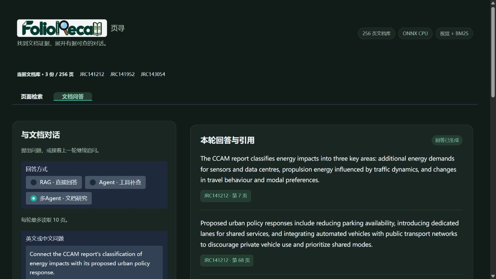
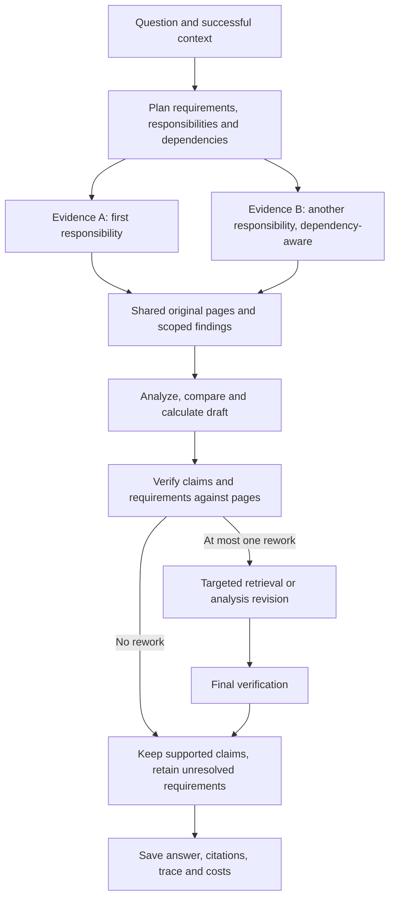

<p></p>

# FolioRecall · 页寻

**Document research with original-page evidence, distinct roles, verification and targeted rework.**

English · [简体中文](README.zh-CN.md)

FolioRecall combines visual retrieval and BM25 for documents containing text, tables and figures. LangGraph schedules responsibility-specific evidence tasks and dependencies, then analyzes pages, verifies a draft and optionally reworks once. A single-Agent path remains available for quick questions. The local UI reports actual steps, supports English and Chinese follow-ups, and keeps the CPU query model and index resident.

The interface defaults to white cards, a light-gray background and green accents, retaining the simple two-column layout. [Current light interface](doc/assets/research-light-ui.png)

> The local `0.1.0` final candidate is complete: multi-turn Agent features, the recommended ONNX FP32 backend, refreshed layout and onboarding, and the project logo. It awaits review; updated source has not been pushed and assets have not been published.
> [Candidate review](doc/v0.1.0发布说明.md) · [Complete quick start](doc/v0.1.0快速开始.md)

The research workflow now has 60 live comparison/ablation attempts, 60 assistant reviews and six installed-wheel browser confirmations. It is delivered as an optional engineering workflow; single-Agent remains the recommended fast path because overall coverage did not improve. [Results and limitations](doc/首版使用与评测.md#multi-agent-research-results).

## A real research task

The planner separates energy-impact classification from urban-policy analysis, with an explicit dependency. Verification finds missing policy evidence; targeted rework reads the original policy pages and revises the answer. Other runs retain missed evidence, verifier errors and failures.



The interface exposes role/tool events and separates initial verification, rework and final verification. Verification is a model judgement, not independent human confirmation. [Workflow and results](doc/首版使用与评测.md#multi-agent-research-results)

<details><summary>Actual request progress and insufficient-evidence result</summary>


</details>

[Five-minute demonstration](doc/项目介绍与面试准备.md#五分钟演示) · [Usage and verification](doc/首版使用与评测.md#v010-多轮文档agent与审核候选)

## Agent workflow



Fixed RAG reads the top six pages. Agent mode permits three searches, six distinct pages, eight model requests, 8,000 output tokens and 180 seconds of task activity. Progress comes from actual executor callbacks; hidden reasoning is not displayed.

Research uses at most two concurrent remote calls and a shared limit of 16 requests, 6 searches, 10 pages, 16,000 output tokens and 300 seconds, including one rework. Original single-Agent defaults remain unchanged.

## Implementation and contributions

- **Retrieval integration:** page import, resumable encoding, FAISS indexing, page-text alignment and visual/BM25 Top-50 fusion with RRF `k=60`.
- **Research collaboration:** distinct responsibilities and dependencies, shared original pages, analysis and arithmetic checks, claim verification and one rework; LangGraph checkpoints reuse the HTTPX client, tools and shared resource/cost reservations.
- **Tools and evidence:** search/read feedback, resource limits, current-turn citation permissions, structured answers and SQLite usage accounting.
- **Multi-turn application:** the latest three successful turns supply context. One request resolves references and translates Chinese follow-ups within the current turn's budget. Previous answers do not grant citation permission.
- **Local execution:** a worker and queue expose progress; a shared lock serializes retrieval/model access. A disconnected browser does not resend an active request; the worker still saves its terminal result.
- **Measured delivery:** CLI, resident browser UI, isolated installation, portable examples, a complete ONNX query backend and paired quality/cost comparisons. Failures and negative training results remain in the records.

Qwen and NanoVDR provide upstream models and weights. Sentence Transformers, FAISS, BM25 and Gradio provide reusable infrastructure. This project's contribution is integration, tool execution, application delivery and controlled comparisons; public-student speedups belong to the upstream model. [Sources](NOTICE) · [Interview material](doc/项目介绍与面试准备.md)

The stack uses Python, PyTorch / Sentence Transformers, ONNX Runtime, FAISS / BM25, HTTPX, SQLite, LangGraph and Gradio. The current research workflow has a planner, up to two responsibility-specific evidence agents, an analyst and a verifier, with dependencies, shared pages and one targeted rework. It completed 54 main comparisons and six ablations, totaling 60 live attempts. The earlier basic workflow and single-Agent loop remain available; results are reported under their own methods and budgets. [Research results](doc/首版使用与评测.md#multi-agent-research-results) · [Stack and code entry points](doc/首版使用与评测.md#current-stack)

<details><summary>Earlier basic workflow: 54 main comparisons and eight concurrency diagnostics</summary>

In the earlier basic-workflow comparison, 18 turns per arm had assistant-reviewed coverage of 0.640625 / 0.640625 / 0.625 for original single-Agent / larger-budget single-Agent / collaboration (16 applicable answers each). Costs were CNY 1.851970 / 2.657556 / 1.676076. Collaboration used more calls without improving overall coverage. Three two-worker diagnostic pairs showed overlapping client requests; this does not establish stable end-to-end speedup. All semantic scores remain `human=not_checked`. [Results and limitations](doc/首版使用与评测.md#multi-agent-live-results)

</details>

## Quick start

Tested on Python 3.10 and Ubuntu 22.04 / WSL 2. Obtain the local wheel, `demo-bundle.zip` and `query-onnx-fp32.zip`. The 42-page demo includes vectors, previews, text and BM25. The separate model asset contains the complete query student; no GPU, teacher weights or index rebuilding is required.

From the asset directory (an existing compatible dependency environment can be reused):

```bash
python3.10 -m venv .venv
CPU_PY="$PWD/.venv/bin/python"
"$CPU_PY" -m pip install torch==2.8.0 --index-url https://download.pytorch.org/whl/cpu
"$CPU_PY" -m pip install 'foliorecall-0.1.0-py3-none-any.whl[onnx,demo,agent,multiagent]'
"$CPU_PY" -m zipfile -e demo-bundle.zip demo-local
"$CPU_PY" -m zipfile -e query-onnx-fp32.zip demo-local
cd demo-local/demo-bundle
CUDA_VISIBLE_DEVICES= "$CPU_PY" -m foliorecall query --index . \
  --config configs/baseline.json --query-config configs/student-ml-cpu-default.json \
  --retrieval-config hybrid.json \
  'Which figure compares projections of the EU working-age population under baseline and no-migration scenarios?' --json
```

Retrieval does not call a generation API. Start the free browser UI:

```bash
CUDA_VISIBLE_DEVICES= "$CPU_PY" -m foliorecall serve --index . \
  --config configs/baseline.json --query-config configs/student-ml-cpu-default.json \
  --retrieval-config hybrid.json --port 7867
```

Stop that service, configure a Beijing-region Bailian key, then enable RAG and Agent:

```bash
export DASHSCOPE_API_KEY='replace-with-your-key'
export DASHSCOPE_BASE_URL=https://dashscope.aliyuncs.com/compatible-mode/v1
RUN_DIR="../outputs/chat-$(date +%Y%m%d-%H%M%S)"
CUDA_VISIBLE_DEVICES= "$CPU_PY" -m foliorecall serve --index . \
  --config configs/baseline.json --query-config configs/student-ml-cpu-default.json \
  --retrieval-config hybrid.json --agent-config configs/agent-demo.json \
  --multi-agent-config configs/agent-research-demo.json \
  --public-corpus public-corpus.json --output "$RUN_DIR" --port 7867
```

Open http://127.0.0.1:7867. With generation configured, the app opens on document QA. The research configuration above selects document research; switch to single-Agent for quick QA. Without generation, it opens on page search. The header lists the current collection. Examples fill only the question and keep the selected answer mode. Starter and follow-up examples never trigger generation automatically. Follow-up and new-conversation examples are labelled separately. Sources use short display names and physical page numbers; full filenames remain in tooltips, expanded page details and JSON. A new conversation clears context; JSON and terminal records are saved locally.

QA requires your own API key and service balance. CNY 20 is the example spending cap. Resetting a conversation does not reset costs. Use a new recording directory on restart. Generation uses `qwen3.7-plus-2026-05-26` with thinking disabled.

The [complete quick start](doc/v0.1.0快速开始.md) covers replacing an older wheel of the same version, optional int8 and the PyTorch fallback. Old configurations without a backend field keep using PyTorch. Product CLI, API and answer shape remain compatible. Full JRC data, full PDFs and credentials are excluded; query models are separate assets, outside the source and wheel. [Full usage](doc/首版使用与评测.md) covers source installation and own-PDF indexing.

## Quality, cost and errors

New equal-budget comparison, 18 attempts per main arm: single-Agent / basic / research coverage is 0.734375 / 0.578125 / 0.546875 (16 non-null samples each); costs are CNY 3.426176 / 2.527830 / 2.297742 and mean activity is 32.56 / 37.61 / 56.43 seconds. Research has 17/18 valid verified answers plus one format failure. Its high non-empty factual score does not offset omissions. All 60 attempts, including six no-rework ablations, use seen development tasks and assistant reviews, `human=not_checked`. [Denominators, paired results and failures](doc/首版使用与评测.md#multi-agent-research-results)

The **earlier single-turn A5 version** completed 40 questions × two languages × three conditions: 240 terminal first attempts, all assistant-reviewed, 237 structurally valid. Structural validity is not answer accuracy. Required-fact coverage uses 76 applicable answers per condition.

| Condition | Required-fact coverage | Estimated known QA cost (CNY) |
|---|---:|---:|
| Visual RAG | 0.702193 | 2.200664 |
| Hybrid RAG | 0.736988 | 2.198824 |
| Hybrid Agent | 0.722295 | 7.352474 |

Agent minus Hybrid RAG coverage is −0.014693 on 76 common pairs, with higher cost and question-dependent gains. Costs exclude translation, probes and unknown reservations. Forty questions with language/condition variants are not 240 independent questions. Scores are assistant judgments, `human=not_checked`; independent human review is optional. [Full denominators, failures and accounting](doc/首版使用与评测.md#a5-模型迁移与新一轮验收)

The v0.1.0 multi-turn interface has separate functional verification; A5 is not a benchmark of this new path. Existing mistakes include omitted qualifications, overbroad conclusions and incorrect insufficiency judgments. A valid page ID alone does not establish semantic support.

Five actual browser turns passed progress, follow-up, reset, citation and JSON checks, using 25 API calls with CNY 0.455042 known estimated cost. The cross-document example read only the population report and omitted employment-report evidence; the follow-up retained that omission. The screenshots preserve this limitation. The Saturn case returned no factual claims and reported insufficient evidence. These cases verify use, not aggregate answer accuracy.

A separate evidence-coverage development comparison evaluated 12 turns with baseline and candidate (24 assistant-reviewed attempts). The candidate reduced requests and cost, but required-fact coverage fell from 0.6402 to 0.6061 and core cross-document omissions remained. It was not adopted; defaults and the original candidate package are unchanged. [Results and limitations (Chinese)](doc/首版使用与评测.md#agent证据覆盖开发对照2026-10-14)

## Retrieval architecture and experiments


The original Qwen3-VL-Embedding-2B teacher indexes pages offline; public NanoVDR ML encodes queries online. CPU FP32 queries reuse the matching original-teacher index. LoRA requires a separately matching index.

### Retrieval, training and query cost


Five fixed English tasks—HR, Computer Science, Finance-EN, Industrial and Pharmaceuticals—cover **12,969 pages and 1,489 queries**. Each task uses its full candidate library and original graded labels. Values below are equally weighted domain means; neural rows use GPU BF16, and BM25 uses CPU page markdown.

| Query model / method | nDCG@10 | Recall@5 | Recall@10 |
|---|---:|---:|---:|
| Original Qwen3-VL teacher | 0.537845 | 0.479970 | 0.580596 |
| LoRA750 | **0.573712** | **0.504133** | **0.612973** |
| Public NanoVDR EN | 0.566762 | 0.497533 | 0.605997 |
| Public NanoVDR ML · default | 0.567706 | 0.502397 | 0.611766 |
| Continued distillation · step 94 | 0.437830 | 0.390437 | 0.484633 |
| Page-level BM25 | 0.516565 | 0.455363 | 0.553117 |

- **Local LoRA adaptation:** nDCG@10 improves by **0.035867** over the original teacher, with gains in four domains and a **0.021927 decrease in Finance-EN**. Query latency increases.
- **Public ML query student:** encoding P50 is **6.23–7.65× faster** than the original teacher on the same GPU in BF16. This benefit comes from the upstream NanoVDR model. Our continued distillation decreases nDCG@10 by **0.129877** relative to public ML; step 94 is retained as a negative result.

| GPU query model | Full local request P50, across domains |
|---|---:|
| Original teacher | 30.66–32.37 ms |
| LoRA750 | 44.72–45.07 ms |
| Public ML | 4.51–6.61 ms |

Measured on an **RTX 4060 Laptop 8GB**, batch 1, PyTorch/FAISS threads 4/1, five warmups and three fixed-order rounds in independent processes. A full request runs from input text to Top-10 JSON readiness; model loading, UI preparation and browser rendering are excluded. These are ranges of per-domain P50 values, not pooled latency statistics. CPU deployment is reported separately, not as a same-device encoding speedup.

[Full results and protocol (Chinese)](doc/首版使用与评测.md#本轮实测结果) include CPU comparisons, paired confidence intervals, per-domain timing, memory, indexing cost and error analysis.

### CPU backend comparison

Historical FAISS metadata records four actual threads despite an intended single-thread setting. These figures are not a strict same-condition comparison with later multi-depth runs using search-only single threading.

Same CPU, 200 fixed development queries / 1,000 pages, batch 1, four threads, three rotated rounds:

| Backend | Full request P50 | Warm RSS | Dev nDCG@10 |
|---|---:|---:|---:|
| PyTorch FP32 | 19.33 ms | 636.0 MiB | 0.972699 |
| ONNX FP32 | 8.62 ms | 817.0 MiB | 0.972699 |
| ONNX dynamic int8 | 4.79 ms | 581.1 MiB | 0.969008 |

ONNX FP32 matches PyTorch retrieval metrics on all five domains / 1,489 queries, with a 2.24x dev request speedup but higher RSS; it is the new local candidate CPU default. Int8 gives 4.04x speedup and a 72.2% smaller package, with a 0.005031 drop in equal-domain nDCG; it remains optional. Timings include pooling/projection/normalization and retrieval JSON, excluding loading, display and generation. They are not end-to-end Q&A speedups. Existing PyTorch quickstart remains compatible. [Domain results and export commands (Chinese)](doc/首版使用与评测.md#onnx-cpu-backends) · [Installed UI](doc/assets/onnx-fp32-retrieval.png)

A separate **LLaVE teacher-training comparison** reused the same 256 training queries and 64 batches: dev nDCG@10 was 0.978928 versus 0.977083 for ordinary CachedMNRL (+0.001845), with Recall unchanged at 0.995. Only two of 200 queries improved and one regressed. The small, concentrated gain did not justify teacher/student and index migration; this experiment remains unintegrated. [Results and limitations (Chinese)](doc/首版使用与评测.md#llave-training)

**New 270-query holdout and three-seed validation:** Six fresh 64-step training arms, 21 matched indexes/evaluations, and assistant inspection of 19 cases / 44 original pages are complete. Equal-domain nDCG@10: original teacher 0.612402; ordinary LoRA 0.650042±0.007900; LLaVE 0.649618±0.008002 (sample SD). Ordinary training improves all nine seed/domain combinations. LLaVE provides no stable additional gain and regresses against ordinary LoRA on economics for all three seeds. Product teacher/student defaults are unchanged; these teacher gains have not been transferred to Agent answers. [Full results, regressions and data boundaries](doc/首版使用与评测.md#teacher-holdout-results)

The six-arm depth study includes physical four-layer pruning, independent training, and joint four/six-layer exits. The joint four-layer package removes 20.7% of parameters but scores 0.495222 nDCG@10 versus 0.972699 for the public six-layer student, so the existing six-layer ONNX deployment stays in place. [Controlled results and limitations](doc/首版使用与评测.md#multidepth-query).

## Scope and limitations

- English corpus; Chinese questions and follow-ups retrieve English pages. Native Chinese-document retrieval is unverified.
- Local single-user application with remote generation. Browser-state conversations clear on refresh; there is no persistent conversation database or multi-user deployment.
- Answers may misread figures, omit facts or cite insufficient evidence. History resolves references and is not verified factual evidence.
- Fixed Q&A tasks and assistant scoring limit generalization claims. Earlier training studies mostly used one seed; the new teacher comparison uses three, with document-level isolation and upstream training overlap still unverified.
- Retrieval incurs no generation charges; Q&A requires a key and service balance. Reranking and unrestricted external tools are not implemented.

## Documentation and license

[Usage and experiments](doc/首版使用与评测.md) · [Experiment CSV](doc/experiments.csv) · [Development plan](doc/多模态文档检索项目开发计划.md#当前开发重点) · [Contributing](AGENTS.md)

Code is [Apache-2.0](LICENSE); upstream models and documents retain separate licenses. The example preserves EU attribution, excludes identified third-party images and includes no full PDFs. [NOTICE](NOTICE) credits upstream sources. Report reproducible issues with commands and environment in [Issues](https://github.com/linlin-is-me/FolioRecall/issues).
