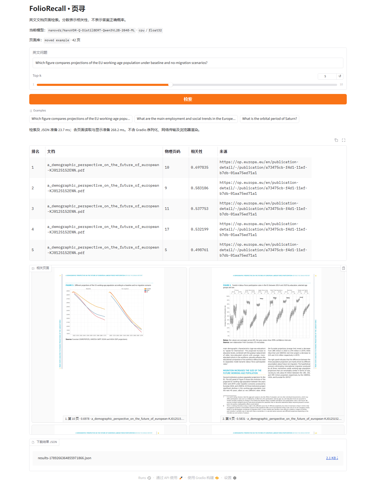
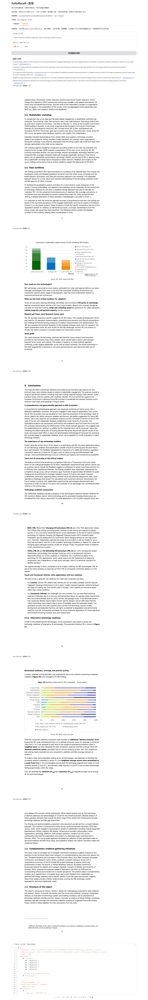
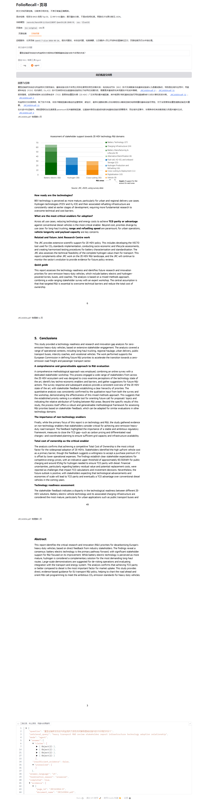

<h1 align="center">FolioRecall · 页寻</h1>
<p align="center"><strong>Visual document retrieval, bilingual RAG and bounded agents</strong></p>
<p align="center">Find evidence in document text, tables and figures, with original-page citations and structured answers.</p>

<p align="center">
  <a href="LICENSE"></a>
  <a href="#quick-start"></a>
  <a href="pyproject.toml"></a>
</p>
<p align="center"><strong>English</strong> · <a href="README.zh-CN.md">简体中文</a></p>
<p align="center"><a href="#demo">Demo</a> · <a href="#features">Features</a> · <a href="#quick-start">Quick Start</a> · <a href="#results">Results</a> · <a href="#implementation-and-upstream-work">Contributions</a></p>

FolioRecall retrieves page evidence before running fixed RAG or a bounded agent. A multimodal teacher indexes pages offline; a lightweight student searches online, optionally combining visual rankings with page-level BM25. English and Chinese questions retrieve English documents, with original-page links and JSON answers.

> Source code is public. The `0.1.0rc3` package, 42-page example and release notes are prepared locally; downloadable release assets are not yet published.

## Demo

A real CPU query over the 42-page example retrieves **physical page 10, Figure 3** from the population report, with its source, preview and JSON.

<p align="center">
  <a href="doc/assets/stage4-cpu-demo.png"></a>
</p>

<details>
<summary>Actual RAG and Agent screenshots</summary>

Task 9 shows Hybrid RAG with original-page citations; task 22 shows a Chinese Hybrid Agent response using multiple documents. These screenshots come from retained real-use records, without regenerating answers for presentation.

<a href="doc/assets/a6-rag-jrc09.png"></a>
<a href="doc/assets/a6-agent-jrc22.png"></a>

</details>

[Five-minute demonstration and insufficient-evidence example (Chinese)](doc/项目介绍与面试准备.md#五分钟演示) · [Installed real-use validation (Chinese)](doc/首版使用与评测.md#a6-收尾计划与展示目标)

## Features

- **Page and hybrid retrieval:** import PDFs or page images; retrieve with visual embeddings or RRF fusion of visual rankings and BM25.
- **Bilingual RAG and agents:** fixed RAG reads retrieved pages; agents search and read within request, page and time limits. Chinese questions are translated for retrieval, while answers follow the original question language.
- **Evidence and structured output:** separate factual claims, read-page citations and unresolved information; navigate to original pages and retain JSON in the CLI and browser.
- **Local application:** a shared retrieval implementation serves the CLI and a persistent single-model Gradio UI; page encoding saves resumable chunks.
- **Training and evaluation:** retain LoRA, query distillation, BM25 and neural retrieval comparisons with measured quality, latency and resource use.

## Quick Start

Tested with Python 3.10 and Ubuntu 22.04 / WSL 2. GPU indexing used an RTX 4060 Laptop 8GB; other platforms have not been tested.

### CPU retrieval with the local 42-page candidate

Place the candidate wheel and `demo-bundle.zip` in one directory and run there. The first query needs the public student pinned by the configuration; CPU retrieval needs no teacher weights, GPU or generation API.

```bash
python3.10 -m venv .venv
CPU_PY="$PWD/.venv/bin/python"
"$CPU_PY" -m pip install torch==2.8.0 --index-url https://download.pytorch.org/whl/cpu
"$CPU_PY" -m pip install 'foliorecall-0.1.0rc3-py3-none-any.whl[demo]'
"$CPU_PY" -m zipfile -e demo-bundle.zip demo-local
cd demo-local/demo-bundle
CUDA_VISIBLE_DEVICES= "$CPU_PY" -m foliorecall query --index . \
  --config configs/baseline.json --query-config configs/student-ml-cpu.json \
  'Which figure compares projections of the EU working-age population under baseline and no-migration scenarios?' --json
CUDA_VISIBLE_DEVICES= "$CPU_PY" -m foliorecall serve --index . \
  --config configs/baseline.json --query-config configs/student-ml-cpu.json --port 7864
```

Open `http://127.0.0.1:7864`. Local assets are not public downloads. Without the candidate, use the source and own-PDF workflow below.

### Source installation and your own PDF

```bash
git clone https://github.com/linlin-is-me/FolioRecall.git
cd FolioRecall
REPO=$(pwd -P)
python3.10 -m venv .venv-cpu
CPU_PY="$REPO/.venv-cpu/bin/python"
"$CPU_PY" -m pip install torch==2.8.0 --index-url https://download.pytorch.org/whl/cpu
"$CPU_PY" -m pip install '.[demo,agent,eval]'
"$CPU_PY" -m foliorecall --help
```

Import and index your PDF in a GPU environment, then query with the CPU student. [Installation, PDF indexing and reproduction (Chinese)](doc/首版使用与评测.md#外部获取与复现) do not require unpublished release assets. CPU query support does not imply validated CPU teacher indexing.

### RAG and Agent use

QA calls a generation API. Prepare the page corpus, its matching visual index and `public-corpus.json` containing page text and sources; hybrid retrieval also needs `hybrid.json`. Set `DASHSCOPE_API_KEY` and `DASHSCOPE_BASE_URL` locally, outside configuration files.

The current example uses `qwen3.7-plus-2026-05-26`, thinking disabled and temperature 0. Use `ask` or `serve --agent-config` with a prepared index; see [QA commands and corpus preparation (Chinese)](doc/首版使用与评测.md#问答开发入口与当前验证边界). The local demonstration reuses the 256-page JRC corpus; the full JRC material, index and credentials are not bundled.

## Architecture


<p align="center">
  <a href="doc/assets/architecture-light.svg">
    <picture>
      <source media="(max-width: 640px) and (prefers-color-scheme: dark)" srcset="doc/assets/architecture-mobile-dark.svg">
      <source media="(max-width: 640px)" srcset="doc/assets/architecture-mobile-light.svg">
      <source media="(prefers-color-scheme: dark)" srcset="doc/assets/architecture-dark.svg">
      
    </picture>
  </a>
</p>

The default combination is **original Qwen3-VL-Embedding-2B for indexing + public NanoVDR ML for GPU BF16 queries**. CPU FP32 queries can reuse the same original-teacher index. LoRA requires its own matching page index; equal embedding dimensions alone do not establish compatibility. Omitting `--query-config` in the CLI retains teacher-based queries.

The project's implementation work covers model integration, index compatibility, resumable data processing, CLI/app retrieval and controlled experiments. The backbone and public query students come from upstream projects.

## Results

### Bilingual QA

Forty fixed questions, two languages and three conditions produced 240 terminal first attempts, all assistant-reviewed; 237 were structurally valid. Required-fact coverage below uses 76 applicable answers per condition, excluding tasks without required facts.

| Condition | Required-fact coverage | Estimated known QA cost (CNY) |
|---|---:|---:|
| Visual RAG | 0.702193 | 2.200664 |
| Hybrid RAG | 0.736988 | 2.198824 |
| Hybrid Agent | 0.722295 | 7.352474 |

Agent minus Hybrid RAG coverage is −0.014693 on 76 common pairs, with higher cost and question-dependent gains. Language and condition variants do not make these 240 independent questions. Costs include known QA estimates, excluding translation, probes and unknown reservations. [Full QA metrics, pairs, failures and accounting (Chinese)](doc/首版使用与评测.md#a5-模型迁移与新一轮验收) retain actual denominators. Reviews are assistant judgments with `human=not_checked`; independent human review is optional follow-up.

The installed rc3 passed two CLI and four actual browser QA cases, covering Chinese conversion, cross-document answers, citation navigation and insufficient evidence. These six cases validate application flows rather than constitute a new independent quality benchmark.

### Retrieval, training and query cost


Five fixed English tasks—HR, Computer Science, Finance-EN, Industrial and Pharmaceuticals—cover **12,969 pages and 1,489 queries**. Each task uses its full candidate library and original graded labels. Values below are equally weighted domain means; neural rows use GPU BF16, and BM25 uses CPU page markdown.

| Query model / method | nDCG@10 | Recall@5 | Recall@10 |
|---|---:|---:|---:|
| Original Qwen3-VL teacher | 0.537845 | 0.479970 | 0.580596 |
| LoRA750 | **0.573712** | **0.504133** | **0.612973** |
| Public NanoVDR EN | 0.566762 | 0.497533 | 0.605997 |
| Public NanoVDR ML · default | 0.567706 | 0.502397 | 0.611766 |
| Continued distillation · step 94 | 0.437830 | 0.390437 | 0.484633 |
| Page-level BM25 | 0.516565 | 0.455363 | 0.553117 |

- **Local LoRA adaptation:** nDCG@10 improves by **0.035867** over the original teacher, with gains in four domains and a **0.021927 decrease in Finance-EN**. Query latency increases.
- **Public ML query student:** encoding P50 is **6.23–7.65× faster** than the original teacher on the same GPU in BF16. This benefit comes from the upstream NanoVDR model. Our continued distillation decreases nDCG@10 by **0.129877** relative to public ML; step 94 is retained as a negative result.

| GPU query model | Full local request P50, across domains |
|---|---:|
| Original teacher | 30.66–32.37 ms |
| LoRA750 | 44.72–45.07 ms |
| Public ML | 4.51–6.61 ms |

Measured on an **RTX 4060 Laptop 8GB**, batch 1, PyTorch/FAISS threads 4/1, five warmups and three fixed-order rounds in independent processes. A full request runs from input text to Top-10 JSON readiness; model loading, UI preparation and browser rendering are excluded. These are ranges of per-domain P50 values, not pooled latency statistics. CPU deployment is reported separately, not as a same-device encoding speedup.

[Full results and protocol (Chinese)](doc/首版使用与评测.md#本轮实测结果) include CPU comparisons, paired confidence intervals, per-domain timing, memory, indexing cost and error analysis.

## Implementation and upstream work

Project work includes document import and recovery, complete model/index integration, visual–BM25 fusion, a bounded Agent tool loop, citation and JSON validation, separated timing and cost records, and CLI, persistent UI and isolated installation. Training and distillation comparisons measure quality–resource tradeoffs.

Qwen and NanoVDR supply models and weights; Sentence Transformers supplies encoding and training interfaces. FAISS, BM25 and Gradio are reused libraries. Public-student speedups come from the upstream model; this project contributes integration, measured comparisons and application delivery. [Project explanation and interview material (Chinese)](doc/项目介绍与面试准备.md) describe this boundary and the evidence.

## Models & Documentation

| Asset | Status | Entry |
|---|---|---|
| Original Qwen teacher | Available upstream | [Pinned configuration](configs/baseline.json) |
| Public NanoVDR students | Available upstream | [ML CPU](configs/student-ml-cpu.json) · [ML GPU](configs/student-ml-cuda.json) |
| rc3 and 42-page example | Local candidate; assets unpublished | [Usage and presentation (Chinese)](doc/首版使用与评测.md#本地发布准备与求职展示) |
| LoRA750, distillation step 94 and experiment assets | Historical local candidates; assets unpublished | [Acquisition and reproduction (Chinese)](doc/首版使用与评测.md#外部获取与复现) |

[Experiments](doc/experiments.csv) · [Training and distillation (Chinese)](doc/查询学生与蒸馏.md) · [Development plan (Chinese)](doc/多模态文档检索项目开发计划.md#当前开发重点)

## Limitations

- Automated checks and assistant reviews are complete, but factual errors, omissions and incorrect insufficiency judgments remain. Valid structure or an existing citation does not establish factual support.
- Chinese questions retrieve English pages; native Chinese-document retrieval is unverified. The application is local and single-user, with remote API generation.
- Results use fixed tasks and one training seed; upstream training overlap and document-level independence are not fully established. Twenty HR queries were used for earlier workflow checks.
- LoRA gains vary by domain; continued distillation did not improve retrieval. The public student's upstream teacher instruction differs from this project.
- GPU teacher indexing and CPU student queries have different resource needs; reranking, ONNX/int8 and multi-user deployment are unimplemented.

## Contributing & License

Report commands, environment and reproducible issues in [Issues](https://github.com/linlin-is-me/FolioRecall/issues). Development conventions are in [AGENTS.md](AGENTS.md).

Project code is [Apache-2.0](LICENSE); upstream sources are credited in [NOTICE](NOTICE). Models and data retain separate licenses. The example preserves European Union attribution and material licenses, excludes known third-party images and contains no full PDFs. The code license does not cover upstream documents.
