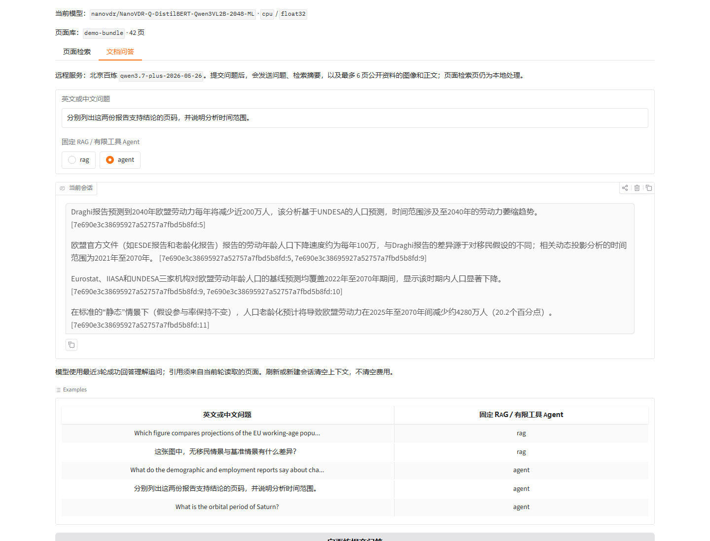
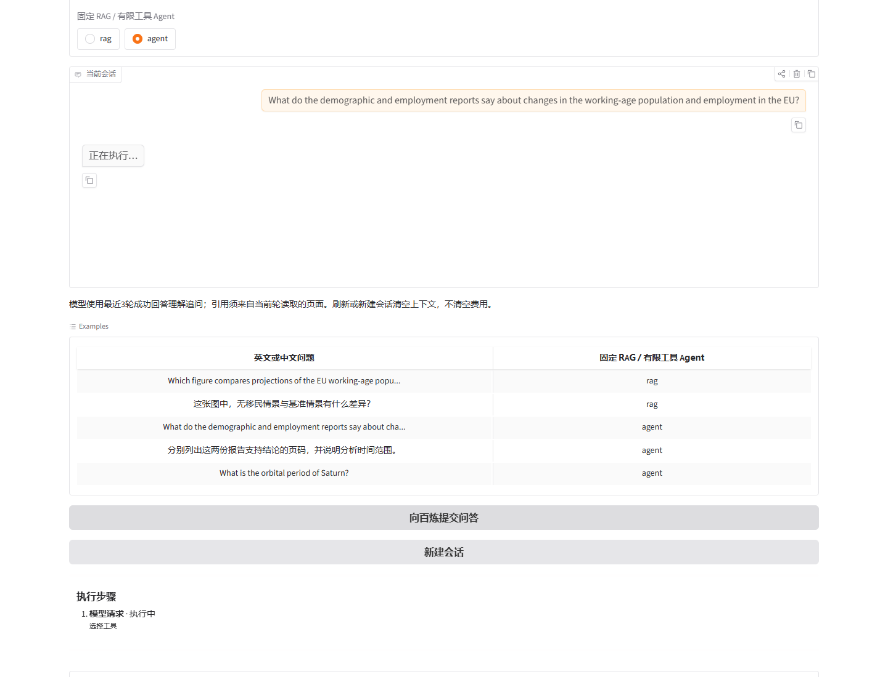
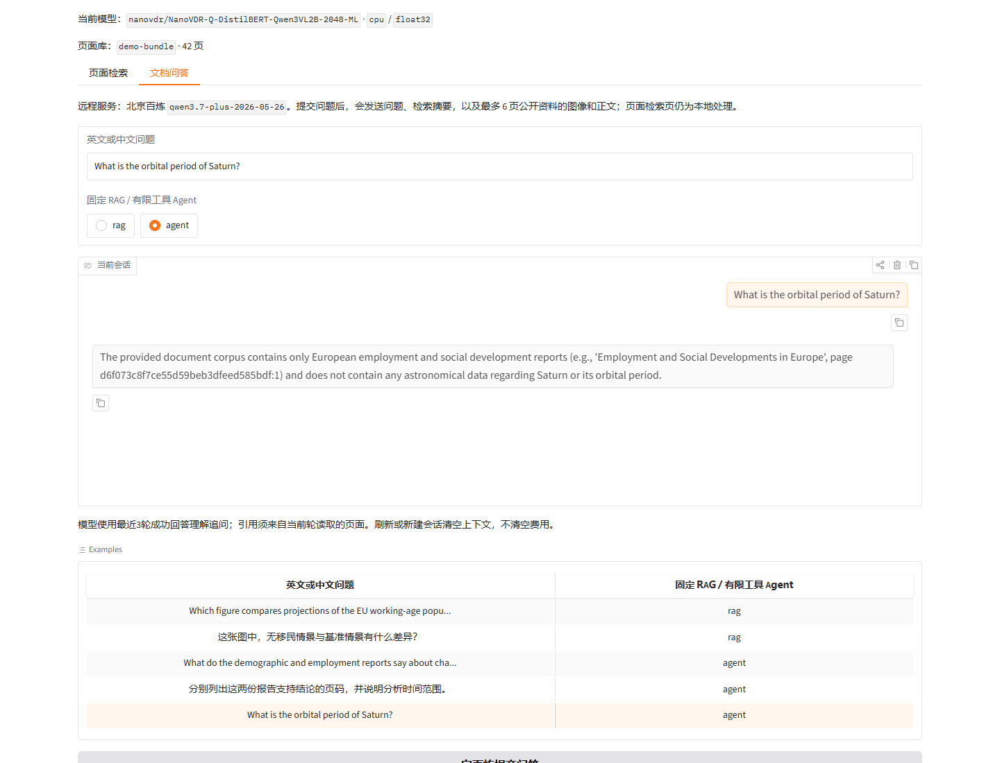
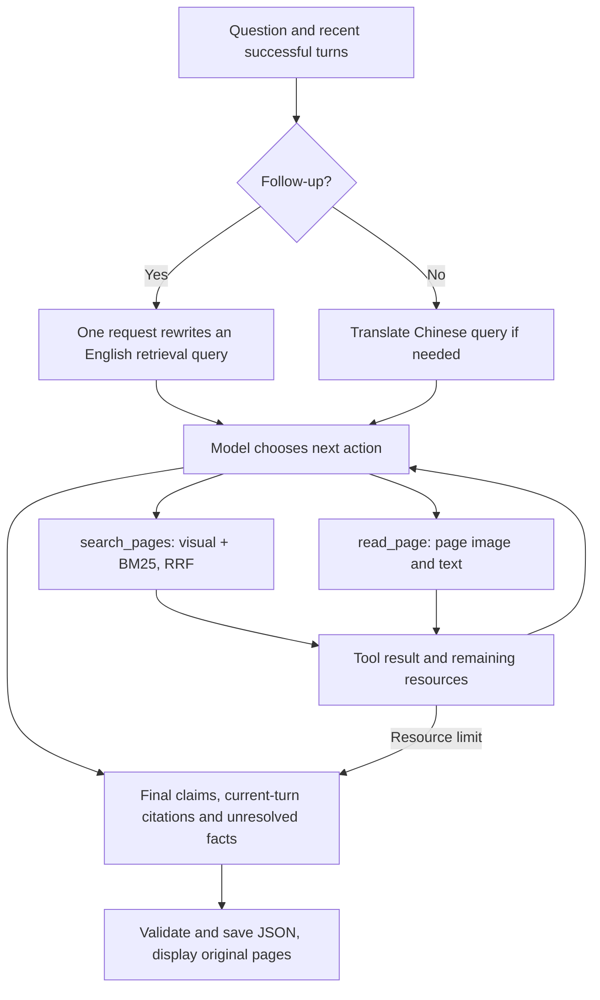
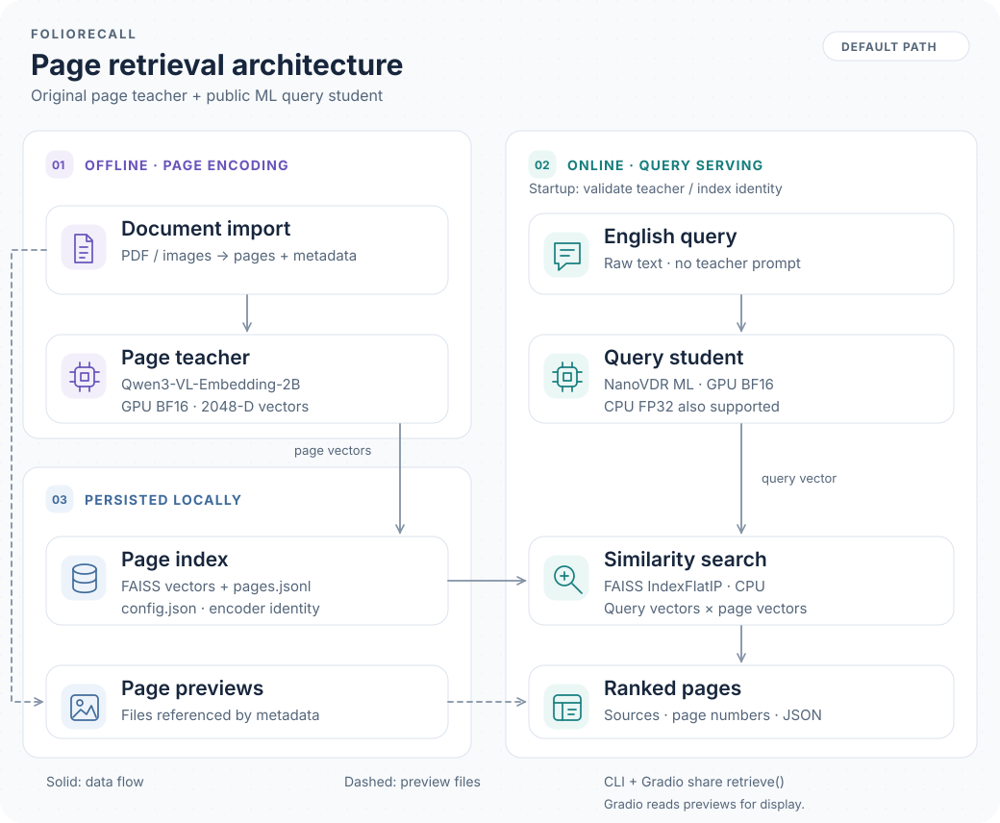

# FolioRecall · 页寻

**A document Agent that searches evidence, reads original pages and answers with citations.**

English · [简体中文](README.zh-CN.md)

FolioRecall combines visual retrieval and BM25 for documents containing text, tables and figures. Its bounded Agent decides when to search and read again, reports actual execution steps, and supports English and Chinese follow-ups. A local Gradio application keeps the CPU query model and index resident.

> `0.1.0` is a local review candidate. Updated source and release assets have not been published; public asset downloads are not available yet.

## A real document task

Ask how two European reports describe working-age population and employment, then ask in Chinese for evidence pages and time ranges. Searches, page reads and model requests appear as they happen, followed by claims, original-page citations and saved JSON.



<details><summary>Actual request progress and insufficient-evidence result</summary>




</details>

[Five-minute demonstration](doc/项目介绍与面试准备.md#五分钟演示) · [Usage and verification](doc/首版使用与评测.md#v010-多轮文档agent与审核候选)

## Agent workflow



Fixed RAG reads the top six pages. Agent mode permits three searches, six distinct pages, eight model requests, 8,000 output tokens and 180 seconds of task activity. Progress comes from actual executor callbacks; hidden reasoning is not displayed.

## Implementation and contributions

- **Retrieval integration:** page import, resumable encoding, FAISS indexing, page-text alignment and visual/BM25 Top-50 fusion with RRF `k=60`.
- **Tools and evidence:** search/read feedback, resource limits, current-turn citation permissions, structured answers and SQLite usage accounting.
- **Multi-turn application:** the latest three successful turns supply context. One request resolves references and translates Chinese follow-ups within the current turn's budget. Previous answers do not grant citation permission.
- **Local execution:** a worker and queue expose progress; a shared lock serializes retrieval/model access. A disconnected browser does not resend an active request; the worker still saves its terminal result.
- **Measured delivery:** CLI, resident browser UI, isolated installation, portable examples and paired quality/cost comparisons. Failures and negative training results remain in the records.

Qwen and NanoVDR provide upstream models and weights. Sentence Transformers, FAISS, BM25 and Gradio provide reusable infrastructure. This project's contribution is integration, tool execution, application delivery and controlled comparisons; public-student speedups belong to the upstream model. [Sources](NOTICE) · [Interview material](doc/项目介绍与面试准备.md)

## Quick start

Tested on Python 3.10 and Ubuntu 22.04 / WSL 2. Obtain the reviewed wheel and enhanced `demo-bundle.zip` locally. The 42-page example includes vectors, previews, text and BM25; no GPU indexing or teacher weights are needed. First launch needs the public query student specified by the configuration, or an existing model cache.

```bash
python3.10 -m venv .venv
CPU_PY="$PWD/.venv/bin/python"
"$CPU_PY" -m pip install torch==2.8.0 --index-url https://download.pytorch.org/whl/cpu
"$CPU_PY" -m pip install 'foliorecall-0.1.0-py3-none-any.whl[demo,agent]'
"$CPU_PY" -m zipfile -e demo-bundle.zip demo-local
cd demo-local/demo-bundle
CUDA_VISIBLE_DEVICES= "$CPU_PY" -m foliorecall query --index . \
  --config configs/baseline.json --query-config configs/student-ml-cpu.json \
  --retrieval-config hybrid.json \
  'Which figure compares baseline and no-migration scenarios?' --json
```

CPU retrieval needs no generation API. For RAG and Agent, set a Beijing-region Bailian key and start the browser:

```bash
export DASHSCOPE_API_KEY='replace-with-your-key'
export DASHSCOPE_BASE_URL=https://dashscope.aliyuncs.com/compatible-mode/v1
CUDA_VISIBLE_DEVICES= "$CPU_PY" -m foliorecall serve --index . \
  --config configs/baseline.json --query-config configs/student-ml-cpu.json \
  --retrieval-config hybrid.json --agent-config configs/agent-demo.json \
  --public-corpus public-corpus.json --output outputs/chat --port 7864
```

Open `http://127.0.0.1:7864`, select RAG or Agent and submit a question. Ask a follow-up in the same conversation, or select **新建会话** to clear context. Expand the result panel to copy JSON; terminal records are also saved locally. API calls incur charges. The example sets a relative ledger and CNY 20 budget; resetting a conversation does not reset costs.

The single-turn `ask` CLI and browser API remain available. [Full usage](doc/首版使用与评测.md) covers source installation and own-PDF indexing. Full JRC documents, full PDFs, model weights and credentials are not included in this candidate.

## Quality, cost and errors

The **earlier single-turn A5 version** completed 40 questions × two languages × three conditions: 240 terminal first attempts, all assistant-reviewed, 237 structurally valid. Structural validity is not answer accuracy. Required-fact coverage uses 76 applicable answers per condition.

| Condition | Required-fact coverage | Estimated known QA cost (CNY) |
|---|---:|---:|
| Visual RAG | 0.702193 | 2.200664 |
| Hybrid RAG | 0.736988 | 2.198824 |
| Hybrid Agent | 0.722295 | 7.352474 |

Agent minus Hybrid RAG coverage is −0.014693 on 76 common pairs, with higher cost and question-dependent gains. Costs exclude translation, probes and unknown reservations. Forty questions with language/condition variants are not 240 independent questions. Scores are assistant judgments, `human=not_checked`; independent human review is optional. [Full denominators, failures and accounting](doc/首版使用与评测.md#a5-模型迁移与新一轮验收)

The v0.1.0 multi-turn interface has separate functional verification; A5 is not a benchmark of this new path. Existing mistakes include omitted qualifications, overbroad conclusions and incorrect insufficiency judgments. A valid page ID alone does not establish semantic support.

Five actual browser turns passed progress, follow-up, reset, citation and JSON checks, using 25 API calls with CNY 0.455042 known estimated cost. The cross-document example read only the population report and omitted employment-report evidence; the follow-up retained that omission. The screenshots preserve this limitation. The Saturn case returned no factual claims and reported insufficient evidence. These cases verify use, not aggregate answer accuracy.

## Retrieval architecture and experiments



The original Qwen3-VL-Embedding-2B teacher indexes pages offline; public NanoVDR ML encodes queries online. CPU FP32 queries reuse the matching original-teacher index. LoRA requires a separately matching index.

### Retrieval, training and query cost


Five fixed English tasks—HR, Computer Science, Finance-EN, Industrial and Pharmaceuticals—cover **12,969 pages and 1,489 queries**. Each task uses its full candidate library and original graded labels. Values below are equally weighted domain means; neural rows use GPU BF16, and BM25 uses CPU page markdown.

| Query model / method | nDCG@10 | Recall@5 | Recall@10 |
|---|---:|---:|---:|
| Original Qwen3-VL teacher | 0.537845 | 0.479970 | 0.580596 |
| LoRA750 | **0.573712** | **0.504133** | **0.612973** |
| Public NanoVDR EN | 0.566762 | 0.497533 | 0.605997 |
| Public NanoVDR ML · default | 0.567706 | 0.502397 | 0.611766 |
| Continued distillation · step 94 | 0.437830 | 0.390437 | 0.484633 |
| Page-level BM25 | 0.516565 | 0.455363 | 0.553117 |

- **Local LoRA adaptation:** nDCG@10 improves by **0.035867** over the original teacher, with gains in four domains and a **0.021927 decrease in Finance-EN**. Query latency increases.
- **Public ML query student:** encoding P50 is **6.23–7.65× faster** than the original teacher on the same GPU in BF16. This benefit comes from the upstream NanoVDR model. Our continued distillation decreases nDCG@10 by **0.129877** relative to public ML; step 94 is retained as a negative result.

| GPU query model | Full local request P50, across domains |
|---|---:|
| Original teacher | 30.66–32.37 ms |
| LoRA750 | 44.72–45.07 ms |
| Public ML | 4.51–6.61 ms |

Measured on an **RTX 4060 Laptop 8GB**, batch 1, PyTorch/FAISS threads 4/1, five warmups and three fixed-order rounds in independent processes. A full request runs from input text to Top-10 JSON readiness; model loading, UI preparation and browser rendering are excluded. These are ranges of per-domain P50 values, not pooled latency statistics. CPU deployment is reported separately, not as a same-device encoding speedup.

[Full results and protocol (Chinese)](doc/首版使用与评测.md#本轮实测结果) include CPU comparisons, paired confidence intervals, per-domain timing, memory, indexing cost and error analysis.

## Scope and limitations

- English corpus; Chinese questions and follow-ups retrieve English pages. Native Chinese-document retrieval is unverified.
- Local single-user application with remote generation. Browser-state conversations clear on refresh; there is no persistent conversation database or multi-user deployment.
- Answers may misread figures, omit facts or cite insufficient evidence. History resolves references and is not verified factual evidence.
- Fixed tasks, one training seed and assistant scoring limit generalization claims; upstream training overlap is not fully established.
- Retrieval incurs no generation charges; Q&A requires a key and service balance. Reranking, ONNX/int8 and unrestricted external tools are not implemented.

## Documentation and license

[Usage and experiments](doc/首版使用与评测.md) · [Experiment CSV](doc/experiments.csv) · [Development plan](doc/多模态文档检索项目开发计划.md#当前开发重点) · [Contributing](AGENTS.md)

Code is [Apache-2.0](LICENSE); upstream models and documents retain separate licenses. The example preserves EU attribution, excludes identified third-party images and includes no full PDFs. [NOTICE](NOTICE) credits upstream sources. Report reproducible issues with commands and environment in [Issues](https://github.com/linlin-is-me/FolioRecall/issues).
