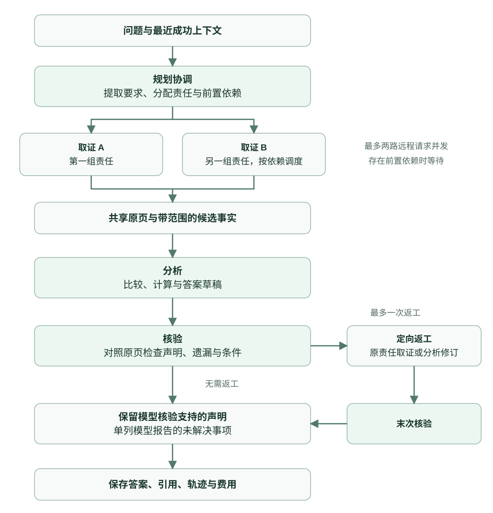

<p></p>

# FolioRecall · 页寻

**用原页证据完成取证、分析、核验与定向返工的文档研究应用。**

[English](README.md) · 简体中文

FolioRecall结合视觉检索与BM25，处理含文字、表格和图表的文档。LangGraph按责任和依赖组织取证，再分析原页、核验草稿，必要时返工一次；单Agent提供快速问答。界面展示实际步骤，支持英文与中文追问，CPU查询模型与索引常驻本地。

界面使用白色卡片、浅灰背景和绿色强调色。任务卡显示不同取证责任、依赖与运行状态，原页列表标明成功读页的任务，核验区保留各版草稿、问题和返工结果。读页工具成功不等于取证模型随后已收到该页图像。

> **v0.1.0** 整合了多轮问答、协作视图、四份离线案例和ONNX FP32查询后端。
> [GitHub Release与下载](https://github.com/linlin-is-me/FolioRecall/releases/tag/v0.1.0) · [发布说明](doc/v0.1.0发布说明.md) · [完整快速开始](doc/v0.1.0快速开始.md)

历史方法 `6fe8d8c` 完成60次真实对照及消融、60份助手评审和六次安装态浏览器确认。本轮展示更新复用这些记录，当前候选以真实检索配模拟生成器验证装配，没有新增API调用或重新评测。研究模式用于展示协作工程，快速问答仍推荐单Agent；整体覆盖未改善。[历史真实结果](doc/首版使用与评测.md#multi-agent-research-results) · [当前展示验证](doc/首版使用与评测.md#agent-showcase)

## 一个真实研究任务

比较人口与就业报告时，规划Agent分配不同取证责任，两个取证Agent分别搜索和读页；分析与核验接收实际原页，最终声明关联证据。下面展示历史真实调用的保存结果，使用当前浅色界面重新呈现，不是新增调用或新的质量评测。


四份静态案例可以在没有API密钥、模型或索引的环境下打开，查看原页、任务、草稿与核验记录。案例来自既有实验，没有为展示重新生成答案。

| 案例 | 可查看的工程行为 | 保留的限制 |
|---|---|---|
| 人口与就业 `cov-01` | 不同责任、并行请求与跨来源取证 | 访问多个来源不等于答案完整 |
| 中文图表 `confirm-04` | 前置依赖、共享原页与比例计算 | 程序复算不能证明操作数符合题意 |
| 城市政策 `confirm-03` | 缺口核验、指定责任人补查与两版草稿 | 补查后仍有必需事实遗漏 |
| 土星题 `cov-11` | 核验格式错误、失败阶段与草稿保留 | 技术失败不记作合法不足回答 |

核验属于模型判断，所有语义评审保持 `human=not_checked`。[离线案例与启动说明](doc/首版使用与评测.md#agent-showcase) · [工作流与实测](doc/首版使用与评测.md#multi-agent-research-results)

[五分钟演示与实现讲解](doc/项目介绍与面试准备.md#五分钟演示) · [使用与验证记录](doc/首版使用与评测.md#v010-多轮文档agent与审核候选)

## Agent执行流程



研究模式最多两路远程请求并发，共享16请求、6搜索、10页、16000输出tokens、300秒；仅有一次返工，不额外增加资源。单Agent保留原工具循环和默认配置。固定RAG读取检索前六页。Agent最多执行三次搜索、读取六个不同页面、发起八次模型请求，输出预算为8000 tokens，任务活动时间上限180秒。进度来自执行器实际回调，不展示模型隐藏思考。

## 核心实现与个人贡献

- **检索装配：** 文档导入、分块恢复编码、FAISS索引、正文与页面绑定，以及视觉和BM25各Top-50的RRF融合，固定 `k=60`。
- **研究协作：** 用LangGraph `StateGraph`和条件边连接规划、取证、分析、核验与一次返工；`Send`分发可执行的取证任务，依赖未完成时等待，技术失败时保留部分结果并标记阻塞。
- **工具与证据管理：** 搜索和读页反馈、资源限额、本轮引用权限、结构化答案，以及SQLite调用费用记录。
- **多轮应用：** 最近三轮成功问答提供上下文；一次请求完成指代改写与中文转换，占用当前轮原有资源。历史答案不扩充引用权限。
- **并发与恢复：** 父任务提交锁保持用户请求串行；独立查询锁只串行本地编码与检索，取证Agent的远程请求最多两路并发。同一次尝试从图检查点继续；已记录终态的合法网络补跑另起一次尝试，沿图流程复用成功操作缓存。浏览器断开不重发，后台继续保存终态。
- **协作展示：** 复用实际回调显示责任、依赖和执行状态，按草稿版本展示核验与返工；同一展示组件支持在线结果和无需API的历史案例。
- **实测与交付：** CLI、常驻浏览器界面、隔离安装、便携示例、完整 ONNX 查询后端，以及质量和费用的配对对照；保留失败及训练无收益结果。

LangGraph提供图执行、分支调度和检查点接口，本项目实现任务约定、依赖规则、共享证据权限、预算分配、核验返工和界面装配。Qwen与NanoVDR提供模型和权重；Sentence Transformers、FAISS、BM25与Gradio提供基础组件。公开学生的基础能力和加速收益归于上游。[来源说明](NOTICE) · [面试材料](doc/项目介绍与面试准备.md)

代码入口：[研究图](foliorecall/multi_agent_research.py)、[共享执行与恢复](foliorecall/multi_agent.py)、[会话与队列](foliorecall/chat.py)、[浏览器装配](foliorecall/demo.py)。技术栈为Python、PyTorch／Sentence Transformers、ONNX Runtime、FAISS／BM25、HTTPX、SQLite、LangGraph和Gradio。[技术栈与运行方式](doc/首版使用与评测.md#current-stack)

<details><summary>历史basic协作对照：54次主对照与8次并发诊断</summary>

此前basic轮次的三组各18轮助手评审中，覆盖均值A原单Agent／B扩预算／C协作为0.640625／0.640625／0.625，非空分母均16；费用为1.851970／2.657556／1.676076元。C增加调用数但未提高整体覆盖，三个双worker诊断出现真实请求重叠，不代表稳定的端到端加速。评分均为助手来源，`human=not_checked`。[完整结果与限制](doc/首版使用与评测.md#multi-agent-live-results)

</details>

## 快速体验

**先看协作案例：** 下载[完整交付包](https://github.com/linlin-is-me/FolioRecall/releases/download/v0.1.0/foliorecall-0.1.0-research-review.zip)，解压后打开 `package/showcase/index.html`，选择四份历史真实案例查看任务、原页和核验过程。此入口不需要安装Python、加载模型或配置API。压缩包沿用审核时的文件名。

已验证 Python 3.10、Ubuntu 22.04／WSL 2。也可分项下载 [wheel](https://github.com/linlin-is-me/FolioRecall/releases/download/v0.1.0/foliorecall-0.1.0-py3-none-any.whl)、[42页示例](https://github.com/linlin-is-me/FolioRecall/releases/download/v0.1.0/demo-bundle.zip)和[ONNX FP32模型](https://github.com/linlin-is-me/FolioRecall/releases/download/v0.1.0/query-onnx-fp32.zip)。示例包含向量、预览、正文和BM25；独立模型附件提供完整查询学生，无需GPU、教师权重或重新建库。[int8模型](https://github.com/linlin-is-me/FolioRecall/releases/download/v0.1.0/query-onnx-int8.zip)为可选附件。

在附件目录执行，已有相同依赖环境可复用：

```bash
python3.10 -m venv .venv
CPU_PY="$PWD/.venv/bin/python"
"$CPU_PY" -m pip install torch==2.8.0 --index-url https://download.pytorch.org/whl/cpu
"$CPU_PY" -m pip install 'foliorecall-0.1.0-py3-none-any.whl[onnx,demo,agent,multiagent]'
"$CPU_PY" -m zipfile -e demo-bundle.zip demo-local
"$CPU_PY" -m zipfile -e query-onnx-fp32.zip demo-local
cd demo-local/demo-bundle
CUDA_VISIBLE_DEVICES= "$CPU_PY" -m foliorecall query --index . \
  --config configs/baseline.json --query-config configs/student-ml-cpu-default.json \
  --retrieval-config hybrid.json \
  'Which figure compares projections of the EU working-age population under baseline and no-migration scenarios?' --json
```

检索不需要生成 API。免费浏览器：

```bash
CUDA_VISIBLE_DEVICES= "$CPU_PY" -m foliorecall serve --index . \
  --config configs/baseline.json --query-config configs/student-ml-cpu-default.json \
  --retrieval-config hybrid.json --port 7867
```

停止上述服务，设置北京百炼环境变量后启动 RAG／Agent：

```bash
export DASHSCOPE_API_KEY='replace-with-your-key'
export DASHSCOPE_BASE_URL=https://dashscope.aliyuncs.com/compatible-mode/v1
RUN_DIR="../outputs/chat-$(date +%Y%m%d-%H%M%S)"
CUDA_VISIBLE_DEVICES= "$CPU_PY" -m foliorecall serve --index . \
  --config configs/baseline.json --query-config configs/student-ml-cpu-default.json \
  --retrieval-config hybrid.json --agent-config configs/agent-demo.json \
  --multi-agent-config configs/agent-research-demo.json \
  --public-corpus public-corpus.json --output "$RUN_DIR" --port 7867
```

打开 http://127.0.0.1:7867。启用生成服务时默认进入文档问答；上述research配置选择文档研究，可切换单Agent快速问答。未配置生成服务则显示页面检索。顶部列出当前文档库；示例只填入问题，保留当前回答模式；首问和追问均不会自动调用模型。追问示例与新会话问题单独标注。来源显示简称与物理页码，完整文件名保留在提示、原页详情及 JSON 中。新建会话清空上下文，JSON 与终态记录保存在本地。

问答需自行配置密钥及实际服务余额，示例 20 元为支出上限。切换会话不清空费用；重复启动使用新的记录目录。模型固定 `qwen3.7-plus-2026-05-26`，关闭思考。

[完整快速开始](doc/v0.1.0快速开始.md)包含同版本旧 wheel 替换、int8 可选切换和 PyTorch 回退。旧配置省略后端字段时继续使用 PyTorch；产品 CLI、API 与答案结构兼容。完整 JRC 库、完整 PDF 和凭据不随候选提供，查询模型作为独立附件分发，不进入源码或 wheel。[使用说明](doc/首版使用与评测.md)另含源码安装与自有 PDF 建库入口。

## 质量、费用与误例

同预算新轮主对照各18次：单Agent／basic／research覆盖为0.734375／0.578125／0.546875（各16个非空样本）；费用3.426176／2.527830／2.297742元，平均活动32.56／37.61／56.43秒。research有17/18有效核验答案，另1次结构失败；高非空事实分数不能抵消遗漏。60项含6条关闭返工消融，均为已见开发任务、助手评分，`human=not_checked`。不宣称整体协作优势。[完整分母、配对与误例](doc/首版使用与评测.md#multi-agent-research-results)

**原单轮A5版本**完成40题、双语、三条件共240项首次终态与助手评审，237项结构合法。结构合法率不等于回答准确率；必需事实覆盖每条件有76项适用结果。

| 条件 | 必需事实覆盖 | 已知问答费用估算（元） |
|---|---:|---:|
| Visual RAG | 0.702193 | 2.200664 |
| Hybrid RAG | 0.736988 | 2.198824 |
| Hybrid Agent | 0.722295 | 7.352474 |

Agent对Hybrid RAG的覆盖配对差为−0.014693，共76对，费用更高，收益随问题变化。费用不含转换、探针和未知预留。语言和条件变体不构成240个独立问题。评分来自助手，保持 `human=not_checked`；独立人工复核为可选后续。[完整分母、失败与费用](doc/首版使用与评测.md#a5-模型迁移与新一轮验收)

v0.1.0多轮界面另有功能验证，A5不作为新路径的质量基准。已有误例包括遗漏适用条件、证据范围不足却扩大结论，以及不足判断错误；引用ID合法仍需核对语义支持。

早期多轮版本 `05d286a` 在接入LangGraph前完成五轮RAG／单Agent真实浏览器问答，通过进度、追问、重置、引用和JSON检查，共25次API请求，已知费用估算0.455042元。该版本的跨文档用例只读取人口报告，遗漏就业报告证据，追问延续遗漏；土星问题返回空事实声明与不足判断。这些历史用例与上方研究模式四例分别保留，不代表当前版本质量或整体回答准确率。[早期五轮记录](doc/首版使用与评测.md#v010-多轮文档agent与审核候选)

另做12轮×基线／候选的Agent证据覆盖开发对照，24项均有助手评审。候选降低请求与费用，但必需事实覆盖0.6402→0.6061，跨文档核心遗漏仍在，未采用；默认行为与原候选包保持不变。[开发结果与局限](doc/首版使用与评测.md#agent证据覆盖开发对照2026-10-14)

## 检索架构与实验


原始Qwen3-VL-Embedding-2B离线编码页面，公开NanoVDR ML在线编码查询。CPU FP32查询复用匹配的原教师索引；LoRA需要另建匹配索引。

### 检索、训练与查询成本


HR、Computer Science、Finance-EN、Industrial 和 Pharmaceuticals 五个固定英文任务共包含 **12,969 页、1,489 条查询**。各任务保留完整候选库和原始分级标签。下表按领域等权平均；神经模型使用 GPU BF16，BM25 在 CPU 上使用官方页面 markdown。

| 查询模型 / 方法 | nDCG@10 | Recall@5 | Recall@10 |
|---|---:|---:|---:|
| 原始 Qwen3-VL 教师 | 0.537845 | 0.479970 | 0.580596 |
| LoRA750 | **0.573712** | **0.504133** | **0.612973** |
| 公开 NanoVDR EN | 0.566762 | 0.497533 | 0.605997 |
| 公开 NanoVDR ML · 默认 | 0.567706 | 0.502397 | 0.611766 |
| 继续蒸馏 · 第 94 步 | 0.437830 | 0.390437 | 0.484633 |
| 页面级 BM25 | 0.516565 | 0.455363 | 0.553117 |

- **本地 LoRA 微调：** 相对原始教师，nDCG@10 提高 **0.035867**，四个领域提高，**Finance-EN 下降 0.021927**；查询延迟增加。
- **公开 ML 查询学生：** 同卡 BF16 下，编码 P50 比原始教师快 **6.23–7.65 倍**，该收益来自 NanoVDR 上游模型。本项目继续蒸馏后的 nDCG@10 相对公开 ML **下降 0.129877**，第 94 步保留为无收益对照。

| GPU 查询模型 | 各领域完整本地请求 P50 |
|---|---:|
| 原始教师 | 30.66–32.37 ms |
| LoRA750 | 44.72–45.07 ms |
| 公开 ML | 4.51–6.61 ms |

测量使用 **RTX 4060 Laptop 8GB**、batch1、PyTorch/FAISS 线程 4/1、5 次预热，各配置在独立进程中按固定查询顺序运行 3 轮。完整请求从输入文本计时至 Top-10 JSON 就绪，不包含模型加载、界面准备和浏览器渲染。表中范围来自各领域的 P50，未混合不同领域计算延迟统计。CPU 作为独立部署方案报告，不计作同设备编码加速。

[完整结果与评测协议](doc/首版使用与评测.md#本轮实测结果)包含 CPU 对照、配对置信区间、逐领域计时、内存、建库成本及误例分析。

### 新增CPU后端对照

同一 CPU、200 条冻结开发查询／1000 页，batch1、编码 4 线程，三轮交替测量。原入口计划 FAISS 单线程，但测量元数据记录实际为 4 线程；下表保留该轮实测值：

| 后端 | 完整请求P50 | 预热RSS | 开发集nDCG@10 |
|---|---:|---:|---:|
| PyTorch FP32 | 19.33 ms | 636.0 MiB | 0.972699 |
| ONNX FP32 | 8.62 ms | 817.0 MiB | 0.972699 |
| ONNX动态int8 | 4.79 ms | 581.1 MiB | 0.969008 |

ONNX FP32在五领域1489题的检索指标与PyTorch一致，约2.24倍提速，但内存更高，选作最终本地候选的 CPU 默认。int8约4.04倍提速、包体积减少72.2%，五域等权nDCG下降0.005031，保留为可选配置。只替换查询执行，包含池化、投影和归一化；时间不含加载、显示与生成，不代表问答同比加速。旧 PyTorch 体验入口继续兼容。该轮历史计时不与后来搜索阶段单线程的多深度实验作严格同条件比较。[完整领域结果与导出命令](doc/首版使用与评测.md#onnx-cpu-backends) · [安装态真实界面](doc/assets/onnx-fp32-retrieval.png)

另完成 **LLaVE教师训练对照**：同256条训练查询、64批，开发集nDCG@10为0.978928，普通CachedMNRL为0.977083，增加0.001845，Recall保持0.995。200题中仅2题改善、1题退化，收益较小且集中，暂不承担新教师、匹配学生与索引迁移成本，保留实验结果。[详细对照与局限](doc/首版使用与评测.md#llave-training)

**新增270题留出与三种子验证：** 六个64步训练臂、21份匹配索引／评测及19题44张原页助手复核完成。领域等权nDCG@10：原始教师0.612402，普通LoRA 0.650042±0.007900，LLaVE 0.649618±0.008002（样本标准差）。普通训练在九个种子／领域组合均提高；LLaVE相对普通未显示稳定额外收益，经济领域三个种子均退化。产品教师与公开学生保持原状，收益尚未迁移到Agent。[完整结果、退化和数据边界](doc/首版使用与评测.md#teacher-holdout-results)

**CPU学生迁移对照：** 新训练的LoRA教师目标学生在三领域等权nDCG达到0.637859，高于原教师目标蒸馏的0.566638，但低于公开学生的0.669182。开发集虽改善，跨域仍未达到采用条件；完成17题40页助手复核后停止产品迁移，保留公开六层ONNX FP32。[对照、误例与取舍](doc/首版使用与评测.md#teacher-transfer)

多深度学生已完成实际四层裁剪、独立训练与四／六层联合训练的六组对照。联合四层参数减少20.7%，但开发集nDCG@10为0.495222，低于公开六层0.972699，故保留现有六层ONNX部署。[对照与负结果](doc/首版使用与评测.md#multidepth-query)。

## 能力边界

- 文档库为英文，中文问题和追问检索英文页面；原生中文文档检索尚未验证。
- 本地单用户应用，远程API生成；上下文保存在Gradio服务端会话内存，刷新或新建会话后不再沿用。终态文件独立保存在磁盘，无持久会话数据库或多用户部署。
- 可能误读图表、遗漏事实或引用不足证据；历史回答用于理解指代，不是已核验事实。
- 问答固定任务和助手评分限制泛化结论；早期训练多为单seed，新增教师对照已测三seed，但文档级隔离与上游训练重叠未完全确认。
- 检索无生成费用，问答需要密钥和服务余额；未实现重排序或任意外部工具。

## 文档与许可

[使用与评测](doc/首版使用与评测.md) · [实验CSV](doc/experiments.csv) · [开发计划](doc/多模态文档检索项目开发计划.md#当前开发重点) · [开发约定](AGENTS.md)

代码采用[Apache-2.0](LICENSE)，上游模型与资料保留各自许可。示例保留欧盟署名、排除已确认的第三方图像，不含完整PDF；[NOTICE](NOTICE)记录来源。可在[Issues](https://github.com/linlin-is-me/FolioRecall/issues)提供命令、环境和可复现问题。
