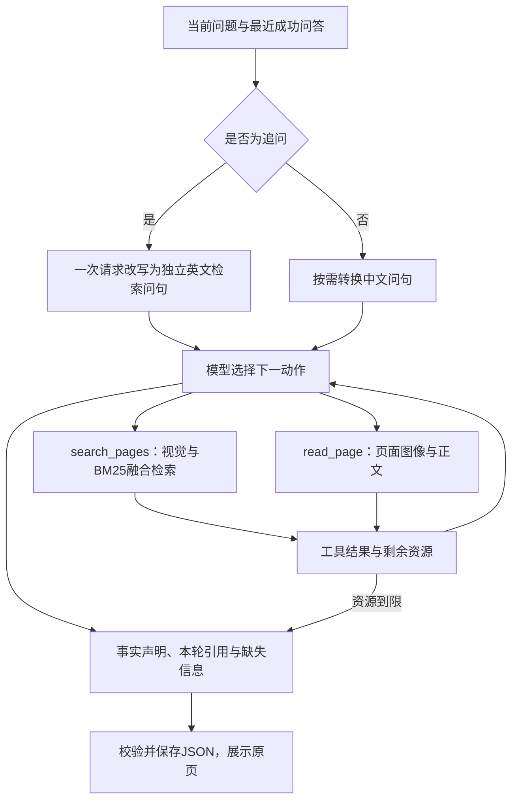

# FolioRecall · 页寻

**检索文档证据、读取原页、执行补查并提供引用的文档Agent。**

[English](README.md) · 简体中文

FolioRecall结合视觉检索与BM25，处理含文字、表格和图表的文档。受限Agent决定何时继续搜索和读页，界面展示实际执行步骤，支持英文与中文追问。本地Gradio应用常驻CPU查询模型与索引。

> `0.1.0`为本地审核候选。新版源码和发布附件尚未公开，本页暂不提供附件下载链接。

## 一个真实文档任务

询问两份欧洲报告如何描述劳动年龄人口与就业变化，再用中文追问证据页和分析时间范围。界面实时显示搜索、读页和模型请求，随后呈现事实声明、原页引用与保存的JSON。


<details><summary>实际请求进度与不足回答</summary>


</details>

[五分钟演示与实现讲解](doc/项目介绍与面试准备.md#五分钟演示) · [使用与验证记录](doc/首版使用与评测.md#v010-多轮文档agent与审核候选)

## Agent执行流程



固定RAG读取检索前六页。Agent最多执行三次搜索、读取六个不同页面、发起八次模型请求，输出预算为8000 tokens，任务活动时间上限180秒。进度来自执行器实际回调，不展示模型隐藏思考。

## 核心实现与个人贡献

- **检索装配：** 文档导入、分块恢复编码、FAISS索引、正文与页面绑定，以及视觉和BM25各Top-50的RRF融合，固定 `k=60`。
- **工具与证据管理：** 搜索和读页反馈、资源限额、本轮引用权限、结构化答案，以及SQLite调用费用记录。
- **多轮应用：** 最近三轮成功问答提供上下文；一次请求完成指代改写与中文转换，占用当前轮原有资源。历史答案不扩充引用权限。
- **本地执行：** 工作线程和队列传递实时步骤，共用请求锁串行访问检索模型。浏览器断开不重发任务，后台仍保存终态。
- **实测与交付：** CLI、常驻浏览器界面、隔离安装、便携示例，以及质量和费用的配对对照；保留失败及训练无收益结果。

Qwen与NanoVDR提供上游模型和权重；Sentence Transformers、FAISS、BM25与Gradio提供现成基础设施。本项目贡献是集成、工具执行、应用交付和受控比较，公开学生的加速收益归于上游模型。[来源说明](NOTICE) · [面试材料](doc/项目介绍与面试准备.md)

## 快速体验

已验证Python 3.10、Ubuntu 22.04／WSL 2。取得本地审核wheel与增强版 `demo-bundle.zip`。42页示例含向量、预览、正文与BM25，无需GPU建库或教师权重；首次启动需要配置指定的公开查询学生，已有缓存可直接复用。

```bash
python3.10 -m venv .venv
CPU_PY="$PWD/.venv/bin/python"
"$CPU_PY" -m pip install torch==2.8.0 --index-url https://download.pytorch.org/whl/cpu
"$CPU_PY" -m pip install 'foliorecall-0.1.0-py3-none-any.whl[demo,agent]'
"$CPU_PY" -m zipfile -e demo-bundle.zip demo-local
cd demo-local/demo-bundle
CUDA_VISIBLE_DEVICES= "$CPU_PY" -m foliorecall query --index . \
  --config configs/baseline.json --query-config configs/student-ml-cpu.json \
  --retrieval-config hybrid.json \
  'Which figure compares baseline and no-migration scenarios?' --json
```

CPU检索不调用生成API。RAG与Agent需要北京地域百炼密钥：

```bash
export DASHSCOPE_API_KEY='replace-with-your-key'
export DASHSCOPE_BASE_URL=https://dashscope.aliyuncs.com/compatible-mode/v1
CUDA_VISIBLE_DEVICES= "$CPU_PY" -m foliorecall serve --index . \
  --config configs/baseline.json --query-config configs/student-ml-cpu.json \
  --retrieval-config hybrid.json --agent-config configs/agent-demo.json \
  --public-corpus public-corpus.json --output outputs/chat --port 7864
```

打开 `http://127.0.0.1:7864`，选择RAG或Agent并提交问题，查看实时步骤；同一会话可追问，新建会话清空上下文。展开结果面板可复制JSON，终态记录同时保存到本地。生成请求计费，示例使用相对账本路径与20元预算，新建会话不清空费用。

原单轮 `ask` CLI和浏览器API继续可用。[完整使用说明](doc/首版使用与评测.md)提供源码安装与自有PDF建库入口。完整JRC语料、完整PDF、模型权重和凭据不随示例或候选包提供。

## 质量、费用与误例

**原单轮A5版本**完成40题、双语、三条件共240项首次终态与助手评审，237项结构合法。结构合法率不等于回答准确率；必需事实覆盖每条件有76项适用结果。

| 条件 | 必需事实覆盖 | 已知问答费用估算（元） |
|---|---:|---:|
| Visual RAG | 0.702193 | 2.200664 |
| Hybrid RAG | 0.736988 | 2.198824 |
| Hybrid Agent | 0.722295 | 7.352474 |

Agent对Hybrid RAG的覆盖配对差为−0.014693，共76对，费用更高，收益随问题变化。费用不含转换、探针和未知预留。语言和条件变体不构成240个独立问题。评分来自助手，保持 `human=not_checked`；独立人工复核为可选后续。[完整分母、失败与费用](doc/首版使用与评测.md#a5-模型迁移与新一轮验收)

v0.1.0多轮界面另有功能验证，A5不作为新路径的质量基准。已有误例包括遗漏适用条件、证据范围不足却扩大结论，以及不足判断错误；引用ID合法仍需核对语义支持。

五轮真实浏览器问答通过进度、追问、重置、引用和JSON检查，共25次API请求，已知费用估算0.455042元。跨文档用例只读取人口报告，遗漏就业报告证据，追问延续了遗漏；截图保留这项局限。土星问题返回空事实声明与不足判断。这些用例验证使用流程，不代表整体回答准确率。

## 检索架构与实验


原始Qwen3-VL-Embedding-2B离线编码页面，公开NanoVDR ML在线编码查询。CPU FP32查询复用匹配的原教师索引；LoRA需要另建匹配索引。

### 检索、训练与查询成本


HR、Computer Science、Finance-EN、Industrial 和 Pharmaceuticals 五个固定英文任务共包含 **12,969 页、1,489 条查询**。各任务保留完整候选库和原始分级标签。下表按领域等权平均；神经模型使用 GPU BF16，BM25 在 CPU 上使用官方页面 markdown。

| 查询模型 / 方法 | nDCG@10 | Recall@5 | Recall@10 |
|---|---:|---:|---:|
| 原始 Qwen3-VL 教师 | 0.537845 | 0.479970 | 0.580596 |
| LoRA750 | **0.573712** | **0.504133** | **0.612973** |
| 公开 NanoVDR EN | 0.566762 | 0.497533 | 0.605997 |
| 公开 NanoVDR ML · 默认 | 0.567706 | 0.502397 | 0.611766 |
| 继续蒸馏 · 第 94 步 | 0.437830 | 0.390437 | 0.484633 |
| 页面级 BM25 | 0.516565 | 0.455363 | 0.553117 |

- **本地 LoRA 微调：** 相对原始教师，nDCG@10 提高 **0.035867**，四个领域提高，**Finance-EN 下降 0.021927**；查询延迟增加。
- **公开 ML 查询学生：** 同卡 BF16 下，编码 P50 比原始教师快 **6.23–7.65 倍**，该收益来自 NanoVDR 上游模型。本项目继续蒸馏后的 nDCG@10 相对公开 ML **下降 0.129877**，第 94 步保留为无收益对照。

| GPU 查询模型 | 各领域完整本地请求 P50 |
|---|---:|
| 原始教师 | 30.66–32.37 ms |
| LoRA750 | 44.72–45.07 ms |
| 公开 ML | 4.51–6.61 ms |

测量使用 **RTX 4060 Laptop 8GB**、batch1、PyTorch/FAISS 线程 4/1、5 次预热，各配置在独立进程中按固定查询顺序运行 3 轮。完整请求从输入文本计时至 Top-10 JSON 就绪，不包含模型加载、界面准备和浏览器渲染。表中范围来自各领域的 P50，未混合不同领域计算延迟统计。CPU 作为独立部署方案报告，不计作同设备编码加速。

[完整结果与评测协议](doc/首版使用与评测.md#本轮实测结果)包含 CPU 对照、配对置信区间、逐领域计时、内存、建库成本及误例分析。

## 能力边界

- 文档库为英文，中文问题和追问检索英文页面；原生中文文档检索尚未验证。
- 本地单用户应用，远程API生成；会话保存在浏览器状态，刷新清空，无持久会话数据库或多用户部署。
- 可能误读图表、遗漏事实或引用不足证据；历史回答用于理解指代，不是已核验事实。
- 固定任务、单个训练seed和助手评分限制泛化结论，上游训练重叠未完全确认。
- 检索无生成费用，问答需要密钥和服务余额；未实现重排序、ONNX/int8或任意外部工具。

## 文档与许可

[使用与评测](doc/首版使用与评测.md) · [实验CSV](doc/experiments.csv) · [开发计划](doc/多模态文档检索项目开发计划.md#当前开发重点) · [开发约定](AGENTS.md)

代码采用[Apache-2.0](LICENSE)，上游模型与资料保留各自许可。示例保留欧盟署名、排除已确认的第三方图像，不含完整PDF；[NOTICE](NOTICE)记录来源。可在[Issues](https://github.com/linlin-is-me/FolioRecall/issues)提供命令、环境和可复现问题。
