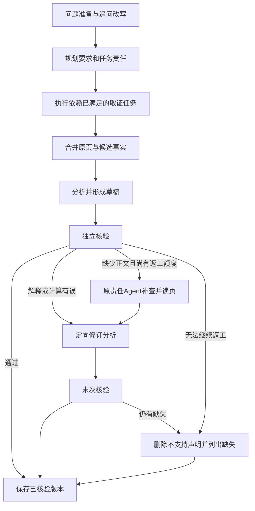

# FolioRecall（页寻）：视觉文档多Agent协作项目开发计划

更新日期：2026-10-19。多Agent协作展示、真实任务生命周期、四份离线案例和双语展示材料已经实现，当前进入独立候选装配及仓库外安装验证。复用原研究方法、60次真实记录和原模型索引，不新增付费调用或质量评测；原28次对照继续作为可选后续。当前不推送或发布。

## 1. 项目目的与最终形态

**项目名称：FolioRecall（页寻）：面向复杂文档研究的多Agent协作。** 视觉页面检索、双语问答与轻量查询模型构成已有基础。

GitHub 仓库名：`FolioRecall`。项目方向英文说明：Multi-agent document research with page-level visual evidence。当前README仍按实际已交付能力介绍，规划不提前写成可用功能。

项目仓库：[linlin-is-me/FolioRecall](https://github.com/linlin-is-me/FolioRecall)。HTTPS 克隆地址：`https://github.com/linlin-is-me/FolioRecall.git`。

远程仓库已有早期公开源码，默认分支为main；当前v0.1.0开发成果仍在本地分支，不能将已有仓库视为新版已发布。源码同步与Release附件发布分别记录，发布前再读取远端实际状态。

### 本地工作目录与开发环境

| 项目 | 约定 |
|---|---|
| Windows 工作目录 | `D:\myproject\FolioRecall`，用户指定的项目工作副本位置 |
| WSL 工作目录 | 默认磁盘挂载下对应 `/mnt/d/myproject/FolioRecall`，与 Windows 路径指向同一份代码 |
| 本地开发系统 | WSL 2，Ubuntu 22.04 |
| 项目环境 | 独立 venv `foliorecall_env` 已创建，不继承其他环境依赖；安装与验证状态见[历史本机环境记录](首版使用与评测.md#历史开发与本机环境记录) |
| 环境目录 | 实际为 `/root/.venvs/foliorecall_env`；缓存与临时目录放在 `/mnt/d/foliorecall_cache`，激活方式见[本机开发环境](首版使用与评测.md#本机开发环境) |
| Python 与依赖 | Python 3.10.12；实际依赖与验证记录见[历史本机环境记录](首版使用与评测.md#历史开发与本机环境记录)和 requirements.txt，保留已有 Windows、mosca 及其他环境 |
| 本机资源 | Ryzen 7 8845H、24GB 内存、RTX 4060 Laptop 8GB；已完成第二阶段教师训练与小规模对照。后续优先复用本机，按实测耗时、显存和已确定预算决定是否使用 AutoDL |

早期安装前曾记录 C 盘约10.4GB、D盘约25GB余量，这不是当前空间读数；仅在新增安装或大规模下载前定向检查实际余量。代码使用指定工作目录，环境与模型缓存可以独立放置；首次确定位置后记录并复用，不因会话切换重复创建环境或搬迁代码。环境、缓存和权重不纳入代码提交。

首次开发先检查目标目录是否已有工作副本；需要克隆时将该目录作为目标，避免额外嵌套一层 FolioRecall。首次创建或接入 `foliorecall_env` 时，检查解释器、必要依赖导入及可用 GPU 的小型运算；后续只在环境变更或出现异常时检查受影响部分，已验证且未变化的环境直接复用。GPU 尚不可用时先推进 PDF 处理等 CPU 工作。环境可用不等于模型加载或训练已经验证。若工具仅能访问云端工作区，应提供供用户在本机 WSL 执行的命令，不把云端安装记为本机完成。AutoDL 的工作目录和环境按实际实例另行记录。


项目面向Agent开发岗位，重点体现任务分工、依赖调度、证据交接、核验返工、执行恢复与真实对照能力。目标是交付可在GitHub公开、供他人安装使用和复现实验的文档研究应用。已有模型训练与查询优化作为技术基础和取舍证据保留；不以新增模型或角色数量作为成果。

用户可以导入自己的 PDF 文件或页面图像，系统将 PDF 渲染为页面图像、编码并建立索引。输入英文问题后，返回 Top-5 页面、文档来源、页码和分数，支持预览及查看原文。页面图像保留文字、表格、图表和版面信息；基准数据用于训练和评测，自有文档用于实际检索。

系统离线使用多模态模型编码页面并建立索引，在线编码问题后搜索页面。完成训练后，进一步用轻量学生模型替代在线查询编码器，降低查询延迟与部署资源需求。

**当前主线是让多个职责不同的Agent协作完成复杂文档问题，并用原页证据检查和修订结果。** 职责分工、依赖、共享证据与一次定向返工闭环已完成，实测支持保留可选研究模式，默认继续使用单Agent。提高检索准确性、降低查询成本是已经完成的早期主线；A5、A6、多轮应用及四项方法探索保留原结论，B3暂不启动，独立人工复核仍为可选后续。

当前使用多个主题的公开数据，微调定位为视觉文档检索任务适配。产品手册或技术报告首先承担演示和实际使用测试的作用；只有后续采用明确的领域训练数据及独立领域测试，才进一步声明对应领域的适配效果。

早期首版已完成文档导入、微调、查询蒸馏、评测和演示；后文对应章节保留历史方法安排。多Agent研究流程及本轮协作展示均已实现，当前完成独立候选验证与审核材料整合，B3及其他研究实验不阻塞审核。远端发布仍需用户确认。

扩展A已支持中文问句转换为英文后检索英文页面，并完成双语问答助手评测。原生中文文档检索与中文专门适配仍属后续方向，启动顺序与候选数据见第7.4节，不追加为A6完成条件。

### 当前开发重点

**2026-10-19当前状态：协作展示实现已完成，独立候选验证进行中。** 本轮从 `codex/agent-extensions@7a85e98` 接续，以 `cov-01` 已有终态为起点完成任务卡、依赖与阶段状态、原页归属、版本化核验和定向返工展示。用户目标是体现多Agent框架的工程实现经验，质量优于单Agent不作为本轮完成条件；已有负结果继续保留。

原计划 `d02b39d` 将24次同预算主对照和4次预算诊断作为下一轮工作，现移出主线，不再作为发布准备或工程完成的前置条件。完整方案保留在[后续可选对照](#complex-research-plan)，其中次数、费用和时间仅在未来明确启动该方案时适用。当前不实现其专用实验入口，不为证明协作胜出追加评测或调参。

<a id="agent-showcase-plan"></a>

#### 已实现的协作展示与当前收尾

本轮复用原图、工具和状态，只补实际执行位置的展示事件；没有调整模型消息、检索策略、核验规则、预算或恢复方法。原始实验JSON及其活动时间保持不变，离线渲染使用副本。

| 交付部分 | 当前完成状态 | 依据与范围 |
|---|---|---|
| 共用展示 | 已实现 `research_display`，在线终态、实时进度与静态案例共用数据展示 | 显示要求、任务责任、依赖、页码、实际读页角色、分析版本与最终引用；缺失字段注明未记录 |
| 实时任务状态 | 已在真实执行位置保存 `research_task` 生命周期 | 区分等待、运行、结束、失败和阻塞；结束原因与要求是否答全分开，历史记录不补造时间线 |
| 核验与返工 | 已实现草稿版本绑定、逐声明判断、计算复算记录和返工新增页 | 两版原文并排保留，不按相同序号推断同一声明；核验结果仍是模型判断 |
| 四份离线案例 | 已导出并刷新4例、9张原页图，直接打开 `outputs/extensions/A/agent-showcase-v1/index.html` | `cov-01`分工并行、`confirm-04`依赖计算、`confirm-03`补查返工仍有遗漏、`cov-11`核验结构失败；不需要API、模型或索引 |
| README与面试材料 | 已统一中英文首例、代码入口、职责边界和五分钟讲解 | 重点说明LangGraph编排、共享证据、并发预算与恢复；训练结果移至补充材料，保留 `human=not_checked` |
| 候选装配 | 已增加白名单收集案例、截图和本轮验证摘要 | 复用原打包入口及浅色候选资产，不复制案例验证目录、检查点或原始运行目录 |

**已完成的定向验证：** 43项相关定向测试通过，包含研究流程16项、展示6项、会话7项、界面5项、离线案例8项、打包1项。实际浏览器已核对四份案例、原页跳转、核验版本和失败状态；没有重新执行模型实验。JSON下载自动化等待超时，尚未确认文件落盘，不能列为下载通过。桌面1440像素与390像素窄屏已查看，修复长原文件名横向溢出后，375像素内容宽度与滚动宽度一致。浏览器工具不允许file协议，实际检查使用localhost静态服务；相对资源无fetch由导出检查覆盖，不宣称双击文件已实测。

**当前待收尾：** 仓库外安装的新wheel、真实ONNX配模拟生成器的问答装配，以及最后的候选文件与文档核对正在进行。安装验证结果和最终提交号在实际完成后补充；当前不宣称新候选已经通过安装验收。模拟问答仅验证界面、会话和保存，不计入历史60次真实结果，也不新增实验CSV评分行。

新候选使用 `outputs/releases/v0.1.0-agent-showcase-candidate/package`，旧 `outputs/extensions/A/multi-agent-research-v2/candidate-light/package` 原样保留。新目录包含wheel、源码、42页示例、独立ONNX模型、四例静态页面、更新材料与验证摘要。代码与模型方法保持兼容，默认快速问答仍推荐单Agent。

已有源资产和案例准备好后，采用原入口构建：

```bash
python -m scripts.package_v010_candidate \
  --research-source outputs/extensions/A/multi-agent-research-v2/candidate-light/package \
  --output outputs/releases/v0.1.0-agent-showcase-candidate
```

安装验证完成后在同一输出使用 `--refresh-docs` 更新源码说明、附件清单和审核ZIP，不重新调用模型。沿用现有[发布说明](v0.1.0发布说明.md)作为审核入口，最终装配来源以 `assembly.json` 和 `CHANGE-SUMMARY.md` 为准。本轮API新增费用为0，无GPU任务、训练、模型导出或页面重编码；旧费用快照不当作本次重新读取账本。完成本地候选和相关提交后停在用户审核，暂不推送、创建PR、标签或Release。

<details><summary>2026-10-17至19的展示实施计划与初始缺口，保留历史安排</summary>

以下是实现前的核对与工作顺序，供追溯；其中尚未实现、下一次实施和时间估计均为当时状态，当前完成情况以上表为准。

#### 历史多Agent工程展示与候选交付计划

**2026-10-19接续核对：** 当前分支 `codex/agent-extensions`，本次修改前为 `fbea28a`、工作区干净，近两天没有新增产品实现。以下范围和8–15小时估计继续适用；本次补充具体代码入口、开发顺序和展示数据的实际限制，下一次实现直接从终态视图开始，不再重复整轮审查。

##### 1．现有能力、证据和展示缺口

| 核对对象 | 当前实际能力或记录 | 下一步处理 |
|---|---|---|
| 角色和任务依赖 | [研究图](../foliorecall/multi_agent_research.py)已有规划、取证、分析、核验四类角色；最多两名取证worker，依赖任务等待前置完成，前置失败会阻塞后续任务 | 展示每项责任、前置任务及实际状态，不增加角色或另写调度器 |
| LangGraph使用 | 已使用StateGraph、条件分支、Send分发、worker状态合并与SQLite检查点；模型请求和工具节点分离 | 用一张流程图对应代码入口，明确框架能力与本项目实现的区别 |
| 并发和资源 | [公共执行能力](../foliorecall/multi_agent.py)已有角色独立请求上下文、并发预占、页数去重和费用账本；父任务串行，worker远程请求最多两路并发，本地查询另行加锁 | 修正材料中容易混淆的锁说明；客户端请求重叠不写成服务端计算并行或必然加速 |
| 共享证据与核验 | 保存了角色读页、分析版本、草稿、逐声明核验及一次返工；分析和核验接收原页，最终引用仍受实际证据限制 | 将已有字段呈现出来；页面读到、内部核验通过和事实正确分别说明 |
| 恢复与保存 | 已有成功节点复用、网络失败补跑、未知在途暂停、终态先于渲染保存；原CLI支持恢复 | 复用已有测试证据，不新增浏览器恢复按钮、任务平台或任意崩溃下恰好一次的承诺 |
| 前端 | [进度组件](../foliorecall/chat.py)主要输出按时间排列的日志；[结果组件](../foliorecall/demo.py)仅折叠展示任务名称、问题、核验问题和返工提示 | 补齐责任卡片、依赖状态、原页归属、两版草稿和逐声明判断；原始日志与JSON保留为展开项 |
| 截图与讲解 | 浅色截图是初始页，研究结果截图仍是旧深色界面；五分钟讲解给检索训练较多篇幅，研究流程约占80秒 | 用已有真实记录在新浅色组件中展示并截图，多Agent工程占主要讲解时间 |
| 候选包 | 当前推荐入口仍为 `multi-agent-research-v2/candidate-light/package`，有安装和真实API使用的历史记录；后续文档和研究结果未全部重新打包 | 最终统一构建一次独立候选，保留旧包；本次核对不算新包验证 |

现有方法仍有责任重叠、读页遗漏、核验漏检和误删等问题。保留 `cov-03/04`、`cov-05` 的原诊断，不因展示目标调整而删除。此轮先让分工、证据交接、核验和失败可观察；不为改善展示去改变规划提示、检索策略、核验规则或预算。发现真正的执行故障时修复受影响路径，另记方法是否变化，旧实验结论不改写。

##### 2．协作过程展示：复用状态和回调

在现有模块中提取少量展示函数，让实时界面、终态界面与离线案例复用，不建设新的状态数据库或事件系统。输入优先采用已有 `research.tasks`、`workers`、`pages`、`drafts`、`verifications`、`rework` 和 `progress`；显示字段缺失时注明未记录，不能用模型摘要推断原页接收或任务完成。

| 展示部分 | 显示内容 | 数据边界 |
|---|---|---|
| 阶段概览 | 问题准备、规划、取证、分析、核验、必要返工及终态；指出当前执行位置 | 按实际节点更新，不显示虚构的完成百分比；单次请求完成不等于阶段成功 |
| 任务卡片 | 动态职责名、负责要求、子问题、前置任务、等待／执行／完成／阻塞／失败状态 | 依赖来自 `depends_on`，不按名称猜测；最多两张取证卡片，协调、分析、核验显示为阶段 |
| 证据列表 | 简短文档名、物理页码、实际读页角色、进入的分析版本、最终引用情况，点击查看原页 | 同页只列一次但保留所有接收角色；检索候选与已读原页分开，不能把收到页面标为要求已满足 |
| 核验与返工 | 声明原文、对应版本、支持判断和理由；返工类型、责任任务、新增页面及修订前后内容 | 全部注明模型内部判断；保留被删声明和未解决要求，不自动宣称修改后更正确 |
| 运行详情 | 原有检索问句、工具事件、请求、预算、费用及JSON | 维持展开查看，主界面优先呈现任务与证据；不展示隐藏思考 |

已有事件不能表达等待、阻塞或worker结束时，仅在实际状态变化处补充轻量回调，并沿用原事件保存方式。新事件只服务展示，不参与调度、预算或恢复决策。历史记录没有对应事件时，使用已保存终态呈现，不能补造历史时间线。声明编号必须连同草稿版本展示，避免首次与末次核验串用。

**实施顺序及代码入口：**

| 顺序 | 入口 | 最小改动与验收依据 |
|---|---|---|
| 1．先做终态视图 | `demo.py::qa_display`及少量共用展示函数 | 用 `cov-01` 保存结果展示任务、依赖、取证页和答案，再加入两版核验；不加载模型即可检查信息是否完整 |
| 2．补任务生命周期 | `multi_agent_research.py` 的 `plan`、`decision`、`tools`、`gather_end` | 在实际初始化、执行、结束和阻塞处补回调，字段限于任务ID、角色、main／rework阶段、状态及原因；沿用原顺序号和耗时，不增加图节点 |
| 3．接实时界面 | `chat.py::progress_html`、`stream_chat`及 `demo_style.py` | 阶段与任务卡按事件更新，读页事件显示实际来源；详细草稿和逐声明核验在终态展示，避免为实时展示复制整份证据或增加轮询 |
| 4．导出案例及打包 | 薄脚本 `prepare_agent_showcase.py` 与现有 `package_v010_candidate.py` | 同一套展示函数服务在线和离线；前者只读已有记录，后者增加案例与截图附件，不改模型、索引或配置格式 |

worker的执行结束与问题已经答全分别表达；达到决策上限时显示结束原因，不能显示为所有要求已满足。返工开始后只更新对应任务的本阶段状态，保留第一次取证记录。事件交错按角色与任务区分，不依赖卡片位置。

本次源码核对发现三处数据边界，实施时直接处理：`research.pages.received_by`目前只列取证worker，`analysis_versions`表示哪些草稿实际采用该页，不能据此补造核验Agent收页清单；`verifications`列表没有独立version字段，应从保存文件版本或明确的事件版本关联，无法确定时注明未记录；`v0-c1`与`v1-c1`不代表同一声明的修改关系，先并排展示两版原文，不自动绘制逐条纠错连线。

##### 3．前端排版和首次使用

保留浅白背景、浅灰分区、现有绿色强调、logo与双栏。左栏继续放输入、模式、示例和会话；右栏上部显示阶段及任务，下部显示答案和证据。核验对照、完整日志、费用和JSON采用折叠区，避免把所有原始字段铺满首页。窄屏按任务、答案、证据顺序纵向排列，不增加流程图编辑器或大屏仪表盘。

首次提示明确区分三种用途：单Agent快速问答、research展示分工与核验、离线案例无需API。研究模式等待文案对应真实阶段，技术失败明确标注失败阶段，草稿可查看但不显示为已完成答案。保留新建会话、最近三轮成功历史、引用跳页和下载；不新增持久会话、多人并发或聊天数据库。

##### 4．四份真实案例的离线展示

复用 `outputs/extensions/A/multi-agent-research-v2/main/attempts/*/attempt-0001.json` 中M2首次记录。下列四份在本次核对中均确认存在，对应范围足够覆盖核心流程，不需要为展示另跑付费问答。

| 案例 | 已保存的真实过程 | 展示重点与限制 |
|---|---|---|
| `cov-01`，42页人口与就业 | t1负责人口、t2负责就业，无前置依赖；两个worker有客户端请求区间重叠，分别读取人口物理10／5页和就业5／7页 | 责任划分、并行请求及跨来源证据。保留现有回答和评审，不把不同来源出现直接当作完整覆盖 |
| `confirm-04`，中文图表比例 | t2依赖t1；两位worker均收到 `JRC143054:46`，分析使用27、24、66计算占比 | 顺序依赖、共享页、操作数与原图。程序复算只验证算术，操作数和分母仍需证据支持 |
| `confirm-03`，自动化与城市政策 | 首版只有 `JRC141212:7`；核验要求补证据，t2返工读取68／70页，保存两版草稿及两次核验 | 明确展示缺口、责任人、新证据和修订。既有助手评审仍指出遗漏，末次核验通过不等于完整正确 |
| `cov-11`，土星不足题 | 空草稿后核验返回无效声明编号，终态为 `verification_invalid_output`，`completed=false` | 技术失败、未完成核验和草稿分开呈现；不能包装成成功拒答，也不为演示重生成 |

增加一个薄准备脚本，从固定记录选取展示字段，复制实际用到的少量公开预览与来源说明，生成本地静态案例页和JSON。拟用 `scripts/prepare_agent_showcase.py`，尚未实现；页面复用前述HTML渲染与样式，少量JavaScript仅用于切换案例、展开信息和查看图片，不另建前端框架。新产物放入 `outputs/extensions/A/agent-showcase-v1`，不覆盖实验目录。

案例页明确标为历史真实调用的只读展示，不提供执行或恢复操作，不需要API密钥、模型或索引。保留任务编号、执行方法版本和原结果关联，剔除本机绝对路径、账户字段和无关原始日志；不复制检查点数据库、完整JRC库或PDF。少量预览沿用既有素材来源和使用范围，来源不允许分发的页面仅提供出处，不打包。

`qa_display()`当前会写入展示准备耗时；案例导出必须传入副本，原实验JSON及其耗时保持不变，新页面渲染耗时不能计入历史任务。静态案例使用相对图片地址和随页数据，直接打开时不依赖跨文件fetch、Gradio服务或外部CDN。不增加播放动画作为验收项，完成可查看、可展开、可跳转原页即可。

先完成 `cov-01` 的全过程展示，再复用组件加入其余三例。新版截图来自实际打开这些案例页或真实结果渲染，注明历史调用与本次界面整理；不伪装为新在线实验。实时动画、依赖阻塞和恢复需要补充观察时使用模拟生成器，明确标记模拟，不与真实案例混用。

##### 5．README与面试材料围绕实现展开

双语README保持同一结构：项目任务与浅色实际界面、角色和条件分支图、核心实现、离线案例与在线启动、已有结果及限制。中文页使用中文说明图。图展示独立取证并行、依赖取证等待、分析、核验和最多一次返工，连到真实代码入口；不把LangGraph画成通用智能体能力的全部来源。

在现有[项目介绍与面试准备](项目介绍与面试准备.md)内整理实现分工：LangGraph提供图执行、条件路由和检查点；本项目实现任务约定、依赖调度、共享证据权限、预算分配、核验返工、界面与交付；检索和生成模型的基础能力来自上游。明确父任务提交锁与本地查询锁的作用不同，worker网络请求可以并发。解释检查点与费用事务分开，无法承诺任意崩溃窗口下恰好一次执行。

五分钟讲解调整为：前30秒说明用户任务和入口，随后约90秒展示分工、依赖与并行证据，90秒展示原页、核验及返工，60秒说明失败保存和恢复边界，最后30秒说明安装方式与实测取舍。训练、蒸馏与ONNX详细指标保留在后半部作为追问材料，不占主要演示时间。

简历继续采用项目简介和主要工作两段，突出已实现的LangGraph编排、角色分工、共享证据、恢复和安装交付。十个面试问题围绕角色划分、StateGraph与Send、依赖与状态合并、证据权限、核验返工、并发和预算、检查点恢复、多轮与界面、测试与真实记录、上游复用和取舍重新组织。保留覆盖下降、内部核验误判、助手评审来源及 `human=not_checked`，不把237项结构合法写成准确率。

##### 6．定向验证与最终候选

本轮验证只覆盖新增展示及实际修改，不重跑60次对照、A5、训练或性能实验。复用现有FakeProvider、研究流程测试和会话测试，不增加独立测试平台。

| 检查 | 本轮新增或复用方式 |
|---|---|
| 展示与记录一致 | 使用保存结果和小型测试数据，核对角色、依赖、共享页、版本及失败状态；测试HTML转义、缺字段显示和渲染不修改历史数据 |
| 真实事件顺序 | 若增加回调，用模拟双worker验证等待、运行、阻塞、返工状态重置和终态，交错事件不串角色；不靠长时间休眠，不额外发模型请求或改变工具参数 |
| 核验展示 | 正常、返工、误删、空草稿及技术失败分别展示；不把缺少判断填为支持或完成 |
| 在线装配 | 真实ONNX与42页索引配模拟research生成器，在浏览器操作首问、追问、新会话及失败显示，复用原保存路径；不作为质量证据 |
| 离线案例 | 无API环境下打开四例，检查原页、引用、版本、JSON及来源；只读展示没有重新执行入口 |
| 安装交付 | 最终wheel从仓库外独立目录加载，复用已验证CPU依赖；验证一次免费检索和受影响的浏览器入口，不称全新机器安装 |

复用 `scripts/package_v010_candidate.py` 的研究候选装配和文档更新能力，必要时只补展示资产的收集。最终候选放入 `outputs/releases/v0.1.0-agent-showcase-candidate`，版本仍为未发布的 `0.1.0`，保留浅色旧候选。页面教师、六层ONNX FP32学生、索引和预算配置均不改变；源包和wheel不混入模型权重，模型附件与42页示例直接复用。

候选包含wheel、源码包、现有模型与示例附件、离线案例、QUICKSTART、发布说明及验证摘要。更新现有发布说明为统一审核入口，不另建交接文档。打包结束检查一次拟提交差异、附件文件列表、相对链接和启动命令；不新增逐文件哈希、缓存扫描或重复安装检查。实验CSV不记录计划或案例回放；实际发生的安装验证沿用原记录方式并明确零生成调用。

##### 7．执行顺序、投入与完成口径

| 顺序 | 工作与阶段产物 | 有效投入参考 |
|---|---|---:|
| 1 | 整理展示数据，以 `cov-01` 完成任务、证据与终态视图，再加入核验版本 | 1–2小时 |
| 2 | 必要状态回调、浅色实时面板及其定向测试 | 3–4小时 |
| 3 | 四例离线展示、来源整理与实际页面截图 | 1–2小时 |
| 4 | 双语README、架构图、简历、五分钟讲解和面试问题 | 2–3小时 |
| 5 | 仓库外安装、模拟问答装配、候选和说明统一 | 1–2小时 |
| 余量 | 仅处理实际兼容或展示故障 | 0–2小时 |
| **合计** | **约2–3个工作日，审核等待另计** | **8–15小时** |

默认新增生成API费用为0，不使用GPU，不下载模型、不导出模型、不重建索引。已有真实记录覆盖本轮需要，不安排新的复杂任务实验。最近一次账本快照为4346条，共享占用69.346794元，含15.326592元历史未知预留；上限94.025037元，余额24.678243元。本次未重新查询账本，也不调整额度。后续若出现只能用新真实调用验证的具体故障，单独说明用例与必要性，不将其自动扩为对照实验。

**工程完成口径：** 职责有实际区别，任务和证据按依赖传递；并发、预算、引用权限和恢复能够按设计工作；真实使用有完整记录；他人可以安装并理解系统。质量优于单Agent不作为门槛，但技术失败不能伪装成功、内部核验不能冒充人工确认、已知质量退化不能从材料中删除。研究模式作为主要工程展示，快速问答保留单Agent，展示定位与默认推荐分别说明。

本阶段完成时，四例可离线查看，在线界面能对应角色与真实状态，核验返工及失败可解释，README、面试材料和候选入口一致。按协作展示、案例与材料、最终候选等实际成果做有意义的本地提交，不规定提交次数。终点是本地审核候选，GitHub推送、PR、标签和Release继续等待用户确认。本次只提交核对结论与计划，以上新增界面、脚本和候选均尚未实现。

</details>

<a id="complex-research-plan"></a>

#### 原复杂文档研究对照方案：后续可选，尚未执行

**本节保留2026-10-17早先制定的完整方案，已移出当前主线。** 下列28次尝试及10–15小时投入不再属于本轮必做工作；如未来需要回答协作收益与任务难度的关系，再单独接续。此前从代码和轨迹得到的问题分析仍可用于工程说明，不需要先执行整轮实验。

##### 1．现有问题及本轮要回答的问题

上一轮54次主对照使用相同的16请求、6搜索、10页、16000输出tokens和300秒。单Agent S与research M2的必需事实覆盖分别为0.734375和0.546875，分母均16；M2有3题改善、6题退化、7题持平，平均差−0.1875。平均活动时间32.56秒与56.43秒；18次费用分别为3.426176元与2.297742元。研究流程更慢、覆盖更低，费用却较低，不能只用请求数解释成本。M2事实均值0.984722只对应12个非空回答，S的0.966964对应14个，不能据此宣称整体回答更准确。

以下诊断来自保存的轨迹、草稿和既有助手原页复核；本次没有重新评审全部回答。依据为 `outputs/extensions/A/multi-agent-research-v2/case-notes.json`、`review-decisions.json`、`closeout-summary.json` 及[现有结果](首版使用与评测.md#multi-agent-research-results)。

| 已有证据 | 可以确定的问题 | 下一轮如何观察 |
|---|---|---|
| `cov-03/04`责任名称不同，但取证集中同一报告；另一报告正文已召回未读 | 名称不同不保证责任互补；存在来源定位和读页选择损失 | 按要求记录负责来源、返回候选、实际收到的正文，重复来源不自动扣分，须看是否留下责任缺口 |
| `confirm-01`补查读到H8，分析仍称缺证据 | 证据取得后仍可能在整合阶段遗漏 | 对每条必需事实分别记原页取得、草稿覆盖、最终覆盖 |
| `cov-05`首次核验纠正无依据推断，末次核验却删除正确声明；`cov-03`也有漏检 | 核验有帮助，也有误报、漏报和误删 | 助手单独核对草稿与核验判断，统计纠正和新增错误，不把核验输出当评分依据 |
| `cov-08`所有条件都没读到目标情景 | 公共检索或证据定位瓶颈会同时限制两种方法 | 单列各条件均未取得证据的要求；不能归因于多Agent分工，也不能从主结果剔除 |
| `cov-04`把调查日期要求扩展到另一份不适用的报告 | 规划会增加题目没有提出的要求 | 以预先冻结的外部要求评分，比较规划遗漏与无根据的要求扩张 |
| `cov-11`空草稿核验返回不存在的声明编号 | 结构约定仍有真实失败 | 保留技术失败与阶段；不把草稿不足回答算作完成答案 |

代码核对进一步说明约束的位置：[研究图](../foliorecall/multi_agent_research.py)只合并完全相同的责任，不能判定语义重复；取证每位最多四次模型决策，候选事实摘要可为空，分析仍直接接收原页；分析输出上限2048 tokens，核验1024 tokens，取证返工只处理首个需要新证据的问题，最多两次决策。最终代码按核验的支持判断删除声明。以上都是现有方法的一部分，本轮记录实际限制，不预先加角色、放宽预算或改核验策略。分析的coverage列表只做格式检查，也不能当作所有要求已经覆盖的证明。

本轮检验三个问题：复杂任务中R16是否优于同预算S16；这种差异是否比同主题简短题更有利；改善若存在，来自互补取证、整合还是核验。旧任务中已经有跨文档、图表和计算，单Agent覆盖也未接近满分，因此任务较简单只是待检验解释。新任务表现即使改善，也不能证明它是旧轮退化的唯一原因。

##### 2．语料、任务与复杂度控制

复用完整42页示例和256页JRC库，各题搜索其所属的完整库，不缩成参考页集合，不合并为新索引。页面教师继续用原始教师，查询学生继续用公开六层ONNX FP32；LoRA迁移候选不进入本轮。已有五份来源分别覆盖人口预测、近期就业、CCAM能耗、重型运输研发项目和利益相关方成熟度。

固定四个主题，每个主题一道旧简短题、两道新增复合任务。复杂任务要求先取得来源、期间或操作数，再据此比较、计算或判断建议是否成立；不只罗列互不相关的小题。每题拟定6–8条原子要求，其中2–3条为关键要求，目标证据分布在3–8张正文页。10页是执行上限，不要求模型读满；参考允许等价证据页，不只认预先选中的一页。

| 编号 | 层次／语料 | 固定任务方向 | 证据与依赖 |
|---|---|---|---|
| cr-01 | 简短／JRC | 复用`jrc-21 EN`：比较项目综述与成熟度报告的证据收集方法 | TRIMIS筛选与调查／研讨会；保留原问题与原参考 |
| cr-02 | 复杂／JRC | 为技术路线决策编写证据方法审查：比较两报告的数据来源、筛选／样本、时间、代表性，以及哪些结论能支持、哪些不能支持 | `jrc-05/09/16/21`为定位入口；先辨认方法和来源，再判断项目成果与感知分数能否直接比较 |
| cr-03 | 复杂／JRC | 审查一份同时含正确与错误推断的技术简报：调查偏好能否证明市场采用、研发成果能否代表普遍改善、两报告法规状态差异是否构成矛盾 | `jrc-06/07/09/28`；先区分样本、项目成效及文档时间，再保留或限定结论；不查询现行法规 |
| cr-04 | 简短／JRC | 复用`jrc-22 EN`：基础设施建议与实际部署障碍 | 项目综述建议与成熟度报告的电网容量、连接问题 |
| cr-05 | 复杂／JRC | 为城市配送和困难长途场景分别提出有条件的部署建议：列明场景、技术选择、基础设施前提及仍缺的数据 | `jrc-07/15/17/20/22/23`；场景定义→技术适用性→建设约束→条件式建议，不要求固定推荐某技术 |
| cr-06 | 复杂／JRC | 联合三份交通报告审查自动化和零尾气排放能否保证降低总能耗：区分系统边界、交通方式变化、技术成熟与实施条件 | `jrc-01/02/24/25/26/27`；先核对统计对象和边界，再解释表面冲突，不把尾气、全生命周期和总能耗混为一谈 |
| cr-07 | 简短／JRC | 复用`jrc-29 EN`：电池电动与氢能支持计数差 | 单图取数与减法，原题原参考 |
| cr-08 | 复杂／JRC | 编制研发优先级证据短报：从支持图计算电池技术与充电设施占比，对照项目数量／资金分布，说明这些统计能支持和不能支持的排序结论 | `jrc-14/29/30/36`；取数→确认各自分母→计算→解释计数、项目占比与资金占比不可互换 |
| cr-09 | 复杂／JRC | 审核车队TCO情景：按原文运营假设算单车八年差额及假设100辆同条件车辆的合计，再核对能源价格、基础设施与预测限制 | `jrc-18/19/33/34/35/39`；100辆明确为问题给定假设，不冒充报告实测；不能直接将不同受访者的价格回答当作同一情景输入 |
| cr-10 | 简短／42页 | 复用`cov-01 EN`：人口和就业报告如何描述欧盟变化 | 长期工作年龄人口预测与近期就业观测，保留原问题及参考 |
| cr-11 | 复杂／42页 | 撰写劳动力变化证据短报：对照基准、无移民及参与率情景，与近期就业趋势并列，说明期间、对象和不能推出的结论 | 人口物理9–12页、就业3／6页为初始定位线索；情景比较与时期核对先于综合判断 |
| cr-12 | 复杂／42页 | 审查近期就业增长足以推翻长期劳动力收缩预测、迁移单独即可解决全部缺口的说法，提出有证据的修订与尚缺信息 | 人口4／9–12／17页、就业3／6页为线索；检验人口、劳动力与就业口径，保留报告支持的政策条件，不强行判定所有说法错误 |

表中是任务规格与已有参考定位线索，**不是已完成的新参考答案**。下一步先查看原页，确定精确问题、原子要求、关键要求、可接受结论、条件、操作数与替代证据页，再保存一次任务文件。旧冻结参考有摘要页和正文页并存，不能直接拼接就宣称新参考已核验。cr-03的待审简报要同时保留有依据的事实与过度推断；cr-05允许不同但证据充分的建议；cr-12不能将两份报告没有证明的因果关系补成事实。

任务准备不读取新生成结果、不根据任何条件的检索排名挑题。若现有预览不足以支持某项要求，在正式调用前缩小该要求并记录依据；开始后不换题、改参考以追求某方法胜出。所有新问题采用英文、每题新建会话，消除中文转换和失败历史对难度比较的干扰；不新增翻译调用，不声称验证多轮或中文泛化。输出继续使用原三字段JSON，内容为简洁研究短报，拟要求6–8个事实／推理项，不要求自由长文或新报告格式。

这是已见语料上的新组合开发评测。四个主题内的问题有关联，12题不能视为12个独立领域样本，28次调用也不是28道独立问题。新任务更强调依赖和限定，但不代表开放网络研究、长报告写作或任意数量文档的通用能力。

##### 3．比较条件与执行顺序

| 条件 | 次数 | 请求／搜索／不同页 | 输出tokens／活动时间 | 作用 |
|---|---:|---|---|---|
| S16 单Agent | 12 | 16／6／10 | 16000／300秒 | 主要基线，允许原工具循环自主补查 |
| R16 现有research | 12 | 16／6／10 | 16000／300秒 | 相同资源上限，四类角色、最多两位取证Agent和一次返工 |
| S8 默认单Agent | 4 | 8／3／6 | 8000／180秒 | 固定在cr-02／05／08／11，判断增加预算本身的作用 |

主对照24次；预算诊断4次，合计28次首次尝试。R16对S16检验现有完整流程，S16对S8仅在四道指定题上检验资源上限；R16对S8只说明产品取舍。basic协作与关闭返工已在旧轮比较，本轮不再加实验臂。内部草稿前后变化可以诊断核验作用，但不能充当随机消融的因果结论。

三组使用同一生成快照、关闭思考、温度0、相同索引和混合检索。两个实验开关继续关闭。题目明确所讨论报告的名称，三组收到完全相同的题目和输出要求，不给任何条件参考页或标准答案。research规划器已有公开目录和内部阶段约束属于该方法，单Agent保留原循环；相同总预算不表示内部请求、算术检查和提示完全相同，因此结论针对完整执行方法，不单独归因于Agent数量。

先完整准备12题和顺序，再开始生成。主任务顺序固定为：

1. 第一段：cr-01、02、10、11，各S16／R16一次，共8次。涵盖两个主题的简短与复杂题，核对记录、评审及费用。
2. 第二段：cr-04、05、07、08，各两次，累计16次。
3. 第三段：cr-03、06、09、12，各两次，累计24次。
4. 主对照完整后执行S8的cr-02、05、08、11，共4次。该段属于后置预算诊断，和主结果时间不完全交错，说明服务时段差异，不作严格延迟因果比较。

主对照按上述题序交替S16→R16与R16→S16，每个主题的两道复杂题各有一种先后顺序。所有回答重新运行，旧分数仅作背景。首段就是正式尝试，不另做付费探针。回答质量不佳仍完成预定任务；每段补齐评审并检查剩余费用，因真实故障暂停时保留已完成配对，未完成计划单列，不报告为28次完整实验。

父任务串行，ONNX尽量常驻，R16内部最多两路远程请求。沿用65秒任务间冷却，较长服务等待优先，每段最多四小时。网络失败已有完整终态、预算允许时独立补跑一次；结构和质量问题不重新生成。真正未知在途、模型不可用、身份错配和费用不足沿用现有暂停规则。未知费用预留继续占用额度，本身不新增停止条件。

##### 4．最小适配与定向验证

产物拟放入 `outputs/extensions/A/complex-research-v1`，与旧research结果分开。复用[实验入口](../scripts/run_multi_agent_experiment.py)、[research包装](../scripts/multi_agent_research_experiment.py)、`qa_runtime`、`qa_reviews.save_judgments`、`qa_evaluation.summarize_attempts`、现有检查点及SQLite账本。只补一个窄范围实验分支，读取四主题的任务、分层和固定顺序；计划为现有准备选项增加 `complex-research-v1`，**当前尚未实现，不能把此标识当作可执行命令**。

新增内容限于任务文件、实验展开和分主题报告；可在任务旁保存要求类型、关键项、前置要求及参考页，评审记录旁保存阶段判断，避免修改产品答案、配置或通用评分格式。新任务均英文且无历史，实验包装不应再硬编码旧19次中文缓存、11次追问或60项验收。保留现有执行身份和回答绑定检查，不新增哈希清单。

研究方法在付费前沿用当前代码，暂不为已见质量反例修提示、增加角色或调整阶段预算。离线只复用历史失败，确认记录能够区分规划、候选、已读原页、草稿、核验和终态；质量判断由后续助手查看原页。发现必须修复的运行故障时，单独记录方法版本；影响提示、资源或图流程的修复不能与原方法混报。

定向验证限定为：

- 恰好展开24个主对照键和4个诊断键；8道复杂题、4道锚点题，全部空历史、无翻译调用，各自绑定完整42页或256页库。
- S16和R16总预算相同，S8只出现于四个指定任务；参考事实、前置答案及评审信息不进入模型请求。
- 补跑、阶段接续和费用归属沿用原逻辑；按本次实际请求、`actual_searches`和`ledger_id`统计，不重新累计历史调用或转换费用。
- 合成记录覆盖规划遗漏、已召回未读、已读未写、核验误删及技术失败；辅助诊断不能改变原有四项语义评分。
- 共同配对、主题内复杂度差值、空声明／缺评／不适用，以及四题S8子集的分母正确。

不重复原125项协作验证、全库回归、ONNX性能实验或模型能力探针。复用已有安装与真实浏览器证据；本轮主评测走CLI，不另安排截图付费调用。若后续结论需要新的产品改动，再安排对应界面验证和候选更新。

##### 5．评价与问题归因

每项实际尝试都完成助手评审，绑定尝试编号及实际回答；评分统一为 `assistant`、`human=not_checked`。先以隐藏条件、费用和工具轨迹的回答视图交错评审最终内容，再查看轨迹定位原因；答案风格仍可能透露方法，不宣称严格双盲。参考来自原页，内部核验输出不得直接导入评分。

**主要质量指标仍为必需事实／要求覆盖**，沿用0、0.5、1逐项判断及现有平均方式，不另造综合总分。复杂题的参考要覆盖比较结论、适用条件、计算和有解释的信息缺失，不能只列容易命中的数字。每题先等权汇总，分别报告8道复杂题、4道锚点题及四主题结果，避免要求较多的题自动获得更大权重。

| 指标 | 统计方式与用途 |
|---|---|
| 必需事实覆盖、事实正确性、引用支持、不足处理 | 沿用现有评分与非空分母；逐题配对，列改善／退化／持平和差值 |
| 关键要求完整率 | 预先标记的2–3个关键项全部达到1，且无改变主要结论的无依据声明；报告满足任务数及分母，不代替连续覆盖指标 |
| 比较与计算 | 从S16、R16及S8答案同样检查主体、期间、单位、分母、假设和算术；R16的程序复算不能证明操作数或范围正确 |
| 复杂度差异 | 每主题计算两道复杂题的平均R16−S16，再减该主题锚点的R16−S16；列四个原值及平均值。它是主题内描述性对照，不能证明任务难度单独造成差异 |
| 执行可靠性 | 完整终态、技术失败、合法不足、预算终止、缺评分别统计；不只在成功子集报告质量 |
| 成本与时间 | 实际请求／搜索／重复读页／不同页、已知费用与未知预留、父任务活动时间中位数及范围，另列加载与冷却；小样本不估计稳定P95 |

所有新复杂题都有可回答的参考要求；其中部分要求可能是解释为什么无法推出结论，仍有数值覆盖。空声明在有参考事实时覆盖为0，事实和引用为不适用；缺评是缺评，不能改成0或null。技术失败按原规则评分并单列原因，不当合法拒答。辅助统计某项不适用时列明实际分母。

按每条外部要求记录证据在哪一阶段丢失：相关候选未返回、候选返回但未读、原页读到但草稿未写、正确草稿在核验后丢失、错误声明未被核验发现。研究模式另记规划遗漏、责任重叠是否留下缺口，以及要求扩张；单Agent没有显式草稿或规划时记不适用，不将其当作缺陷。证据充分与否由原页判断，不能以读过某个文件或模型自报coverage代替。

核验另列真实错误检出、正确声明误报、错误漏检、返工纠正和返工引入错误的数量及分母。共享同页可能是合理重复，读更多文件或产生更多事实不自动加分。所有退化题、所有技术失败都看原页；改善题重点说明新增事实由哪一步带来。原始标签和未解决项保留，不为了支持协作改判。

##### 6．费用与时间安排

2026-10-17只读核对原SQLite账本：4334条usage费用54.020202元，12条未知预留15.326592元，总占用69.346794元；上限94.025037元，余额24.678243元。沿用原冻结价格规则，不将此数值冒称服务账户充值余额。

上一轮每次平均已知费用：S16约0.190343元、research约0.127652元。按本轮12＋12＋4次直接外推约4.577318元，其中S8先借S16费率作参考；考虑新题原页更分散、输入更长、取证更充分，规划采用**6–9元新增已知费用**，不是费用上界或已发生支出。

现有计费实现下，每个768-token worker请求预留5.969280元，两路合计11.938560元；最大2048-token请求预留6元。正常计划的已知费用加两路发起空间约17.94–20.94元，当前余额覆盖。若再保留一次6元未知请求，约需23.94–26.94元，**当前只覆盖这一范围的低端，不能承诺发生未知费用后仍完成全部28次**。发起空间是临时占用，不重复计入实际消耗；规划已对历史费率上浮，不再机械叠加多层余量。

未来执行前读取一次实际余额，首8次后及每段结束按实测修正剩余预测。优先24次成对主对照，4次S8最后执行。余额不足时按已有预算保护保留部分报告；不临时将R16改成单worker、不缩减复杂任务或释放历史预留来凑完整结果。任何额度调整另按用户明确授权处理，本次不申请、不追加额度。

| 工作 | 预计有效投入 |
|---|---:|
| 新问题、原子参考和原页核对 | 3–4小时 |
| 薄实验分支、分层报告和定向测试 | 2–3小时 |
| 28次运行、逐项评审及阶段诊断 | 4–6小时 |
| 分析、文档与本地提交 | 1–2小时 |
| 合计 | **10–15小时，通常2–3个工作日** |

28次按65秒间隔，固定等待约29–30分钟。旧活动时间直接外推约20分钟；复杂题预计增加到30–60分钟，连同加载和正常服务波动，可预留1.5–2.5小时自动运行窗口，包含在上述投入内。服务故障及等待另计；不使用GPU、不重新编码、不下载模型。

##### 7．结论与交付边界

若R16仅在部分任务有收益，明确适用类型、共同配对数及额外延迟；若复杂题覆盖仍落后，就按阶段证据提出一个后续修复目标，不继续增加角色或追加提示搜索。若更复杂的题暴露2048／1024输出限制或十页不足，应据终止原因和usage如实说明容量约束，不在同轮改预算；本轮只能判断既定约束下的效用。

不预设必须胜出，也不凭8道复杂题更换产品默认。预期交付为28次计划的终态／独立补跑、对应助手评审、12题主配对与4题预算诊断、按主题的复杂度比较、阶段误例、费用及明确建议。因余额或真实故障未完成时标为部分结果，完成条件不降格。原候选继续用于审核；本轮不自动改产品推荐或重建发布包。

本次只提交规划；后续实现和结果分别按有意义的成果创建本地提交。更新现有使用说明与实验CSV时只记录已发生的验证或调用；README、面试材料和发布说明只补得到支持的结论。全程不推送、不创建远端PR、标签或Release。

#### 最近完成的研究：教师收益与学生迁移

**2026-10-17完成：普通LoRA向CPU学生迁移对照已按条件收尾。** 两个学生训练臂均完成最终282步，三组12份完整评测覆盖470题、1410次查询；3000条新教师目标和1000页匹配开发索引齐全，原目标缓存及三领域索引复用。17题40张原页完成助手复核，human=not_checked，官方标签保留。实现与运行代码 `de8b43e`；11项定向测试通过，完成态恢复零新增子进程。

三领域等权nDCG@10：公开学生P 0.669182，原教师目标蒸馏O 0.566638，普通42教师目标蒸馏L 0.637859。L对O增加0.071222，说明教师训练收益在当前蒸馏方法中有部分体现；L对P下降0.031322，仅一个领域nDCG改善，三个领域Recall@10均下降。开发集L为0.975545，高于P的0.972699，仍不足以支持跨域产品迁移。真实改善、封底／目录干扰、跨主体误排及标签范围疑点见[完整结果](首版使用与评测.md#teacher-transfer)。

按既定继续条件，不启动后续ONNX导出、五领域重编码、产品库迁移或12次付费问答，不重建候选，也不追加训练搜索。全部正式实验进程成功退出，无API或租卡费用；共享占用仍69.346794元、余额24.678243元。产物为 `outputs/extensions/D/teacher-transfer-v1`，包括comparison、case-review、resource-summary、adoption、completion-check和closeout-summary。旧教师三种子结果、产品配置和浅色研究候选全部保留。

**本阶段收尾安排：** 训练验证和学生迁移研究均已结束，产品与候选继续供审核。后续按上方多Agent工程交付安排推进；复杂度对照留作可选研究。源码同步、标签及Release仍待用户确认，不自动开展新损失、B3或额外训练。

**2026-10-17完成：六个64步训练臂、21份匹配索引及21份评测全部齐全。** GPU重新可用后仅续建LLaVE2026的ESG余下770页，并完成最后52题评测，未重跑已完成训练或页面。270道新查询、3006页形成1890份最终排名；三组比较各取平均改善和退化最大的五题，合并为19题、44张原页，已完成助手复核，保留 `human=not_checked` 和全部官方标签。

领域等权nDCG@10：原始教师0.612402；普通LoRA三种子均值0.650042±0.007900；LLaVE为0.649618±0.008002（±为样本标准差）。普通LoRA在三个种子、三个领域的九种组合均改善。LLaVE相对普通的等权差为−0.000424，经济领域三个种子均退化；Recall略有增加，但不足以支持继续扩大LLaVE。该教师轮次确认普通训练收益，没有迁移产品；后续学生迁移对照及保留公开学生的结论见上文。

完整结果与19题原页诊断见[使用与评测](首版使用与评测.md#teacher-holdout-results)。产物包括 `comparison.json`、`domain-seed-summary.json`、`case-review.json`、`resource-summary.json`、`adoption.json` 和 `closeout-summary.json`。失败、60／48步续训、分页调整及768页用户暂停记录全部保留；最后续跑使用 `7fe2657`，训练核心与冻结配置未变。本轮无API费用或租卡费，GPU任务已退出。新查询无规范化文本重叠，文档级隔离及上游预训练重叠仍未证实，三种子结果不等于统计显著，也不等于Agent答案质量提升。

**教师三种子阶段与学生迁移阶段均已收尾。** 现有浅色研究候选继续供审核，B3不启动，发布仍待用户确认。

<details><summary>本轮准备、失败、资源调整与暂停历史</summary>

**2026-10-16首段历史记录：** 索引续跑修复提交为 `5aef38c`：识别相邻 `.work/manifest.json`，完整索引跳过重建；两项新增定向测试通过，包含模拟编码器的实际分块恢复。原始教师三个完整领域索引和270题评测均已完成，领域等权nDCG@10为0.612402，查询加权为0.630524。首个 `ordinary-42` 训练在第0步CUDA OOM退出，无有效训练检查点；当时用户选择保留当前应用、先完成原始教师基线，尚未再次启动训练。运行时GPU高占用来自本任务，不能据此归因于外部应用；该次OOM原因尚未确定。首段结束时GPU任务全部退出，原始日志和一次切换执行顺序时中断后重跑的生物医学查询评测均保留。结果见[使用说明](首版使用与评测.md#teacher-holdout-preparation)和 `original-baseline-summary.json`。无生成API调用、租卡或候选更新。

**2026-10-16后续执行历史：** 按用户授权保持原配置接续，普通42、LLaVE42、LLaVE123、普通123均完成64步、参数更新检查及最终适配器保存，执行代码为 `b6b19d3`。普通2026运行至60步后按3600秒限制保存，检查点有效；其恢复在首个待执行步骤发生CUDA OOM。同步采样记录Windows剩余提交额度最低13.35 MiB，此时CUDA仍报告约1.35 GiB空闲；这一轮失败已有系统提交容量不足的直接证据，不再只按显存占用解释。初始第0步OOM没有同等采样，原因仍不确定。默认分配器与临时分配器选项、WSL重启均未解决恢复失败，原配置未变，失败日志保留。

**23:13用户暂停：** 分页扩容后，普通2026从60步完成到64步；LLaVE2026在48步按原时限保存并恢复，最终完成64步。六臂均通过实际配置、参数更新和冻结参数无梯度检查。20份完整匹配索引及评测保留。最后一份 `indexes/llave-2026/esg_human.work/` 已保存12个连续64页块，共768页；用户要求腾出GPU后停止本任务，未完成块不计入断点。`user-pause.json`、原执行日志和暂停前执行记录保存实际状态；用户暂停不计为新增训练失败。没有API调用、训练方法变化或候选更新。

**23:13暂停时的接续安排（已完成）：** 等用户重新授权使用GPU，只续建LLaVE2026的ESG余下770页，再执行52题评测。六个训练臂及20份完整结果不重跑，原包装入口会识别 `.work/manifest.json` 并传递 `--resume`。21份结果齐全后运行原report入口，复核三组比较各自平均改善／退化最大的5题原页，再更新采用结论和README。当前不声明完整三种子训练收益，不自动启动GPU工作。

**19:43资源调整与接续状态：** 用户随后明确授权增加D盘分页空间。已新增固定16 GiB分页文件，C盘继续系统管理；`Win32_PageFileUsage`确认D盘已实际分配16384 MiB，系统提交上限约44.78 GiB，无需重启。原设置与生效结果保存在 `pagefile-settings-before.json`、`pagefile-settings-after.json`。D盘调整后约83.32 GiB可用。此前评测进程已退出，现有5份完整评测结果及普通42的三个完整索引保留，ESG未完成的评测和执行记录另存；退出原因尚未确定，不标记为成功。下一次从普通2026第60步恢复，完成LLaVE2026，并跳过已有完整索引和评测，收齐余下任务；不再以等待分页设置阻断接续。

**2026-10-15准备记录：** 规划提交为 `48a85c1`，CPU实现提交为 `fac4de4`；V2窄范围适配整理生物医学、经济报告和人工标注ESG三个完整test语料，共270题、3006页、1550条qrels。`scripts/run_teacher_holdout.py` 与 `configs/teacher-holdout-v2.json` 保存六份训练配置、三个种子的64批记录，以及七个模型的21条建库、21条评测计划。18项数据／入口测试及16项训练恢复／分块索引兼容测试通过；报告更新另复核其中7项，不重复计入34项。完整安排见[留出集与三种子计划](#teacher-holdout-seeds-plan)，命令见[使用说明](首版使用与评测.md#teacher-holdout-preparation)。

本轮确认新查询与3000条训练查询、200条开发查询、已用五领域1489题及VDR英文元数据中的53443条非空唯一查询均无规范化文本重叠。原训练源没有可靠的原文档映射，尚不能声称严格的文档级隔离或上游预训练零污染。数据选择依据是未参与本项目调参、英文页面与既有标签，不依据任何候选模型的得分。

历史全轮估算为本机RTX 4060 Laptop 8GB约6–8小时GPU工作；AutoDL速度和费用仅为2026-10-15规划参考，见下方假设，没有租卡授权。本轮实际选择本机，原始教师三领域建库内部累计1371.18秒，其中页面编码1271.32秒；三个成功查询评测子进程累计101.13秒。失败训练、中断查询及人工等待没有完整计时，不能将这些数值当作本轮全部GPU占用时间。剩余训练和索引耗时仍需按后续实测更新。

实际来源按doc-id／pdf_url分为27／5／30组；ESG数据卡原写27份文档，实际30个URL的路径也各不相同，记录差异而不合并或删页。抽查文字、显微图、图表和表格可读；医学页 `biomedical:50` 上游移除了版权插图，该页无正相关标签，原样保留。3006页的物理页码均显式记为未知。原始Parquet及小型元数据合计892655787字节，提取图像983769898字节；源文件与断点下载日志留在忽略目录。CPU准备结果见 `preparation-summary.json`、`data-preparation.json` 和 `preparation-page-review.json`；2026-10-16基线结果另存 `original-baseline-summary.json`，CSV只追加本轮真实运行，候选包保持原状。

</details>

#### 历史产品交付：浅色研究候选

界面已恢复白色卡片、浅灰背景和绿色强调色。首次打开默认浅色，不随系统深色偏好自动切换；研究模式、示例绑定和排版不变。浏览器实际确认默认浅色及点击示例仍保留研究模式，未提交生成请求。当前审核候选改为 `outputs/extensions/A/multi-agent-research-v2/candidate-light/package`，下述candidate-reviewed作为上一轮修订记录保留。

发布审查四项修复已完成：示例保留模式、候选包内导航与清单、研究候选可重复装配，以及README／面试材料的新旧方法区分。推荐审核目录为 `outputs/extensions/A/multi-agent-research-v2/candidate-reviewed/package`，原candidate保留。6项定向测试通过；从仓库外安装新wheel后，实际点击首问、追问和新主题示例，研究模式及手动选择的RAG／单Agent均保持不变，新建会话清空输入。真实ONNX与42页库加载一次，生成接口模拟且未提交问答；未重跑实验或新增API调用。包内八份配置与示例一致，导航指向实际文件；54份非配置示例成员及原结果摘要保持不变。共享账本仍4346条，占用69.346794元。验证详见候选内 `final-install-validation.json` 与发布说明。

**上一轮实现、真实对照、评审及完整候选交付已完成，等待用户审核。** 执行方法为 `6fe8d8c`，正式目录 `outputs/extensions/A/multi-agent-research-v2`；`--final` 报告通过，54次主对照＋6次关闭返工消融全部终态并完成助手评审。研究模式18次中17次形成有效核验答案，1次空声明核验生成了不存在的声明编号，记为技术失败。没有补跑、新增未知预留、未知在途或待处理合法补跑。全部评分为assistant、human=not_checked。

三组统一16请求、6搜索、10页、16000输出tokens和300秒。单AgentS／原协作M1／研究模式M2覆盖为0.734375／0.578125／0.546875，非空分母各16；平均活动时间32.56／37.61／56.43秒，已知费用3.426176／2.527830／2.297742元。M2相对M1覆盖5项改善、4项退化、7项持平，但配对均值下降0.03125；不推荐替代单Agent。六组消融覆盖差M2−N为−0.041667，未证明返工普遍提高覆盖。完整分母、配对和误例见[实测说明](首版使用与评测.md#multi-agent-research-results)。

职责、依赖、共享原页、模型核验、返工和恢复均有实现与验证。M2实际出现4个带依赖的任务、11次返工（7次取证、4次分析），10轮有客户端worker请求重叠，最多两路。场景定义分工补齐里程与吨位，城市政策返工取得正文；也出现同源重复、已有证据未整合、核验漏检和误删、无效返工与中文不足项混入英文。新候选以研究流程作工程展示，标为可选实验模式；快速问答继续推荐单Agent，不宣称整体质量或延迟提升。

新轮634次真实请求已知费用8.899076元；中止旧方法6次另耗1.098084元，合计本阶段新增9.997160元。共享占用69.346794元，其中历史未知15.326592元，余额24.678243元，上限94.025037元不变。19次冻结中文缓存命中、11次追问改写齐全；历史转换0.002113元按原ledger_id去重单列，不再次计费。问答活动2538.70秒、冷却3833.90秒、CLI加载449.51秒、浏览器模型加载54.79秒分别记录；约8986.61秒的起止跨度包含人工操作及等待，未记录的人工等待保持未知，不能作为完整在线延迟。

六次M2确认使用仓库外安装的0.1.0 wheel，复用原CPU依赖，模型一次加载。已实际操作角色进度、追问、新建会话、引用跳页、原页展开与JSON复制，六份浏览器保存结果与实验记录一致。付费结束后仅为核验面板增加首次／末次标签，4项展示测试通过，避免把返工前问题误当成末次未解决项；提示、资源和图方法不变。旧候选和中止方法全部保留。审核入口继续放在[发布说明](v0.1.0发布说明.md)，本轮不启动B3、训练或其他评测。

修订候选的wheel来自 `95fd4a8`，源码包同步验证完成后的文档提交，分别记在 `candidate-reviewed/assembly.json`。审核整包为该目录下 `foliorecall-0.1.0-research-review.zip`。原candidate的wheel与源码来自 `dffd1a5`，其仓库外final-site导入、CLI和真实结果渲染记录保留；付费验证使用的 `6fe8d8c` 冻结wheel另存。用户可继续审核最新candidate-light的README、真实界面、误例、附件和贡献表述；下述训练验证不阻塞已有候选审核，发布仍须另获确认。

<details><summary>历史阶段快照与原协作记录</summary>

**修复版首段已完成。** `6fe8d8c` 在独立 `multi-agent-research-v2` 目录完成14次首次尝试和14份助手评审，全部结构合法，无补跑或新增未知预留。172次新增请求、已知费用2.978412元；首段结束共享占用63.426130元、余额30.598907元。四轮主对照覆盖均值S／M1／M2为0.6875／0.5625／0.6875，各分母4；两项N消融覆盖0.5。研究模式补齐部分总体就业证据，但方法比较仍出现两worker集中同一来源、核验漏检主体混淆、分析返工未补证据，以及英文核验意见进入中文不足项。该快照不代表最终采用结论。报告为 `multi-agent-research-v2/reports/first14-reviewed.json`；正在执行其余26次开发，之后完成20次确认。

**当前任务：research源码与离线验证完成，接续60项真实对照和候选交付。** 本轮从 `eded5a3` 开始，原工作区干净。新增研究图、阶段资源、独立核验及一次返工，保留basic默认行为；114项受影响测试分两组通过。真实ONNX与完整42页库验证首问、追问、新会话，上下文0／1／0、模型加载一次，生成全部模拟。产物为 `outputs/extensions/A/multi-agent-research-offline-v1/summary.json`；共享账本仍3648条，占用59.349634元、余额34.675403元，没有新增真实请求。

**接口修复与方法分离。** 上段账目为离线结束快照。`36a8ed4` 首轮实际执行6项，4项完成、2项research在分析结构校验失败，全部已有助手评审；64次请求新增1.098084元，无补跑或新增未知。根因是分析提示未明确展示嵌套三字段，模型返回 `answer.text` 或将claims放在外层。只修正结构契约示例，不修改取证、质量要求或资源。旧目录 `multi-agent-research-v1` 保存 `method-stop.json` 和部分报告；修复版本另用 `outputs/extensions/A/multi-agent-research-v2` 重新运行60项。当前占用60.447718元、余额33.577319元，按阶段预算保护接续，不增加额度。

原方法 `8b57e0a` 的54次主对照、8次诊断及62份助手评审保留，[完整实测](首版使用与评测.md#multi-agent-live-results)不改写为新方法结论。新实验目录 `outputs/extensions/A/multi-agent-research-v1` 已保存54主对照＋6消融，真实质量、核验误判及返工收益尚未验证。

旧协作候选已生成，41份附件、约342MB；源码包包含 `b6c02b1` 的结果与说明，已验证wheel保持冻结运行版。[发布说明](v0.1.0发布说明.md#可选协作候选2026-10-15)继续提供审核入口。旧轮已收尾，不再补跑；下方新计划使用独立方法与产物目录。

旧轮执行顺序为12次首段、24次其余开发、18次确认及8次并发诊断，均已评审。覆盖均值A／B／C为0.640625／0.640625／0.625，适用分母各16；协作调用更多但实际费用较低，未证明整体覆盖提升。现有分工缺少明确责任，部分任务重复取证，且出现补查召回正文后没有额度读页的情况，新阶段针对这些具体问题实施。

**历史开发36项快照：** 运行版本 `8b57e0a`，36次首次终态、36项结构合法、36份助手评审，补跑及新增未知预留均为0；四条历史译文的12次中文首问缓存命中，另六次中文追问分别使用本条件历史。281次真实请求新增已知费用3.909374元，共享占用56.293532元、历史未知15.326592元、余额37.731505元，上限94.025037元不变。开发覆盖均值A/B/C为0.659091/0.568182/0.636364，各分母11；事实均值0.897727/0.892677/0.991667，分母11/11/10，不能把拒答的不适用项当满分。报告为 `live-v1/reports/development36-reviewed.json`，该快照之后已完成确认18次和诊断8次，最终以62项报告为准。评分均为assistant、human=not_checked。

统计更正：当前图结果中的 `gap_used` 实际表示完成过汇合检查；实际补查按 `phase=gap` 的操作记录统计。原字段和原评审保留，相关诊断措辞另存 `live-v1/review-diagnosis-corrections.json`，不改变评分、提示或执行方法。

| 工作 | 实际完成状态与采用结论 |
|---|---|
| 检索与问答 | PDF导入、页面索引、视觉与BM25融合、双语RAG和受限Agent已实现；原始页面教师与公开六层ML学生保持匹配。 |
| Agent应用 | 原单Agent保留Python工具循环；新增LangGraph协调器和最多两个并行检索Agent、一次缺口补查及独立SQLite检查点。离线验证后完成62次真实对照／诊断、62份助手评审及六次安装态浏览器确认；局部语义与费用有优势，整体覆盖未提高，可选交付。 |
| 产品部署 | CPU推荐ONNX FP32，int8可选，PyTorch兼容；证据覆盖补查与最终证据核对开关关闭。42页便携示例、独立模型附件、wheel和源码包齐全。 |
| 证据与实验 | A5的240项首次结果均有助手评审，237项结构合法；A6六项真实用例、五轮真实多轮问答及四项扩展记录齐全。结构合法不等于回答正确，语义评分保留 `human=not_checked`。 |
| 界面与展示 | 双栏和窄屏布局、来源简称、首次提示、示例问题、启用生成后的默认问答页、最终Logo及双语README已同步。最终字标已在仓库外安装包和浏览器中验证。 |
| 发布边界 | 协作审核候选为 `outputs/extensions/A/multi-agent-v1/candidate/package`；原 `outputs/releases/v0.1.0-final-candidate` 保留。新版尚未推送、打标签或发布Release，历史候选及失败记录保留。 |

下一步执行首段14项真实对照，补齐评审和费用核对，再继续剩余26项开发及20项确认。源码与离线闭环已完成，旧候选仍可审核；新候选以文档研究为主要展示入口，单Agent保留为快速问答与对照。B3、新训练、多用户部署和长期会话数据库不纳入本阶段。不推送、创建远端PR、标签或Release。

</details>

<a id="teacher-holdout-seeds-plan"></a>

### 新查询留出集与三随机种子教师训练对照（2026-10-17，完整收尾）

#### 1．回答的问题与证据范围

本轮区分普通LoRA相对原始教师的效果，以及LLaVE相对普通LoRA的额外效果。已有200题开发结果为0.969236、0.977083、0.978928；LLaVE相对普通臂仅2题改善、1题退化，净增益集中于少量样本，且只测过seed 42。新数据与三个种子用于检验收益能否重复，不以证明训练必然有效为完成条件。

产物位于 `outputs/extensions/B/heldout-seeds-v1`。`data/`、`configs/`、`manifest.json`、`batches.json` 保留已完成准备。六个训练臂的最终64步模型位于 `training/`，21份完整索引与评测位于 `indexes/`、`evaluations/`。最初普通42的第0步OOM启动目录保留在 `interrupted-starts/ordinary-42-step0-oom-1792130974335996033`，不与成功模型混淆。普通2026的60步、LLaVE2026的48步恢复记录以及原始失败日志均保留；`oom-diagnosis.json`、`resume-host-memory.csv` 保存资源诊断，`user-pause.json` 保存最后索引768页的用户暂停状态。以下冻结方法已执行完毕，配对汇总及原页案例复核齐全；实际结论见本节当前重点和使用说明。保留既有LLaVE、普通LoRA、五领域结果和产品候选，不蒸馏学生、不改变Agent方法或重建产品库，也不启用B3。

#### 2．可用数据核对与留出范围

规划阶段读取上游数据卡和小型queries／qrels；本轮进一步下载固定test语料、生成页面清单并抽查原图。主验证集固定如下，每个领域使用自己的完整候选库，不能只取相关页或将三个库混成一个新的检索任务。

| 数据集 | 英文查询 | 完整页面 | 来源组数 | qrels条数 | 页面Parquet下载量 | 用途与来源 |
|---|---:|---:|---:|---:|---:|---|
| `vidore/biomedical_lectures_eng_v2` | 160 | 1016 | 27 | 515 | 76.7 MB | 生物医学课件；公开合成查询与原标签 |
| `vidore/economics_reports_eng_v2` | 58 | 452 | 5 | 907 | 54.0 MB | 经济报告，多相关页；公开合成查询与原标签 |
| `vidore/esg_reports_human_labeled_v2` | 52 | 1538 | 30 | 128 | 761.1 MB | ESG报告；上游人工标注，单独报告该子集 |
| 合计 | **270** | **3006** | **62** | **1550** | **891.8 MB** | 来源组按doc-id或pdf_url统计，不是270个独立文档 |

数量来自固定版本的实际页面清单、查询与标签。ESG原数据卡写27份文档，实际有30个不同pdf_url，来源组按实际记录；不推断URL与实体PDF必然一一对应。来源：[生物医学](https://huggingface.co/datasets/vidore/biomedical_lectures_eng_v2)、[经济报告](https://huggingface.co/datasets/vidore/economics_reports_eng_v2)、[人工标注ESG](https://huggingface.co/datasets/vidore/esg_reports_human_labeled_v2)。891.8 MB为原始页面Parquet压缩大小，实际准备还包括docs、queries与qrels；网络重传不计成新的语料。

固定revision依次为：

- 生物医学：`e82eb2f3e9f701688e6f3ba41fffad68c5b3b5fa`。
- 经济报告：`d4fba7cf3d620c42810d961435afcfaaa0678e8d`。
- 人工标注ESG：`5a338c329bf1608ac46ac2808060d44bcd92d521`。

三套查询均无内部规范化重复，每条都有正相关标签。与当前3000条训练查询、200条开发查询、五领域1489题，以及原VDR英文元数据中53443条非空唯一查询比较，文本交集均为0。旧256条filtered训练来自上述3000条；保留既有三次助手负例替换，不重新筛数据。元数据读取与交集证据保存在 `planning/data-audit.json`，未查看模型在这些新题上的答案或排名。

另外核对了尚未使用的V3能源和物理数据：分别308／302条英文问题、2225／1674页，但41／42份源文档全部为法语。它们可用于后续跨语言迁移验证，本轮不混入英文训练效果的主结果。既有五领域1489题、旧200题和A5／A6已参与开发，继续作为历史证据，不改称新留出集。

**独立性声明限定在本项目新增查询和方法选择层面。** 这270题不用于训练、选学习率、挑检查点或筛种子；所有设置在运行前确定。原VDR页面仅有独立图像ID和分片路径，未提供可靠原PDF映射，文本无重复不等于页面或文档无重叠。正式准备时按新数据自带的doc-id／pdf_url，对照已有可辨认来源；无法核实的部分保留未知，不为此开展全库图像相似搜索或无限来源审计。若发现明确重复，保留官方完整结果，并另报排除受影响查询后的结果和分母；不得隐藏或事后改标签。报告写明文档级隔离未完全证实、上游预训练重叠未知，不声称完全无污染的独立测试。

生物医学标注CC BY-NC-SA 4.0，经济报告标注CC BY 3.0；ESG数据卡未给统一许可字段，注明原作者版权。此轮仅本地研究评测，公开代码、来源和统计，不把页面、原PDF或完整数据打进发布候选。上游人工标签与项目助手误例分析分开，后者仍为 `assistant`、`human=not_checked`。

#### 3．固定三组方法和三个随机种子

| 方法 | 种子与次数 | 初始化与损失 | 主要比较 |
|---|---|---|---|
| 原始教师 | 无训练；每个领域评测一次 | 固定原始Qwen3-VL-Embedding-2B | 普通训练是否改善新数据 |
| 普通LoRA | 42、123、2026，各一次 | 原始教师重新初始化LoRA；CachedMNRL，hardness关闭 | 三种子均值、波动及相对原始教师差值 |
| LLaVE | 相同三个种子，各一次 | 相同初始化；`in_batch_negatives`、strength 9 | 与同seed普通LoRA逐项配对 |

总计六次新训练、七个模型，不是九次训练。seed 42也重新执行，避免将历史运行与本轮两个新种子拼成同次实验；旧结果单列为历史参照。每对方法使用同一初始化种子、同一256条样本和组批顺序，不从另一个方法的检查点继续。同seed控制方法差异，不同seed同时改变LoRA初始化和组批顺序，因此这里衡量整体训练随机性，不单独归因于其中一项。

本次已用现有训练环境的NoDuplicatesBatchSampler在CPU上核对42、123、2026：均为64批、每批4条、256条完整覆盖，首批分别为 `[102,168,150,116]`、`[254,230,170,249]`、`[1,10,162,234]`。记录为 `planning/seed-batches.json`；没有模型前向或梯度计算。

固定设置沿用 `configs/lora-baseline.json` 和已有LLaVE配置：原始教师revision `9f2f7e710d6d81056aa5c0a4f04764fec6bb7bda`，语言侧LoRA rank 8、alpha 16、dropout 0；BF16、逻辑batch 4、微批1、累积1；AdamW、学习率1e-4、weight decay 0.01、warmup 3%、梯度裁剪1、scale 20；单遍64步。沿用SDPA、确定性设置、2048维、原提示与4096–1310720像素范围，不为租卡放大batch或改变精度。

只比较第64步；第32步仅用于恢复。使用现有 `train --checkpoint-only` 跳过中途开发建库与评测。首几步的loss、梯度和显存检查复用正式训练回调，不另跑四步再重新训练。预先固定训练顺序为普通42、LLaVE42、LLaVE123、普通123、普通2026、LLaVE2026，交替同seed内先后顺序。六臂尽量在同一设备、同一环境完成；如确因故障迁移，保留实际设备差异，不宣称训练时间严格可比。

#### 4．最小实现与执行次序

复用 `trainer.py`、分块建库、`evaluation.py` 和现有恢复功能。需要的新代码限于两处：

1. **窄范围V2数据适配。** 现有 `benchmark_data.py` 面向V3，不能原样用于V2。转换 `query-id`、`corpus-id`、`doc-id`，保留所有qrels等级；英文专用数据没有language列，不额外生成翻译。生物医学、经济报告用原doc-id；ESG用pdf_url识别来源。不同领域ID加领域前缀，防止数字ID碰撞。上游缺失物理页码时记录未知，以corpus-id定位图像，不能把遍历序号冒充PDF物理页码。只读test配置；ESG仓库还存在train文件，不将两套文件重复拼接。
2. **薄实验包装。** 沿用 `run_llave.py` 的配置、报告思路，增加独立的三种子入口，调用原train／index／evaluate；不改写旧脚本固定seed 42和200题的历史协议。准备六份运行配置、三个领域的数据清单，保存实际依赖、训练提交、配置覆盖及每个模型的产物路径。汇总接受实际查询数量，不再硬编码200；不增加通用调度系统或新GPU账本。

实施按以下顺序推进，模型得分不决定后续是否继续某个seed：

| 阶段 | 工作与完成条件 |
|---|---|
| CPU准备 | 下载三套固定test页面与小型docs元数据，生成3006页清单和270条原文查询；核对标签引用、来源和三组批次；保存配置。抽看每领域文字、图表／表格页面确认映射，不做答案打分或改题。 |
| 定向离线验证 | 覆盖V2字段、领域ID、完整候选库、分级标签、缺失页码、同seed配对和三种子汇总；复用既有损失与恢复测试，不重跑未改训练全回归。CPU环境缺datasets，本轮组批已使用原 `/root/.venvs/foliorecall_env`，无需给展示环境补装训练依赖。 |
| 正式训练 | 六个独立输出目录，各64步；进程串行。启动前检查一次GPU占用，直接进入首个正式训练；中断使用已有检查点恢复，不丢弃失败seed或挑最好一次。 |
| 匹配索引与评测 | 七个模型各编码三个完整领域，共21份索引、21042次页面编码；各用自己的教师查询编码器评测，共1890次查询执行。固定BF16、batch1、原预处理与Top-10。不用公开学生查询新教师索引，不把原始页面向量挪给微调臂。 |
| 汇总与误例 | 收齐全部七模型、三个领域后统一分析；先报告三seed分数、配对差异和领域结果，再查看代表性原页。无收益也正常收尾。 |

图像语料只准备一次，七个模型共用输入文件；检查点只保存LoRA和恢复所需状态，复用同一份教师权重。旧1000页开发索引和200题结果仅引用为历史背景，本轮不重复编码旧库。训练及建库按已有 `--max-seconds`、`--resume` 分段，不要求单次占满所有可用时段。有效模型与错误的索引不匹配、缺图或损坏块按现有入口拒绝；正常网络下载失败保留缓存后续传，不重装全套环境。

#### 5．指标、统计与结论

主指标为沿用线性等级增益的nDCG@10，次指标为Recall@5／10，相关页按原score大于0计。ESG保留1／2／3等级，另两集保留原score 2。每领域单列，并同时给出三领域等权均值和270题加权均值；主要采用判断优先看领域等权结果及领域内退化，不让160道医学题掩盖52道ESG题。经济报告只有5份文档，相关页面较多，不能直接与单相关页旧开发集的绝对分数比较。

每个训练方法展示三个seed的完整分数、均值、样本标准差和最小／最大值。核心差值为普通LoRA减原始教师、同seed LLaVE减普通LoRA；另列LLaVE减原始教师。原始教师基线只有一份，不能复制三次当作独立重复。1890次查询执行来自270道题，三seed也不增加题目数量。

逐查询保存三seed差值，统计改善／退化／持平，以及哪些改善跨seed一致。每个主要比较查看平均改善最大和退化最大的各5题，连同领域、原标签、相关页名次、图像和标签疑点记录；不足5题则全部查看。助手不改官方标签以提高得分。ESG人工标注子集单列，有助于区分训练变化与合成题／标签特征。

三seed足以初步看稳定性，不能保证统计显著。主报告不强行添加复杂显著性流程，也不把每条查询当独立文档算很窄的置信区间。若收益极小且seed或领域间相互抵消，结论为证据不足；若普通LoRA稳定改善而LLaVE没有额外收益，优先保留普通训练结论。只有多个seed和领域给出一致、可解释的收益，才建议下一轮做教师迁移及匹配学生验证。不设事后有利门槛，不追加seed、训练轮次、数据或hardness搜索挽救结果。

本轮完成后，新集仍保留本轮首次留出证据；后续若据结果改方法，它即成为已见数据，不能反复用同一批题宣称新的独立泛化。检索训练收益不直接等于Agent答案质量或在线速度提升，产品仍保留原始教师和公开六层ONNX学生。

#### 6．本机与AutoDL时间、费用估算

基准取自[历史LLaVE实测](首版使用与评测.md#llave-training)：普通64步训练约1496.48秒；LLaVE训练子进程1219.38秒；1000页纯编码506.19秒，建库子进程551.29秒；200题教师查询评测进程40.63秒。训练／建库／查询的PyTorch峰值分配约7.14／4.25／3.99 GiB。不同数据页面尺寸会改变速度，下面是规划值。

本机中心外推：六次训练约 `3 × (1496.48 + 1219.38) / 3600 = 2.26小时`；21042次页面编码约 `21042 × 0.50619 / 3600 = 2.96小时`；再加模型加载、查询、保存和合理余量，安排**6–8小时GPU自动工作**。原始教师在三个新领域也要编码，没有现成留出索引可直接复用。

| 选择 | 预计自动工作／占用 | 费用参考 | 适用判断 |
|---|---|---|---|
| 本机4060 Laptop 8GB | GPU约6–8小时；CPU下载、转换约0.5–1.5小时，网络等待另计 | 无租金、无生成API费用；电费未估算 | 默认优先，环境和显存已有实测；可按模型或领域分成两至三段。 |
| AutoDL单张4090 24GB | 假设主要计算比本机快1.5–2.5倍，GPU约2.5–4.5小时；含部署、传输和保存，开机约3.5–6小时 | 按1.88元/小时约6.6–11.3元；若实际机价3元/小时则约10.5–18元，另计确有发生的存储费用 | 希望释放本机、连续完成时可选。尚无本项目4090实测，不能承诺该倍率。 |

AutoDL公开首页在2026-10-15查询时列4090 24GB参考价1.88元/小时；实际可用主机价格、会员优惠以租用时页面为准，不把优惠当保证。按量费用从开机到关机计算，环境安装、上传和闲置也计入；扩容数据盘另计。[官方价格入口](https://autodl.com/home)、[计费说明](https://www.autodl.com/docs/price/)。建议若选择云端，先安排**15–25元总预算**，并在首个正式训练完成后按实际耗时更新；不为测速度额外租卡跑探针。若没有速度收益，也可按接近本机6–8小时重算费用，不能为了赶预算缩减语料或改变方法。

本次D盘实际约余79.5 GiB。三套页面Parquet约0.89 GB，原图提取需额外空间；21份2048维float32向量约172 MB，块缓存与FAISS可能重复保留一份；六臂适配器、优化器、日志按1–2 GB余量估算，本机新增预留5–8 GB即可。云端除这些材料还需原始教师约4.26 GB及依赖，规划30–40 GB工作空间；只传固定训练所需页面和本轮材料，不上传整个仓库产物或凭据。页面和环境实际落地后按实际尺寸修正，不复制完整教师七次。

租卡只改变执行资源，不能增强统计结论本身。本机能提供上述窗口时，没有必须租卡的理由；如果后续选择AutoDL，六臂及新基线尽量在同一实例完成，保留实际设备差异，不宣称迁移前后训练时间严格可比。继续保持现有PyTorch／ST／Transformers版本，不以换卡为由升级核心库、引入FlashAttention或修改batch。2026-10-15任务仅到规划与文档；2026-10-16用户已授权本机正式执行，并在首臂OOM后选择先完成原始教师基线。租卡仍未获授权。

#### 7．实施投入、交付与本轮边界

| 工作 | 预计有效投入 |
|---|---:|
| V2准备适配、种子配置、定向验证 | 2–3小时 |
| 训练／建库接续、结果整理 | 1–2小时，自动GPU时间另列 |
| 配对分析、原页误例和文档 | 2–3小时 |
| AutoDL迁移（仅选用时） | 另加1–2小时 |

本机方案约5–8小时有效投入，加6–8小时自动工作，可重叠安排，通常预留1–2个工作日及网络等待。云端约6–10小时有效投入，加约3.5–6小时开机窗口；第一次迁移未必节省总投入。

实施后的交付为六份64步适配器与恢复记录、七模型各三个领域的完整索引与Top-10结果、三seed和逐领域配对报告、原页误例、实际时间／显存／费用，以及是否继续教师迁移的结论。按数据与实验支持、真实结果与结论形成本地提交；大型数据和权重留在现有忽略目录，CSV只在实际运行后追加。

**本次完成实现与CPU准备。** 未执行上述训练、教师建库或推理，未租卡或调用生成API，未修改README实测数值或候选包。只测试V2适配、种子配置与报告中发生变化的路径，并完成受影响的旧入口兼容验证；未增加能力探针、逐文件哈希、全库缓存扫描、全量回归或新的审批体系。已有产品候选继续可供审核，远程推送与公开发布均未授权。

<a id="multi-agent-research-plan"></a>

#### 已执行的冻结安排：职责分工、共享证据与核验返工

**状态与目标。** 实现与离线验证已完成，以下真实对照和候选交付正在接续。产物放入 `outputs/extensions/A/multi-agent-research-v1`，内部沿用现有尝试、评审、报告和候选目录结构。复用当前生成模型、ONNX FP32学生、完整42页与256页库、译文来源、费用账本和会话机制。既有协作源码与结果作为基线保留，新图不覆盖旧图的运行记录。

本阶段完成可运行的文档研究工作流、60次计划尝试及对应评审、一次针对核验返工的消融和独立本地候选。复杂性体现在不同职责、依赖和纠错闭环；长篇开放研究、任意数量Agent和跨轮长期记忆不在本阶段验收范围。

**角色与责任。** 四类逻辑Agent，检索角色按责任实例化为一至两位，复杂任务通常涉及五个实例；各角色使用同一生成模型和独立消息上下文，最多两个远程请求同时进行。协调调度、预算扣账和状态合并由程序承担，不再设置一个仅转述消息的模型角色。

| 角色 | 输入与职责 | 交付及限制 |
|---|---|---|
| 规划协调Agent | 当前问题、最近三轮成功上下文与公开文档目录；提取主体、时间、条件、计算和比较要求，分配任务 | 输出要求清单、责任范围和依赖；不能读评测参考、把文档标题当作证据，或提前编造答案。 |
| 取证Agent A | 负责指定主体或来源的要求，例如研发综述的项目数据、研究方法和基础设施建议 | 搜索、读页、交付候选事实与未解决项；页面和事实绑定自己的任务编号。 |
| 取证Agent B | 负责另一组要求，例如调查报告的样本、研讨会、部署障碍及适用范围 | 与A复用工具，但责任不同；单来源问题允许只启用一位，不强制凑齐角色。 |
| 分析Agent | 各任务实际读到的原页、候选事实及缺口 | 比较主体和期间、整理条件、计算数值，输出原三字段答案草稿及要求覆盖说明；不能用无出处的worker摘要替代原页。 |
| 核验Agent | 原问题、要求清单、草稿和实际原页；使用独立上下文 | 逐条检查来源、支持、条件、计算和遗漏，输出具体问题及返工负责人；其判断仍是模型判断，不等于人工真值。 |

A、B的名称随任务责任显示，例如研发综述取证、调查证据取证；不永久绑定某份文件。对两份报告方法的比较，A应查项目数据库与筛选方法，B应查调查、研讨会和样本代表性；分析Agent随后解释两类证据能支持什么结论，核验Agent检查是否混淆报告。对计算题，按数值证据与适用条件分工。相同工具和模型可以复用，交付责任必须明确。

**任务依赖与调度。** 规划输出普通结构化对象：`requirement_id`、要求文字、`task_id`、负责的要求编号、主体与来源线索、时间和条件范围、`depends_on`。一个要求指定主要负责人，其他任务可以补充支持；只保存需要执行的任务，不建立通用任务平台。



无依赖的取证任务并行；需要先确认对象才能检索的任务等待其前置结果，分析节点等待取证任务各自完成或形成明确失败记录。前置任务技术失败时，依赖任务记为blocked；已有原页可保存为部分草稿，但父任务仍属技术失败或部分完成，合法网络补跑恢复后再继续，不能把执行失败解释为文档证据不足。依赖不存在、成环等不可执行结构在发请求前拒绝；完全相同的责任分配可由程序合并，不为重复问句追加规划请求。语义近似但无法确定的分工保留并记录，后续报告分析其重复程度，不将每次相似检索判为运行失败。

图采用现有 `StateGraph`、`Send` 与条件边，不引入LangChain模型封装或托管服务；模式组合参考[LangGraph工作流说明](https://docs.langchain.com/oss/python/langgraph/workflows-agents)。简单问答继续有现成快速入口；本阶段用户显式选择文档研究，规划只决定取证数量和依赖，不新增一次付费问题分类。

**共享证据。** 在现有图状态及JSON中增加三类记录，不增加向量库或证据数据库：

| 记录 | 必需信息 | 写入与使用规则 |
|---|---|---|
| 页面 | `page_id`、`doc_id`、文档名、物理页码、实际读取与接收角色 | 程序从已有页面映射填入；一页只占一个不同页面名额，但每个使用它的角色均须实际收到正文和图像。 |
| 候选事实 | 事实文字、任务及要求编号、主体、时间、条件、数值与单位、证据页及段落或图表定位 | 模型提出，初始状态为未核验；无法定位的内容明确保留缺口，不虚构文本偏移或图像坐标。 |
| 核验问题 | 对应草稿版本和声明编号、问题类别、原页依据、返工负责人、解决或未解决状态 | 不覆盖初稿或旧判定；与最终保留、修订、删除的声明逐条关联。 |

页面按已有ID去重，候选事实按任务和局部编号合并，避免并行写入互相覆盖。不同主体、年份、单位或条件的事实分别保留；不能因文字相似就合并为相同结论。跨任务允许共享同一页，读取数量不作为有效协作的替代指标。

分析与核验收到原页和必要的事实候选，不堆入全部历史工具消息。引用权限取当前轮实际读取且提供给答案分析、核验节点的页面；检索摘要、历史引用和worker自报ID均不授予权限。候选事实可以缺省，分析仍可直接核对已读取原页，无需为补齐worker摘要增加请求。

涉及计算时，分析附上操作数、单位、页码与计算步骤；程序只复算明确的加减乘除及比例，不执行模型生成代码。程序复算结果交给核验Agent，操作数及分母是否适用仍须查原页。该检查属于新方法的一部分，不额外增加模型请求，也不把四则运算正确等同于问题答对。

**核验与返工。** 首次核验区分无引用支持、主体或来源错配、时间／条件遗漏、计算或单位错误、要求未覆盖，以及证据不足。核验同时读取原问题，避免规划漏掉要求后所有角色都忽略它。模型报告须指出具体声明或要求，不能只给综合分数。

- 页面已经足够，只是比较、解释或计算错误：直接返回分析Agent修订，不再次搜索。
- 缺少正文证据：选择一名原责任取证Agent，优先读取已经召回的候选；确需搜索时保留随后的读页请求，完成后交给分析Agent。多个缺口可合并，但返工取证合计最多两次请求，不为两名worker分别增加额度；未覆盖部分仍记录。
- 最多一轮语义返工，随后核验修订草稿；不因得分低反复生成，不临时增加角色或预算。网络补跑与语义返工分别计数。
- 末次仍不支持的声明由程序删除，问题进入 `unresolved`；缩小结论范围须发生在分析修订阶段并经过末次核验。最终直接使用核验过的草稿，不在核验后追加一次自由改写。
- 核验失败或额度耗尽时保留草稿与 `verification_incomplete`，不能标为完成核验或合法拒答。技术失败、部分完成与原文确实不足分别记录；失败或未完成核验的回答不进入成功会话历史。

所有终态继续保存原三字段 `claims`、`insufficient_evidence`、`unresolved`。任务表、草稿、核验和返工放在外层记录；旧答案读取与引用校验复用。`verified`仅表示模型核验流程完成，页面和报告明确注明助手来源。

**共享资源与接口。** 新对照三组均使用16次请求、6次搜索、10个不同页面、16000输出tokens、300秒活动时间；单请求timeout仍60秒，单请求输出最多2048。当前配置验证上限为12／4／8／12000／240，实施时只扩展这些数值的可配置范围，原配置值及默认行为保留。

| 新工作流阶段 | 请求最多 | 每次最大输出tokens |
|---|---:|---:|
| 转换或追问改写 | 1 | 512 |
| 规划协调 | 1 | 1024 |
| 首次取证，两worker合计 | 8 | 768 |
| 分析草稿、首次核验 | 1＋1 | 2048、1024 |
| 定向取证返工 | 2 | 768 |
| 修订分析、末次核验 | 1＋1 | 2048、1024 |
| 总计 | **16** | 各阶段最大合计15360，另留640余量 |

这是阶段分配上限，不要求花完。中文冻结转换继续按原实际请求、输出和时间扣账，不改写历史debit；512只限制新增改写请求，超出规划余量的历史资源从本轮可分配量扣除。无转换或无返工时对应请求可以不使用。旧方法M1及单AgentS保持原每请求参数；相同总预算不等于相同调用路径，角色输出限额作为M2方法的一部分报告。

首次取证最多用5次搜索、8个不同页面，为返工保留1次搜索、2页及4次模型请求（取证2、修订1、复核1）；首次分析和核验另预留2次。返工第二次工具请求完成读页后直接进入分析，不要求额外worker总结。已读证据足够时省去返工取证。未触发返工不为消耗剩余额度增加查询。

当前 `Collaboration.request/allocate` 硬编码末端一至两次请求预留，需要改为按阶段传入剩余需求；旧图继续使用原分配，新图预留上述后续容量。费用继续用原SQLite事务预留，最多两个远程请求在途；查询锁只覆盖本地编码与检索，父任务串行。角色数量不等于并发数，也不增加本地生成模型实例。

沿用 `ask --mode multi-agent`、`ask --resume` 和 `serve --multi-agent-config`。配置已新增 `collaboration_workflow=basic|research`，缺省 `basic`；`verification_rework` 仅在research图生效，默认开启，关闭用于固定消融。现有开关 `evidence_coverage_search` 与 `final_answer_evidence_check` 继续关闭，避免同时叠加另一种候选。新字段进行类型校验，不新增必填CLI参数。

**代码复用、恢复与界面。**

| 位置 | 本阶段修改 |
|---|---|
| `foliorecall/multi_agent.py` | 复用 `Collaboration`、`ScopedProvider`、工具、原页加载、操作缓存和检查点；保留basic图，新research图可放入独立小模块，按实际重复提取公共函数。 |
| `foliorecall/generation.py` | 校验新配置与上限；HTTPX调用、价格、账本和未知费用处理不另写一套。 |
| `foliorecall/agent.py`、`chat.py`、`qa_runtime.py` | 复用原工具、结构校验、会话、冷却与尝试记录；只补研究模式的完成状态和恢复路由。 |
| `scripts/run_multi_agent_experiment.py`、`analyze_multi_agent.py` | 保留v1入口及历史格式，增加research方案分支，按保存的任务清单统计54主对照＋6消融，复用评分及账目去重，不建设实验框架。 |
| `foliorecall/demo.py` | 延用工作线程、队列与现有两栏；增加任务责任、证据、初稿／核验／返工状态的折叠展示，无图编辑器或任务管理页。 |

检查点保存任务依赖、各角色收到的页面、初稿／修订稿、问题状态和阶段额度。首次与返工后的分析、核验使用不同操作编号，恢复不能复用过期草稿或判定；图像仍按页从预览加载。保存过的响应不重发，成功分支继续保留，真正未知在途暂停；沿用[LangGraph持久化机制](https://docs.langchain.com/oss/python/langgraph/persistence)，不宣称任意崩溃窗口的恰好一次。

界面展示实际责任及证据流向、核验发现和处理结果，不展示隐藏思考，也不把未完成步骤显示成已通过。新建会话仍清空上下文；浏览器断开后后台保存权威终态。最终图、分析及费用记录关联同一会话和尝试。

**实施与定向验证顺序。**

1. 保存任务／证据结构及阶段分配，扩展配置，先跑默认basic兼容测试；保留原提示、工具消息和恢复行为。
2. 实现责任分配、依赖调度和共享证据。模拟两份报告、同名文档、共享页、单任务和串行依赖，确认分支独立且不会互相覆盖。
3. 实现分析、核验与一次返工。覆盖已有证据修订、搜索后读页、仍有缺口、错误核验删掉正确内容、计算检查、核验超时和输出截断；完整记录失败，不付费修复格式。
4. 验证并发预占、后续阶段预留、草稿版本与恢复；测试预算无搜索额度但已有证据可继续分析、未知在途暂停、已完成恢复零调用。模型语义纠错与网络补跑分开计数。
5. 用真实ONNX与42页库、模拟生成器完成首问、中文追问、新会话和断开后保存；针对改变的路径测试，不重跑训练、建库、全库回归或能力探针。
6. 实现与离线验证形成本地提交，保存执行方法后开始正式对照。质量问题只记录；实际故障若改变提示或资源分配，另存方法版本，不混入同一方法的结果。

**三组同预算对照。**

| 条件 | 实际方法 | 比较目的 |
|---|---|---|
| S | 现有单Agent，使用本轮16次等额资源 | 检查新流程相对简单方法的收益与代价。 |
| M1 | 现有basic协调器＋检索worker，使用相同总资源 | 排除原12次预算不足对比较的影响。 |
| M2 | 新research流程，职责分工、分析、核验及一次返工 | 与M1比较完整新方法；不能仅凭该比较把收益归于某一个新增组件。 |

三组重新执行，同一模型、温度0、关闭思考、ONNX FP32、完整语料和任务顺序。原54＋8结果只作背景，不直接充当新资源上限的基线。保留原12轮开发和6轮确认问题与参考，避免在看到新答案后改题；这批已见任务用于回归与改法比较，不足以证明开放式长篇研究能力。

| 阶段 | 固定任务 | 新增首次尝试 |
|---|---|---:|
| 首段 | `cov-01/02`人口与就业双轮、`cov-03/04`方法与调查双轮，各三组 | 12 |
| 其余开发 | `cov-05–12`：jrc-14 EN、17 ZH、29 EN、35 ZH、02 EN、08 ZH、42页土星EN、38 ZH | 24 |
| 使用确认 | 原 `confirm-01–06`：jrc-22 EN及中文追问、11 EN、30 ZH、37 EN、39 ZH，各三组 | 18 |
| 核验返工消融 | `cov-03/04、cov-05、cov-08、confirm-01/02`，仅M2关闭返工 | 6 |
| 合计 | 54次主对照＋6次消融，合法网络补跑另列 | **60** |

主对照18轮、15个会话单元；六条消融来自其中4个会话单元，不增加独立问题数。各条件使用自己的成功历史，两组消融双轮也从自己的首问重建历史。前置历史全部成功时，六条原中文译文供主对照18次命中、消融cov-08另1次，中文追问主对照9次、消融2次独立改写；这些是预计数，不能共享其他条件答案。前轮技术失败或核验未完成时沿用空历史路径，实际转换和改写数量另记，不为满足预计数而引入失败草稿。原题与参考来自 `evidence-coverage-v1/tasks.json` 和 `confirmation-tasks.json`，准备时复制来源关系，已有独立首问缓存保持原样；没有成功历史的中文追问按原规则实时转换并如实扣账。

按会话块轮换S→M1→M2、M1→M2→S、M2→S→M1。消融与完整M2在对应会话块交替先后，作为独立臂记录，先后表在调用前固定；两臂的初始检索、分析与核验额度相同。关闭返工只禁止核验后的修订／补查，仍运行首次核验并保守收尾，不能把节省额度提前给检索。初稿到终稿变化另作同次尝试内诊断，不当作独立对照。

上表按用途分组，实际消融可穿插对应会话，避免全部落在实验末尾。首12次主对照及当段消融先核对角色、依赖、缓存、费用和评审，再继续剩余任务。方法可靠即继续，不要求首段质量必须提高。M2六次使用确认从仓库外候选实际点击浏览器完成，直接计入18次，不另加演示调用；S与M1走原实验入口。不重做原8次并发诊断。

**评审与采用依据。** 复用现有逐声明／逐参考事实评审工具，检查原页、事实、覆盖、引用、不足及语言，所有60次及补跑均标记 `assistant`、`human=not_checked`。运行中的核验Agent不担任实验评分者，不把其通过率当质量分数。jrc-37与无必需事实的不足题覆盖为null，无声明时事实／引用为null；jrc-38、39有必需解释，覆盖仍为数值，空答为0。缺评、系统失败、未完成核验、合法拒答和不适用分列。

报告S、M1、M2的共同配对差、实际分母和误例；新增检查责任是否互补、每项要求是否取得正文、是否混淆主体／期间、核验漏检或误报、返工补齐或纠正了什么，以及误删正确内容或引入新错误。M2对无返工臂用于判断返工价值；结构合法、角色数量、读页数及内部核验通过率都不能代替实际覆盖改善。

请求、输出、实际新增搜索、不同页、已知费用、未知预留、父任务活动时间、加载与65秒冷却分别报告。用原 `ledger_id` 去重，历史转换不再次收费，补跑不重复累计原搜索。小样本只列中位数与逐项时间，不估计稳定P95；有历史上下文的轮次按完整会话解释。

新流程可靠时交付文档研究模式，快速问答继续使用单Agent。质量有收益则给出适用任务；只在局部有效时说明范围；没有收益也保留工程实现与反例，不宣传更准确。若返工本身无收益，交付可关闭返工的研究配置；不存在支持自动路由的证据时，保持用户显式选择，不增加分类模型。预算、引用或恢复故障未修复时暂不纳入推荐候选。

**时间、费用与执行边界。** 本次只读核对账本3648条，已知44.023042元、历史未知15.326592元，总占用59.349634元，余额34.675403元，固定上限94.025037元。没有恢复或增加额度；账户实际充值余额另计。

费用从已完成18轮的B单Agent2.657556元、C协作1.676076元外推：请求上限12→16的线性参考分别约3.54与2.23元，新M2预计3–4.5元，六次消融约0.9–1.5元，合计约**10–12元**。分析和核验会重复输入页面，实际模型行为可能超过该范围；这不是费用上界，也不把最大请求数当实际消费。

按12元加25%余量、一次最大未知请求约6元及双请求发起空间约13.5元，整轮规划参考约**34.5元**，与余额仅差0.175403元，余量很小。这只规划一次新增未知故障，不能承诺覆盖任意失败。按阶段重算即可，不新增整轮最坏情况审批门槛；真正发送前仍由原账本保护。首段和每阶段后按实际页数、tokens与返工比例更新剩余预测，余额不足时保留已完成结果，继续离线分析，不自行加款或释放旧预留。

父任务之间沿用65秒冷却，更长服务等待优先；worker内部不额外冷却。60次约65分钟固定等待，加活动与加载，自动运行先按2–3小时安排，计入以下投入。已有完整终态及预算的网络故障按原规则独立补跑一次，成功分支不重发；未知费用本身不阻断运行，真正未知在途、模型不可用、身份错配、无法解释的服务等待或余额不足才暂停付费部分。

| 工作 | 预计有效投入 |
|---|---:|
| 任务责任、共享证据与配置适配 | 3–4小时 |
| 分析、核验、定向返工与阶段资源 | 5–8小时 |
| 恢复、引用、并发与离线界面验证 | 3–5小时 |
| 60次执行、逐项评审、消融与报告 | 6–9小时 |
| 安装确认、候选、文档与展示 | 2–3小时 |
| 实际故障余量 | 2–4小时 |
| **合计** | **21–33小时，约4–6个工作日** |

预计先用8–12小时形成可运行的离线闭环，该部分已含在总量内。服务故障等待另计，无GPU、生成模型下载或索引重建。运行期间约每分钟报告阶段、终态／失败／评审数量、最近产物、进程与余额，沿用已有日志。

**交付与完成条件。** 按实现及离线验证、真实对照及结论、候选及展示形成有意义的本地提交。完成须具备可执行的责任分工与依赖、可追溯原页和核验返工记录、60次计划尝试及合法补跑的终态与评审、无待处理补跑或未知在途、费用核对和明确的产品取舍。用模拟故障验证返工分支；真实运行没触发返工就如实记录，不制造错误或再生成来凑展示。

新候选另存本阶段 `candidate`，版本仍为尚未发布的0.1.0；复用模型附件和示例。浏览器展示一组实际任务分工、一次实际核验结果及不足案例，有真实返工时展示前后变化。同步开发计划、使用说明、双语README和面试材料；实验CSV只在实际执行后增加记录。旧候选保持原样，最终交付供用户审核，不推送、不创建远端PR、标签或Release。

#### 既有协作的历史实现与计划

**2026-10-15最小接入与离线验证完成。** 提取 `AgentExecution` 复用原请求、工具和资源处理，原RAG／单Agent保留原循环。与 `9a60867` 原执行器比较8种固定模拟情形，请求消息、工具、限额和结果完全一致。协作模式采用LangGraph StateGraph与独立worker状态，最多两个远程请求并行，本地检索加锁；预占请求及输出，保留汇合与最终回答容量，原SQLite处理真实费用。实际公共页面分别绑定父任务缓存、worker接收和综合接收权限，重复读页不重复占不同页额度。

CLI支持 `ask --mode multi-agent` 和协作任务 `--resume`；浏览器通过 `--multi-agent-config` 增加可选模式与角色进度，原默认模式保留。任务检查点与费用账本分开，已保存响应可复用，成功分支保留，未知在途不自动重发；运行器仅对有明确检查点的协作任务开放原 `running` 状态恢复，已有证据的综合恢复不再要求剩余搜索额度。终态先保存再渲染，修复预览异常可能丢失结果的问题。

受影响的9组测试122项通过；后续恢复、工具错误及保存修正以协作和会话38项定向复测通过，合计覆盖125项不同用例，其中协作31项。两处旧测试直接构造Bailian对象却缺少配置，已补齐夹具，未放宽生产校验。实际ONNX、完整42页库及Gradio回调完成首问、中文追问和新会话，上下文0／1／0，28次模拟请求；另两次免费视觉与Hybrid检索通过。查询模型实际加载一次，未重新编码或下载；共享账本前后3133条、占用52.384158元不变。生成全部为模拟，不能据此判断质量、真实服务并发或延迟改善。

依赖已安装为 `langgraph 1.2.15`、`langgraph-checkpoint-sqlite 3.1.2`；PyTorch 2.8.0+cpu、ST 6.0.1、Transformers 5.16.1、ORT 1.23.2、HTTPX 0.28.1保持不变。产物为 `outputs/extensions/A/multi-agent-v1/offline-validation-v1/summary.json`、`baseline-compatibility.json` 和 `offline-closeout.json`，复现入口见[协作使用说明](首版使用与评测.md#multi-agent-local)。模拟记录不写入正式实验CSV。以上是离线阶段快照；随后54＋8次真实尝试、评审、安装态确认及独立候选均已完成，以本节顶部实测为准。

<a id="langgraph-multi-agent-plan"></a>

#### LangGraph与多Agent协作：开发、对照与可选交付计划

**历史计划，已执行完毕。** 以下保留原方法、预算及验收口径，不是当前待办。原目标是改善跨文档任务的分工、证据汇合和执行可观察性，采用一个协调器、最多两个检索Agent，不设置独立分析与核验角色。真实结果未提高整体覆盖，已按可选模式交付。新增职责与返工按上方research计划另行实现，不修改这轮原始记录。

复用原始教师索引、公开六层ML查询学生、ONNX FP32、完整42页示例与256页JRC库。生成模型保持 `qwen3.7-plus-2026-05-26`，关闭思考、温度0；证据覆盖补查和最终证据核对开关保持关闭。复用共享费用账本，不新增GPU任务、模型下载、索引重建、A5整轮复测或提示词搜索。产物放入 `outputs/extensions/A/multi-agent-v1`，新候选另存其 `candidate` 子目录，版本暂保持未发布的 `0.1.0`；原候选不覆盖。

**实现顺序与复用范围。**

| 顺序 | 工作 | 复用位置与完成依据 |
|---|---|---|
| 1 | 安装可选依赖，提取必要执行函数 | 复用 `agent.py`、`generation.py` 的模型请求、两个工具、证据和资源记录；原RAG与单Agent默认请求行为不变。 |
| 2 | 接入图、有限并行和任务检查点 | 在独立模块组织协调器与检索子任务，共用查询模型、索引和费用账本；验证分支汇合、预算和中断恢复。 |
| 3 | 准备并执行三组对照 | 复用 `run_evidence_coverage.py` 的任务、会话、评审与报告辅助函数，以及 `qa_runtime.py` 的串行任务、冷却和尝试记录。 |
| 4 | 浏览器确认、并发诊断及独立候选 | 确认调用直接计入对照，不另加一轮付费展示；完成来源、步骤、追问、JSON与费用对应检查。 |

图的顺序固定为：问题转换或追问改写 → 协调器拆分 → 一至两个检索Agent → 汇合证据 → 最多一次针对缺口补查 → 最终回答。补查和最终回答均计入本轮资源，不因图循环额外增加额度。

协调器在拆分阶段只读取问题和当前会话的成功历史，不能读取评测参考。各检索Agent拥有独立消息上下文，自主决定搜索、读页或结束；可以使用同一远程模型，不额外加载查询学生。返回内容包括发现、实际读页和未解决事项。综合阶段接收实际页面图像或正文，不能仅凭子Agent摘要获得引用权限；候选页和历史引用同样不授予本轮权限。按文档及页面ID去重，保留不同时间、主体和条件下的冲突，不把冲突自动合成一个结论。

所有Agent检索同一完整语料，沿用 `search_pages(query)`、`read_page(page_id)`，不新增文档过滤器或修改排序。最终答案仍为原三字段结构，图状态、角色及节点记录放在外层结果中。LangGraph使用普通节点函数、条件分支与子任务，模型请求继续由现有HTTPX客户端承担，不引入新的模型封装或托管服务。参考[LangGraph工作流与Agent文档](https://docs.langchain.com/oss/python/langgraph/workflows-agents)。

**并行、预算与恢复。** 最多两个远程请求同时在途，本地查询编码及检索使用短时锁串行执行；不把现有覆盖整轮问答的锁套到全部子任务上。每个worker使用独立的请求上下文，避免共享provider的可变阶段和序号。两条分支共用父任务资源，启动前保留最终回答所需请求及输出空间，再按固定规则分配剩余预算，未用完的额度可以归还。不同Agent读到同一页只占一个不同页面名额，重复操作另记。

任务活动时间按父任务实际经过时间计，不能把并行分支耗时相加；节点耗时、冷却与停机等待分别记录。费用继续使用原SQLite预留与结算，每次调用关联父任务、Agent、阶段和 `ledger_id`。两条并行请求不能分别绕过同一个共享额度检查，失败或缺usage的预留不自动释放。

任务检查点使用独立SQLite文件，与费用账本分开。模型调用和工具执行设置清晰的节点边界，保存已返回响应、资源状态及证据ID，页面图像从现有文件重新加载。已保存的成功节点恢复时不重复调用，状态不明的付费请求不自动重放；不承诺所有崩溃窗口都能做到恰好一次。LangGraph可保留失败分支同一轮中已完成节点的写入，具体接入以[检查点文档](https://docs.langchain.com/oss/python/langgraph/checkpointers)为依据。

已有终态、预算快照完整且剩余资源允许的网络故障，独立补跑最多一次，保留首次结果和成功兄弟分支。补跑仍失败时，保存已取得证据和缺失工作；部分失败不作为下一轮成功上下文，也不统计为合法拒答。未知费用预留本身不阻断接续，真正未知在途、身份错配、模型不可用、预算不足或无法解释的服务等待才暂停付费部分。

**以下接口已实现，并在后续真实对照与协作候选中验证。**

| 接口 | 计划行为 |
|---|---|
| `--mode multi-agent` | 新增协作模式；保留 `rag`、`agent`。 |
| `serve --multi-agent-config` | 可选加载协作配置并显示新模式；不提供时保持原界面和限制。 |
| `ask --resume` | 仅用于多Agent，从原输出目录恢复；实验入口沿用 `run --resume`。 |
| `max_parallel_workers` | 支持1或2，缺省2；1用于串行诊断。 |
| 可选依赖 `multiagent` | 首选 `langgraph==1.2.15`、`langgraph-checkpoint-sqlite==3.1.2`；未启用时不影响旧入口。 |

上述依赖已在现有Python 3.10 CPU环境安装，核心模型依赖未升级或重装。配置校验允许上限已扩展至下表B、C两组，历史配置和默认值保留；详细版本和离线验证见本节完成记录。后续仅在实际冲突出现时定向处理。

界面显示协调器、检索Agent的实际问句、来源、物理页码、状态、耗时和费用，不显示隐藏思考。页面数等提示读取本轮配置，修正当前固定六页的文案。最近三轮成功历史、新建会话和引用交互继续复用现有机制；检查点只服务任务执行，不扩建长期记忆、聊天管理或多用户系统。

**三组对照。**

| 条件 | 最大模型请求 | 最大搜索 | 不同页面 | 输出tokens | 活动时间 | 作用 |
|---|---:|---:|---:|---:|---:|---|
| A：原单Agent | 8 | 3 | 6 | 8000 | 180秒 | 保留当前产品基线。 |
| B：扩预算单Agent | 12 | 4 | 8 | 12000 | 240秒 | 区分额外资源与协作的贡献。 |
| C：并行多Agent | 12 | 4 | 8 | 12000 | 240秒 | 与B同资源上限，最多两个并行worker。 |

C对B判断协作收益，B对A判断增加资源的作用，C对A说明最终使用取舍。三组均重新执行，不把旧回答当作本轮配对基线。模型、查询后端、任务、参考、语料与工具参数保持一致。中文独立首问复用有效的原冻结译文及历史资源扣账口径；追问只读取本条件的成功历史并独立改写，不共享另一条件的答案。唯一合法补跑成功可成为后续上下文，首次失败仍留在主报告；没有成功记录时使用空历史并标明缺失。

调用前从 `outputs/extensions/A/evidence-coverage-v1/tasks.json` 和 `confirmation-tasks.json` 保存问题、参考、语料及来源关联，保留原文。固定任务如下：

| 阶段 | 任务 | 首次尝试 |
|---|---|---:|
| 开发 | `cov-01–12`，三条件 | 12×3＝36 |
| 确认 | 既定6轮，三条件 | 6×3＝18 |
| 并发诊断 | `cov-01、03、05、09`，同一多Agent分别设worker上限1和2 | 4×2＝8 |
| 合计 | 主对照54次，诊断8次；合法补跑另列 | **62** |

开发任务沿用两组跨文档双轮会话：42页库的人口与就业比较及中文证据页、时间范围追问，JRC第21题的方法比较及调查、研讨会、样本局限追问；其余为 `jrc-14 EN、17 ZH、29 EN、35 ZH、02 EN、08 ZH`，42页库土星题EN，以及 `jrc-38 ZH`。`cov-04`原文为：分别列出这两份报告证据收集方法的页码；其中调查于何时进行、后续研讨会何时举行，有什么样本代表性局限？参考仍取jrc-21和jrc-16，不根据前轮回答改题。

确认阶段依次为 `jrc-22 EN`、其中文追问、`jrc-11 EN、30 ZH、37 EN、39 ZH`。前两轮组成会话，其余独立。固定中文追问为：请分别给出这两份报告中基础设施建议与部署障碍的原文证据页，并说明为何技术成熟仍不能保证顺利部署。全部使用完整JRC库。

按会话块轮换三条件先后顺序，一个进程常驻查询学生并切换对应索引；先完成前两个会话块的12次结果，核对上下文、记录和费用，再完成其余开发任务。质量问题只记录，不修改提示或按结果挑选方法。全部开发结果评审后进入既定确认阶段；六次C组确认从仓库外安装后实际操作浏览器完成，并导入同一实验记录，计入上述54次，不额外再跑一组演示。A、B确认使用原实验入口。

并发诊断另做八次新调用，串行、并行顺序交替，记录实际请求重叠、节点和父任务耗时，单列报告，不混入主质量表。四题不足以估计稳定P95，不把支持并行等同实测端到端加速。真实用例间保持65秒冷却，worker内部不机械叠加65秒；服务要求的更长等待对后续请求共同生效。

**评审与采用判断。** 每次实际尝试都复用现有保存工具，绑定尝试编号与答案摘要，核对声明事实、必需事实覆盖、引用支持、不足处理、语言及原页，标记 `assistant`、`human=not_checked`。无必需事实的不足题覆盖为 `null`，无事实声明时事实和引用为 `null`；jrc-38、jrc-39有解释事实，覆盖必须为数值，空答为0。系统失败、缺评、不适用和合法拒答分别统计。

报告列实际非空分母、配对改善与退化、首次结果及补跑，并区分来源出现、正文读取和答案事实覆盖。另报告重复检索／读页、分支冲突、缺口补查是否有效、请求、tokens、已知费用、未知预留、活动时间、加载和冷却。任务已用于开发，不称独立验收，追问按整段会话解释，不把所有轮次当成独立样本。

不预设协作必须胜出，也不新增事后数值门槛。质量有益时说明实际多花的费用和时间；仅在部分问题有效时标明范围；无质量收益但功能可靠时可作为可选协作模式交付，并披露代价。存在未修复的预算、引用或恢复故障时，不能标为可靠交付。默认单Agent保持不变，不追加提示搜索或训练来挽救结果。

**定向验证。** 只覆盖新增图、并行和受影响的原入口：

- 原RAG、单Agent默认请求、提示及答案结构兼容；缺少可选依赖只影响协作模式，并给出安装提示。
- 最多两个子任务，角色、请求序号、会话与上下文不串用；本地编码串行、远程并发受限，共享资源不能超额。
- 只有当前轮实际读到并提供给回答模型的证据可引用；候选列表、历史页面或worker摘要不能绕过校验。
- 检查点恢复已保存响应、证据和费用；模拟调用前、响应保存后和状态未知时的崩溃，验证成功分支不会重复执行。
- 模拟单分支／双分支失败、超时和服务等待，核对终态、部分结果与恢复；不故意制造付费失败。
- 实际浏览器检查角色进度、追问、新建会话、引用跳页、JSON与保存记录，确认旧入口仍可用。

不新增模型探针、逐文件哈希清单、全库缓存扫描、全量回归或额外审批。已有索引匹配、尝试身份和费用保护直接复用，检查通过后结束该项验证。

**时间与费用。** 以下账目为2026-10-15规划时的只读快照，本次文档更新未重新发起模型请求：

| 费用项目 | 金额或口径 |
|---|---:|
| 共享总占用 | 52.384158元 |
| 其中未知预留 | 15.326592元 |
| 固定绝对上限 | 94.025037元 |
| 剩余额度 | **41.640879元** |
| 62次首次尝试的新增已知费用估算 | **8–12元** |
| 两次最大未知请求的故障规划余量 | 12元 |
| 两个并发请求的发起空间 | 约13.5元 |
| 启动参考：已知估算×1.25＋故障余量＋发起空间 | **35.5–40.5元** |

旧证据覆盖实验的单Agent基线平均约0.10元／轮；多Agent额外拆分、综合及上下文使本轮62次已知费用暂估8–12元，并非费用上界。按[当前快照计费说明](https://help.aliyun.com/zh/model-studio/qwen3-7-plus)，输入不超过256K时输入／输出每百万tokens为2／8元，超过时为6／24元；单次最多2048输出tokens的最大未知预留约6元。两次并发请求需要约12元预留，原账本逐次1.25倍发起检查在两次最大请求下需要约13.5元空间。

当前余额覆盖启动参考，余量有限。正式调用前读取一次实际账本，每阶段按实测更新预测，继续保留历史未知费用；规划余量不写成实际支出，不增加上限、不重新恢复额度。探针不在本轮安排内。

| 工作 | 预计有效投入 |
|---|---:|
| 可选依赖与最小执行函数提取 | 3–5小时 |
| 图编排、并行、检查点及定向验证 | 8–12小时 |
| 对照、逐项评审与分析 | 6–10小时 |
| 界面、安装验证、文档与候选 | 5–7小时 |
| 实际问题处理余量 | 2–6小时 |
| **合计** | **24–40小时，约4–7个工作日** |

62次任务按65秒间隔估算约67分钟固定等待；加实际请求与工具工作，自动运行先按2–3小时安排，计入上表，不另行叠加。评审可与运行交错，服务故障和等待另计；首阶段后更新估计，不作为完成承诺。运行期间报告阶段、终态与失败数量、最近产物、进程状态及余额，复用已有日志和账本。

**提交与结束条件。** 按实际成果形成三类本地提交：图运行与定向验证；三组对照、并发诊断及费用结论；可选界面、安装验证和候选材料。原计划文档提交为 `9a60867`，最小实现与离线验证作为首个开发成果提交。后续实际结果更新本节、使用说明和实验CSV，README及面试材料只写已实现、已验证内容，区分支持并行、观察到请求重叠与端到端实测提速。

本轮结束须具备可运行的协作模式、62次计划尝试与合法补跑及全部对应评审、质量费用对照、真实界面轨迹和独立本地候选。保留A5、A6、既有训练与单Agent候选记录；不另建交接体系。完成后交付用户审核，不推送、不创建远端PR、标签或Release。

#### 已完成阶段与历史记录

以下保留各阶段实际记录；其中的下一项、审核安排和费用均按对应阶段理解。2026-10-14曾以用户审核作为下一步，现由上方协作计划接续；旧候选及验证结论未改变。当前技术栈与实现边界见[使用说明](首版使用与评测.md#current-stack)。

**2026-10-14项目字标更新。** FolioRecall 名称直接构成标识，F 使用页面折角，R 左侧为竖立书本，右侧为完整黑框、棕柄及带高光天蓝镜片的放大镜；末尾 ll 用浅色双页、文字横线和页层加强书本特征，外侧保留字母竖笔；前端标题和双语README采用完整字标，浏览器图标采用首字母F。原图、透明底显示尺寸和生成提示已保存，资源随wheel及源码包提供；完整候选同步，前一版整包保留在 `before-logo`。最终字标已在仓库外安装目录和运行中的前端载入，实际浏览器显示及免费检索检查通过，当前展示截图已同步。本轮只调整品牌资源与展示，不改变检索、问答方法或评测结论，不新增百炼调用。仍等待用户审核，不推送或发布。

**2026-10-14首次使用体验更新。** 接续 `61c656d`，来源显示改为去除扩展名、出版编号并截短的文件名简称，完整名称仍见提示、原页详情、检索明细和JSON，原引用ID与运行记录不变。顶部显示当前文档库，首问示例直接可见，依赖上文与需要新会话的示例分开说明；点击只填入问题和模式，不自动生成。配置生成服务时默认进入文档问答，免费服务仍显示页面检索。10项相关测试通过，仓库外安装后的浏览器检查覆盖默认页、示例填写、来源简称与原页跳转；问答仅使用模拟生成器，无新增API费用。候选wheel、源码、文档和截图同步，原整包保存在 `before-onboarding`。仍待用户审核，不推送；历史下载落盘未确认的局限保留。

**2026-10-14界面排版更新完成，继续等待发布审核。** 接续 `d79a647`，检索和问答采用双栏工作区，输入与提交置于会话历史上方，答案引用、折叠原页、执行步骤各自分区；390像素窄屏单列且长引用正常换行。修正聊天组件自带清空按钮未同步清除上下文的问题。10项定向测试与仓库外wheel的真实浏览器检查通过，问答使用模拟生成器，未新增API费用、GPU任务或依赖。新版wheel、源码、截图及验证摘要同步至原最终候选目录，前一版整包保存在该目录的 `before-ui`。旧下载落盘未确认的局限保留，下一步仍为用户审核；本轮不推送、不打标签或发布。

**2026-10-14首次整合记录：v0.1.0最终候选整合完成。** 接续 `b639be3`，统一多轮Agent、实时进度、42页示例与六层ONNX FP32默认查询配置，int8可选，旧PyTorch配置兼容。新交付位于 `outputs/releases/v0.1.0-final-candidate`，原候选全部保留；B3留作后续，不阻塞发布准备。公开API、CLI及答案结构不新增，不重新训练、导出、建库或进行付费问答。配置与文档已提交，最终wheel通过仓库外安装、依赖元数据、四条CLI、两次免费浏览器检索和三轮模拟生成器问答装配。实际ONNX检索及读页保留，验证进度、追问、重置、引用、三轮复制／保存JSON一致；两个服务各加载一次。下载链接HTTP与内容一致性通过，但浏览器自动化下载事件未返回、落盘未确认，保留这一审核局限。共享账本前后一致，新增真实API调用和费用0。新的完整候选包含wheel、源码、示例、两份独立模型和验证摘要；下一步为用户审核后再决定远端同步与Release。审核入口见[发布说明](v0.1.0发布说明.md)。

本轮同时更正ONNX实验的实际FAISS线程为四，保留全部原数值和记录，不与后来的搜索单线程多深度实验作严格同条件比较。四项扩展的产品选择固定：ONNX FP32采用，int8可选，证据覆盖、LLaVE和多深度不接入产品默认。人工独立复核为可选，现有语义评分保持assistant、human=not_checked。源码、标签和Release继续等待用户审核确认。

**2026-10-14第四项扩展多深度查询学生已完成，结论不采用。** 训练版本 `f361475`、测量版本 `1547209`，24项定向测试通过。新训练独立四层和联合四／六层，各3000条原始教师缓存目标、3轮282步；普通六层复用历史282步。六组CPU三轮、18个进程、3600次正式计时完成，200条唯一质量样本，重复排名均一致。四层模型参数减少20.7%，联合四层完整请求P50从19.71降至14.83 ms，预热RSS减少54.9 MiB，模型包减少54.1 MiB；但nDCG@10由0.972699降至0.495222，Recall@10由0.995降至0.705，质量代价过大，不采用。

直接裁剪四层nDCG为0.651919，独立四层0.488461；联合四层仅比独立四层高0.006761。联合六层0.954443，略高于普通六层0.950406，仍低于公开初始化。13题、19张原页助手复核保存标签与可回答性局限；正式测量前发现共享OpenMP导致FAISS线程错配，原两组400次测量另存，不混入结果。新增头已纳入模型梯度清零和裁剪，连续／恢复参数一致，两个实际出口及仓库外离线加载通过。GPU完整窗口130.63秒，无新增API、索引重建、参数搜索或额外seed。四层ONNX、五领域复核和新包因质量不支持而跳过，当前六层ONNX候选不变。

完整结果见[多深度学生使用说明](首版使用与评测.md#multidepth-query)，产物 `outputs/extensions/D/multidepth-v1/final-report.json`、`case-review.json`、`adoption.json` 和 `closeout.json`。本轮无待处理运行，未推送或发布。五项扩展已有四项完成，B3仍未启动，后续另定范围；现有候选仍可审核。

**2026-10-14第三项扩展LLaVE已完成，暂不扩量或集成。** 执行版本 `e6a2ca4`，15项定向测试通过。复用历史filtered普通CachedMNRL基线及原始教师结果，仅新训练 `in_batch_negatives/9`、scale20候选：256条样本、64批和64步，224个LoRA张量更新，独立建库1000页／2048维并评200题。候选nDCG@10为0.978928，普通训练0.977083，原始教师0.969236；相对普通臂+0.001845，2题改善、1题退化、197题持平，Recall@5/10均0.995。192题Top-10变化，其中189题指标不变。三题相关原页共8张已由助手查看：D0公式2→1、屋顶农业3→2、骨器图2→3，屋顶农业未标正的第1页本身亦相关。净增益集中于一个公式问题，单seed已见开发集不足以支持新教师、学生及产品库迁移，保留实现与结果，默认教师及ONNX CPU候选不变。

训练段1174.24秒，加载28.51秒；1000页编码506.19秒，建库完整阶段538.83秒；三个GPU子进程含导入、加载、保存与评测合计1811.30秒，窗口实际1811.32秒（30.19分钟），训练峰值分配7.14 GiB。普通臂资源为历史实测，不宣称同次加速。产物 `outputs/extensions/B/llave-v1/final-report.json`、`case-review.json`、`adoption.json` 和 `closeout.json` 保存完整结论；固定标签不变，页面判断为assistant、human=not_checked。未重跑普通臂、独立四步探针或中途评测，无新增API、扩量、产品重建及打包。旧B0规格保留并标明历史门槛已调整。详细命令与局限见[使用说明](首版使用与评测.md#llave-training)。以上为LLaVE收尾时的状态，当时下一项为多深度学生；当前多深度亦已完成，见本节首段。

**2026-10-14第二项扩展已收尾：ONNX FP32作为新候选CPU默认，int8保留可选。** 推理及测量代码 `8260346`，21项定向测试、开发集9个进程和五域15个进程完成，复用200题／1000页与1489题／12969页，计时请求15201次。完整检索JSON请求P50为PyTorch 19.33、FP32 8.62、int8 4.79 ms；预热RSS中位数636.0、817.0、581.1 MiB。FP32五域质量与基线一致；int8五域等权nDCG由0.567807降至0.562775，Industrial退化最突出，故默认选择约2.24倍提速的FP32，接受较高内存，int8留给愿意承担质量代价的场景。

安装及界面运行版本 `10810ca`：新wheel从仓库外独立site加载，两个ONNX模型包移出仓库后CLI查询通过；真实Chrome四次免费视觉／Hybrid检索验证来源、物理页码、预览与JSON，两服务各常驻加载一次；真实编码器配模拟生成器的RAG／Agent装配也通过，不计作真实问答质量。初始启动脚本预建记录目录造成两次拒绝启动，保留日志，改用新目录后通过，没有查询或API。完整结果与命令见[ONNX记录](首版使用与评测.md#onnx-cpu-backends)，产物位于 `outputs/extensions/D/onnx-int8-v1`，新交付在 `candidate/package`。新增API调用及费用0；共享占用52.384158元、旧未知预留15.326592元、余额41.640879元，上限仍94.025037元。原v0.1.0候选及A4–A6、教师、索引和旧PyTorch配置保留，未推送或发布。**以上为ONNX轮收尾状态，当时尚未启动LLaVE；当前LLaVE已完成，见本节首段。**

**2026-10-14第一项扩展已完成，结论为不采用。** 执行提交 `58030a0`：默认关闭的 `evidence_coverage_search`、文档访问状态反馈、进度渲染与24项会话配对入口已实现，60项受影响测试通过。12轮×两条件全部首次终态、结构合法且完成助手评审，无失败、补跑、缺评或新增未知预留；8项中文独立首问命中4条旧缓存，4项中文追问各自使用本条件成功历史。必需事实覆盖由0.640152降至0.606061（11对，改善1、退化1、持平9），不足处理由0.708333升至0.833333（12对），请求76→67、已知费用1.195880→0.991398元。四轮跨文档覆盖0.468750→0.500000，增益来自时间范围部分补齐，报告身份混淆、就业增长及V2G机制遗漏仍在。只访问更多来源不能视为收益；本轮不进入6轮双条件浏览器确认，不重打包原候选。实验开关留在源码中默认关闭，不作为已验证质量改进对外推荐。

本轮新增2.187278元，共享占用52.384158元，旧未知预留15.326592元，余额41.640879元，上限仍94.025037元；4条历史转换0.001409元未重复收费。执行身份 `d6f726b2679544bea9a4bfec10a44f9e`，原始尝试、24份评分、`final-report.json`、`closeout.json`及来源正文核对保存在 `outputs/extensions/A/evidence-coverage-v1`，公共汇总见[使用说明](首版使用与评测.md#agent证据覆盖开发对照2026-10-14)。评分均为assistant、human=not_checked；已看过的开发资料不称独立验收，整段会话不拆成独立样本。A4–A6和v0.1.0候选保持原样，未推送或发布。该轮结束时下一项为ONNX／int8；当前实际状态见上段。

**已有交付：v0.1.0本地审核候选已完成。** 便携42页RAG／Agent示例、实际执行进度、最近三轮成功上下文和一次追问改写均已实现，原单轮路径保留。24项定向测试、模拟浏览器与仓库外安装通过；五轮真实浏览器首次问答全部终态且结构合法，25次API请求，费用估算0.455042元，无补跑或新增未知预留。免费检索、预览和JSON下载通过。跨文档用例只覆盖人口报告，追问延续遗漏，已保留为误例。原A5和A6单轮结果不改写，人工独立复核为可选后续。候选、截图、发布说明和附件位于 `outputs/releases/v0.1.0-candidate`，审核入口见[发布说明](v0.1.0发布说明.md)。该交付时的历史共享余额为43.828157元、固定上限94.025037元；当前费用见上段。源码推送、PR、标签和Release继续等待用户发布确认；新实验不覆盖该候选包。

<a id="extension-plan-v1"></a>

#### 五项扩展实施计划：范围、顺序与交付

本轮探索面向Agent应用工程展示：能解释一个真实缺陷、完成最小修改、测量收益与代价，并给出采用理由。实现复用 `agent.py`、`query.py`、`trainer.py`、`distillation.py` 及现有评测、费用和页面索引入口，不建立通用插件、训练调度或实验管理框架。SMART、页面端蒸馏、页面分数KL、原生中文适配及其他B–F候选保留观察，不随本轮加入。

| 顺序 | 扩展及首轮规模 | 预计有效投入 | 首轮交付 |
|---|---|---:|---|
| 1 | 证据覆盖与定向补查；12轮任务，基线与单一候选配对 | 6–12小时 | 可开关的工具反馈改进、逐项质量与费用对照 |
| 2 | PyTorch FP32、ONNX FP32、ONNX动态int8；同一200查询／1000页开发集 | 8–16小时 | 可加载的完整查询模型、CPU质量／延迟／内存表 |
| 3 | 普通CachedMNRL对LLaVE；256查询、每臂64步 | 6–12小时 | 参数适配、匹配开发索引、训练质量和成本记录 |
| 4 | 6层单出口与4／6层联合出口；复用3000条蒸馏数据 | 12–24小时 | 联合训练与实际裁剪包、速度和检索退化对照 |
| 5 | 随机组批对B3式组批；同256查询、batch4、64步 | 12–24小时 | 可复用批次文件、挖掘成本和同预算训练对照 |

五项首轮探索合计约44–88小时有效投入；若有可采用方案，另留4–8小时做Agent、后端及仍匹配原教师学生的组合、安装检查和文档，合计约48–96小时。此范围不包含LLaVE／B3入选后的新教师目标缓存、学生适配、产品库及五域页面重建，这部分须根据首轮结果另估。按每天6小时有效投入约8–16个工作日，GPU空闲、服务等待与用户审核另计。这是排期估计，不是已用工时或必须用满的配额；无收益项完成记录后即停止，显著超出本项估计时先记录原因和剩余成本，不自动扩成长期研究。

前两项约14–28小时，可优先形成可展示的工程增量。顺序表示优先级，不要求前项提高指标后才能探索下一项。第三、五项共用普通训练基线和固定数据；GPU不可用时先做第四、五项的CPU实现与离线验证，不让环境等待阻断其余工作。

#### 1．Agent证据覆盖与针对缺口补查

**问题与最小实现。** 已有跨文档演示出现检索可见来源没有进入最终证据的遗漏；继续提高向量相似度未必解决选页问题。先改现有工具决策提示与搜索、读页反馈：显示各文档已召回页、已读页和剩余资源，要求模型按当前问题中的主体、时间范围和比较对象选择下一次搜索或读页。首版以明确要求的多文档任务为切入点，不建设通用语义评分器。

- 增加一个默认关闭的候选配置，工作名 `evidence_coverage_search`，与A4最终回答核对开关区分。关闭时沿用原Agent路径，固定RAG保持基线。该配置与反馈已实现，24项开发对照未支持采用，保留为默认关闭的实验选项；原候选包未加入此变动。
- 对明确要求比较多个来源的问题，优先读取尚未覆盖来源的相关候选；可见候选不足时，由现有决策请求生成针对缺口的检索问句。对未明确多文档的问题，不强制凑齐文档数。已读某文档只表示访问过，不能直接标为语义证据充分；缺少时间、条件或主体信息仍需说明不足。
- 不增加独立规划、评分或最终自检模型调用，不读取冻结参考答案指导工具动作。继续使用三次搜索、六个不同页面、八次请求、8000输出tokens、180秒活动时间；追问改写与最终回答仍在原预算内。记录补查触发、目标来源和实际动作，以已有进度回调显示可见执行信息。
- 不改最终三字段答案、当前轮引用权限和最近三轮成功上下文规则。资源不足时正常收尾并留下未解决信息，不把补查强行变为额外请求，也不恢复历史页面的引用权限。

**对照与评审。** 调用前固定12轮开发任务：跨文档4轮、跨页或条件核对2轮、图表或计算2轮、普通单页2轮、不足回答2轮；英文、中文各6轮，包含两组双轮会话，其4轮计入上述12轮。复用42页演示与完整JRC库，任务清单注明所属语料；每条任务的两条件使用相同库、配置和会话前置问题，分别运行完整会话，不能把基线回答当作候选的历史上下文。旧误例用于诊断，新生成的基线与单一候选共24次首次尝试用于配对；不拿旧单轮A5答案充当新版基线。

先用模拟工具结果检查候选已召回但未读、需补查、单来源任务、预算到限与追问等路径，再跑真实对照。按声明核对事实与引用、按必需事实核对覆盖及不足处理，同时统计相关来源是否读到、重复读页、请求与活动时间。新语义评分继续标记 `assistant`、`human=not_checked`。结构、网络失败和质量退化保留首次记录，合法网络补跑另列；不为得到更好回答反复调提示。本次只试一个清晰候选，发现真实实现错误后修复并另记版本，方法探索不扩成提示词搜索。

**采用依据。** 重点看遗漏是否减少、普通任务是否退化，以及每轮增加多少请求和费用。若只是多读文档而没有提高事实覆盖，或成本增长缺乏相应收益，保留基线。JRC与既有演示结果已经用于开发，本轮报告不得再称这些任务为未见独立验收。产物保存在 `outputs/extensions/A/evidence-coverage-v1`；本轮实测结论为不采用，详见当前开发重点与使用说明。

#### 2．查询学生ONNX与动态int8

在 `query.load_query_encoder` 接入可选后端，默认继续PyTorch；已接入原生torch.onnx与ONNX Runtime，只在启用时安装对应依赖；ST6与公开Optimum ONNX的Transformers版本要求不相容，实际采用方法见本节当前状态。将导出模型存为独立目录，启动时直接加载，不每次临时导出。第一轮只比较PyTorch FP32、ONNX FP32和一种适配本机CPU的动态int8配置，不做线程、图优化或量化参数的组合搜索。

当前学生为Transformer、mean pooling、两层投影及Normalize。ST默认ONNX导出针对Transformer，因此完整推理仍须保留mask处理、`768→768→2048`投影及归一化；先保留ST外层模块执行，只量化实际导出的骨干，按完整加载包报告大小，不能将骨干文件减少等同整个应用减少。参考[官方后端与量化说明](https://sbert.net/docs/sentence_transformer/usage/efficiency.html)。

复用原始教师索引，不重新编码页面。先对少量不同长度查询检查完整输出、保存加载和检索映射，再运行既有200查询／1000页开发评测。三个后端采用相同CPU、batch1、线程数、预热与重复设置；分别报告加载、查询编码、含搜索与JSON序列化的完整请求P50／P95、常驻及峰值内存、模型包体积、nDCG@10与Recall。FP32检查必要数值一致性，int8允许小数值差异，以实际排名和错误判断影响，不要求逐位相同。

ONNX与int8分别作采用决定，int8退化时可以只保留ONNX FP32。若仅核心前向更快、完整检索变化很小，如实记录；不据此宣称远程生成问答同幅度加速。产物拟放 `outputs/extensions/D/onnx-int8-v1`，首轮无需GPU或生成API。

#### 3．LLaVE难度加权

复用B0资料 `outputs/extensions/B/preparation-v1`，不重做方法调研和已有数据审计。向 `trainer.py` 的CachedMNRL显式透传现成的 `hardness_mode`、`hardness_strength`，普通训练默认不加权。首轮固定 `in_batch_negatives`、strength9、scale20，与普通CachedMNRL比较；该实现加权其他样本的正页和显式负页，不加权本样本自身正页、负页，难度项停止梯度。依据[ST v6.0.1实现](https://github.com/huggingface/sentence-transformers/blob/v6.0.1/sentence_transformers/sentence_transformer/losses/cached_multiple_negatives_ranking.py)，不搬入完整LLaVA训练框架。

两臂均从原始2B教师和相同LoRA初始化开始，沿用B0的256条filtered查询、固定批次、batch4、微批1、rank8、alpha16、64步和seed42，固定最后一步比较。只新增损失参数相关验证，确认无加权分支保持原行为、梯度和保存加载有效；无需每臂重新执行一套独立4步资源探针。历史规格原件保留，新运行另存生效配置并注明旧门槛已调整。

每臂用自己的教师编码完整1000页开发库，再评200题；同时保留未训练原始教师对照。报告检索质量、训练与建库耗时、峰值显存和典型退化。先不重建五域12969页或完整JRC库，不追加240项问答。产物拟放 `outputs/extensions/B/llave-v1`。

**进入应用的额外成本必须单列。** 教师训练改变了页面表示；公开ML学生面向原始教师，不能直接当作匹配的新查询端。小试有价值后，先对一个选定教师制作匹配查询目标和短蒸馏对照，再决定是否重建产品页面库；未完成这些步骤只能称教师训练实验，不能替换默认CPU应用。若这部分投入超过收益，保留实验结果并暂停产品集成。

#### 4．多深度查询学生

已实现第4／6层分别池化、投影到2048维、缓存教师余弦等权训练及实际裁剪部署。首轮加入独立四层训练及无训练裁剪，形成公开六层、普通六层282步、直接裁剪四层、独立四层、联合六层和联合四层六组；仅新增两次训练。开发质量退化，结论不采用，未进入四层ONNX或五域复核。具体设置、资源、配对与局限见本节当前状态及[使用说明](首版使用与评测.md#multidepth-query)。后续研究若重启，需另立假设，不重复扩同一余弦方案。

#### 5．B3式智能组批

读取已有训练教师查询／页面向量，复用[B3官方思路](https://arxiv.org/abs/2505.11293)的教师排序、稀疏关系图与社区划分，离线生成固定批次文件，交给 `trainer.py` 现有sampler。只用训练数据构图，开发标签不参与分组；缺少训练向量时只补缺项。若首轮简化为聚类组批，名称明确标为B3式适配，不宣称完整论文复现。

首轮与LLaVE使用同256条数据、batch4、64步和相同初始化；损失采用普通CachedMNRL，不叠加LLaVE。随机基线在运行配置、数据和训练条件确实相同时复用第三项结果，不能为了省计算借用不同设置的历史数字。两臂保持每条样本相同曝光次数，保留现有同页正负冲突检查；只改变batch成员及次序。

先验证批次完整覆盖、去重和标签映射，再训练并建立自己的完整1000页开发索引。记录组批前处理、训练、建库和质量代价；batch4的有效难负例数量有限，不预设B3必然有效。若结果提示扩大batch才可能有效，作为后续单独实验重新估算两臂成本，不悄悄只提高B3的训练预算。

产物拟放 `outputs/extensions/B/b3-v1`。教师采用同样需要匹配索引和查询学生；只有单项有可解释收益时才考虑与LLaVE组合，首轮不做两者交叉网格。

#### 资源、验证与最终采用

**资源按实际消耗记录。** 以下历史记录用于估算，不是新方法已经达到的速度，也不保证本次用时：

| 历史依据 | 已测耗时及范围 | 本轮用途 |
|---|---|---|
| `outputs/stage2/negative-control/original/result.json` | 64步训练段1443.67秒，模型加载另约33.27秒 | LLaVE／B3教师训练的粗略排期 |
| 同目录 `checkpoint-64/dev-index/build.json` | 1000页读图、编码与保存561.60秒，不含加载 | 每个教师变体所需开发建库成本 |
| `outputs/stage3/distill-3000/result.json` | 3000查询、3轮、282步调用75.68秒；其中Trainer报告69.16秒、加载3.87秒 | 学生训练计算较轻，主要投入在接入和评测；不能把75.68秒全部标为纯训练 |

LLaVE两臂按历史速度约需67分钟训练加开发建库，安排约1–2小时本机GPU时段；B3可复用匹配基线，另需约1–2小时含准备余量。学生训练和必要检查安排在空闲时段，首轮总GPU排期参考2–4小时，实际按首臂更新。当前没有确认新的可用时段；旧A5的两小时窗口不能沿用。默认不租GPU、不下载重复权重，租用需求另列价格、时长和必要性后再决定。

Agent首轮24次尝试的已知费用先按4–8元规划；拟采用时另有最多6轮任务的基线／候选确认，共12次，先留2–4元。合计6–12元只是估计，另保留一次当前最大未知请求约6元的发起余量，不预写到账本。正式调用前读一次实际余额，仍使用原SQLite账本和94.025037元上限、65秒任务间隔，已有未知预留保留；账户实际余额与项目预算分别判断，不自动充值或恢复额度。其余四项首轮不需要生成API。服务失败按现有合法补跑规则处理，不仅因未知费用仍待核实而停工。

**检查只覆盖改动。** 复用既有数据切分、索引匹配、模型缓存和费用保护；新增损失、出口、后端及工具反馈各做必要定向测试。检查通过即结束，不增加逐文件哈希、模型能力探针、全库缓存扫描、全量训练回归或新审批流程。若原训练入口强制重复资源短跑，只针对已证明冗余的调用复用记录，不绕过新损失或新导出的必要验证。

**首轮安排两次成本与结果复核。** 前两项结束先报告应用缺陷是否缓解、CPU优化是否值得接入；后三项完成后，用同一表列出质量、领域退化、完整耗时、内存、一次性训练／建库费用及维护工作量。内部200题的既有检索分数已接近上限，小幅变化不等于广泛质量改进。原计划的nDCG至少加0.005、效率至少提高20%不作为本轮统一通过线，也不事后设置有利于某候选的门槛。收益接近波动且影响采用结论时，才补一次针对性复跑，不对所有分支自动增加seed。

| 最终决定 | 所需证据 | 交付方式 |
|---|---|---|
| 建议默认采用 | 目标任务有可解释的收益，代表性退化与完整成本可接受，完整加载和使用路径通过 | 更新默认配置建议、受影响说明和新候选包，发布仍待用户审核 |
| 保留可选 | 仅在部分任务、硬件或质量容忍范围内有价值 | 独立配置、适用范围及限制，默认基线保留 |
| 暂停采用 | 无收益、明显退化，或索引／学生适配成本不合算 | 保留结果与复现入口，停止扩量，不包装成性能改进 |

拟进入应用的方案才做最终组合验证。查询后端或学生先用五域完整既有页面库与1489条查询检查领域变化；这些数据已经看过，只能称回顾性复核，不用于反复调参。教师候选需额外建库、学生目标和蒸馏，先列完整成本再决定扩量。Agent方案以预先留出的6轮功能与质量任务确认，与基线各运行一次；选择前固定任务及必要参考，不因回答差而换题。若组合没有改变问答执行方法，CPU后端验证不额外重复这批生成请求。最终只对拟交付组合做一次仓库外安装和真实界面检查，复用已有问答记录可验证的部分；不为每项探索重跑A5的240项。

**文档与接续。** 五项都给出实现／运行状态、实际成本和采用结论即完成本轮探索，遇到依赖或资源问题可明确记为部分完成，不能假称已实测。沿用开发计划第1节维护状态，使用说明写已验证命令，`doc/experiments.csv` 只追加真实实验，README与面试材料仅写已完成贡献。原规划阶段未新增实验行；现已追加Agent、ONNX、LLaVE及多深度四项真实对照和ONNX安装记录，B3仍待实施。每项形成有意义的本地提交；最终集成另存候选，不覆盖已交付v0.1.0，也不重写A4–A6结论。远程发布仍需用户确认。

**下次执行起点：** 多深度已收尾，默认继续六层ONNX FP32；B3尚未启动，需另定小规模对照范围。现有本地发布候选可先审核，源码同步与Release继续等待用户明确确认。

**历史：2026-10-13 rc3本地发布准备与求职展示完成。** 该轮复用A5全部240项首次结果及助手评审、A6六项真实使用验证和30份助手再次复核。用户确认取消人工独立复核的必选条件，自动检查与助手评审作为该轮交付依据；原记录继续保留 `human=not_checked`，不改写为人工结果。以下rc3目录与零新增调用属于该轮，当前v0.1.0状态以首段为准。

双语README突出页面检索、混合检索、双语RAG、Agent补查、引用与JSON；批次、账户和模型迁移记录留在详细文档。新增[项目介绍与面试准备](项目介绍与面试准备.md)，面向RAG与Agent应用工程岗位，包含简历条目、一分钟介绍、五分钟演示和十个面试问题。项目仍以提高检索准确性、降低在线查询成本为技术基础。

新交付位于 `outputs/extensions/A/presentation-v1`，包含rc3 wheel、源码、既有42页示例、便携配置、QUICKSTART、发布说明草稿和附件列表；原A6与RC2保留。本轮仅本地准备，不推送或创建Release。已从仓库外隔离安装新wheel，固定CPU查询返回物理第10页；真实浏览器检索的来源、页码、预览和下载JSON映射检查通过，离线三份原回答、截图与取舍页面可访问；问答讲解复用原截图与回答，默认不新增API调用或模型下载。

本轮验证记录见 `presentation-v1/validation.json`，新增付费调用、模型下载与索引重建均为0。下一步可使用本地候选演示和求职；GitHub源码同步与Release发布待用户后续决定。

检查只覆盖本次变动和实际故障，不重复能力探针、逐文件哈希、全库缓存扫描或全量回归；原索引匹配与预算保护继续由入口执行。未修改的生成、检索和训练路径复用已有验证。独立人工校准、B–F与公开发布均为后续事项。下方A6启动、A5批次和费用快照按原样保留，不能作为当前待办。

**A6工程与委托助手复核完成，本地rc3交付。** 用户要求助手代做复核后，30份固定回答已逐条复查并另存 `assistant-recheck-report.json`，状态为 `complete_assistant_rechecked`、`human=not_checked`；当时原人工独立验证条款没有据此视为通过；现按用户确认改为可选后续，不更改评分来源。九项复核/界面定向测试通过。rc3在仓库外隔离加载，两项CLI与四项真实浏览器问答均正常终态、结构合法，三项中文使用实时转换；浏览器JSON与保存文件一致，有声明时引用跳页和图像加载通过，无声明时引用不适用，查询模型常驻加载一次。24次调用已知费用0.339620元，无新增未知预留，共享占用49.741838元、余额44.283199元，上限94.025037元不变。六项仅作功能验证，不重新评价独立问答质量或选候选。

产物集中于 `outputs/extensions/A/a6-v1`：匿名review、委托复核报告、CLI/UI记录、原始截图、closeout.json和本地候选包。5分钟演示流程及启动入口写入现有使用说明，RC2与A5保留。本轮未推送或发布；下一步可直接使用本地候选演示，人工独立验证和公开发布由用户后续决定，B–F尚未启动。下面的材料交付记录和15–25小时估计保留为实施前/中历史快照。

**A6材料交付阶段历史快照：真实使用当时待验证。** `outputs/extensions/A/a6-v1/review` 已生成冻结十题30份匿名回答，原页可放大，进度自动保存并可导出/导入JSON；浏览器实际操作验证通过，测试草稿单独保存，不计人工结果。新增 `scripts/a6_review.py` 的prepare/summarize入口、便携新模型配置，候选版本为0.1.0rc3，旧RC2保留。五项评分与绑定测试通过；尚无人工评分、A6付费问答或真实界面验收结论。用户可在 `http://127.0.0.1:7862` 复核并导出JSON，接下来继续隔离安装及六项固定真实用例。详细入口见使用说明A6节。

**A6实施前历史计划：完成A6和可展示版本。** 已有文档导入、检索、训练与蒸馏对照、问答实现及A5助手验收结果；待完成的是30份匿名回答的人工复核材料、安装态真实问答验证、演示与复现整理。按[本节A6安排](#a6人工复核真实界面与阶段交付)推进，预计还需15–25小时有效投入，约3–5个工作日，其中用户人工复核和试用约2–3小时，包含在总量内。可先用4–8小时形成首个本地演示版本，但不能据此提前宣称人工和界面验收完成。以上为工作量估计，不含等待用户反馈的日历时间；不追加B–F、新训练或候选搜索。

**2026-10-13文档一致性修订：** 原始240项首次尝试与240份评审的答案摘要逐项匹配，120项中文缓存命中、实验CSV主结果与最终报告一致；共享账本余额44.622819元。已修正双语README的能力边界、使用说明的旧模型命令和预算、待建库及A6待规划表述。通用报告内部 `reviewed_subset_only` 为旧状态文案，并非实际缺评，说明见[报告状态字段](首版使用与评测.md#a5-模型迁移与新一轮验收)。代码、冻结配置、历史报告和实验数值不变；本次未执行A6或新增调用，下一项仍为准备固定30份人工复核材料。

**2026-10-13 A5收尾历史快照（A6当时尚未执行）：** `outputs/extensions/A/qa-acceptance-v2/final-report.json` 经原入口 `--final` 校验通过，状态为 `complete_assistant_reviewed`。240项首次尝试全部终态，237项结构合法，240份助手评审，120项中文有效命中40条冻结缓存；未开始、缺评、未知在途和待处理合法补跑均为0，问答独立补跑0。1项账户HTTP400 Arrearage和第24题双语Visual RAG的2项空引用失败保留，不替换首次结果；另存1项已授权归档的零API工程中断，不计入问答尝试、不伪造答案或耗时。最后问答产物15:19:36，进程正常结束。五批报告均已另存，历史部分报告和暂停记录保留。

649次问答请求的已知费用11.751962元，探针0.004452元，本轮未知预留6元，新增占用17.756414元；历史转换0.012641元仅关联一次，不计入新增。共享已知34.075626元、未知15.326592元、占用49.402218元，冻结上限94.025037元、余额44.622819元，未再次追加额度。全部质量评分为助手判断，`human=not_checked`。

三条件覆盖均值为Visual RAG 0.702193、Hybrid RAG 0.736988、Hybrid Agent 0.722295，各分母76。Agent相对Hybrid RAG的共同配对覆盖差−0.014693（76对，改善11、退化17、持平48），不足处理差−0.060127（79对）；事实与引用差分别+0.008304、+0.009578（72对）。已知问答费用分别2.200664、2.198824、7.352474元。收益不一致，不宣称Agent整体优胜，不选择新候选，默认基线及 `final_answer_evidence_check=false` 保持不变。完整分组、实际分母、共同配对和误例见使用说明。

问答活动3263.024秒，模型加载873.572秒。已有正常段记录冷却13449.323秒，覆盖208项新尝试；此前缺正常结束记录的32项冷却未获完整记录，不能用固定间隔估算值冒充实测全程。人工等待及零API中断加载/检索时间未知。复用完整256页索引、40题与原译文，执行代码仍为 `6cad78c`，57项定向测试复用，未修改问答方法。执行身份及来源账目通过现有校验，40题双语三条件不是240个独立问题；旧JRC部分结果此前已查看，本轮未据此修改输入、参考或提示。A5止于助手评审完成，A6按下述计划接续，尚未执行；B–F、推送与发布未开展。下方各批次、账户和崩溃状态为历史快照。

**2026-10-13第三批收尾：** reports/batch3-reviewed-v1.json 核对144项首次终态、141项结构合法、144份助手评审、0项问答补跑、96项未开始，72项中文有效命中冻结缓存。累计1项账户HTTP400及2项第24题Visual RAG空引用校验失败，失败原始输出、预算和费用保留；均不符合网络补跑规则，普通接续下一键。零API工程中断另存原件及用户授权，不混入问答终态，也不伪造其活动时间。388次问答请求已知费用7.018470元，本轮新增占用13.022922元；共享占用44.668726元、未知15.326592元，上限94.025037元，余额49.356311元。四项质量均为助手判断：事实0.971023、引用0.969029，分母140；覆盖0.698939，分母144；不足处理0.810284，分母141；语言136/141。第21题中文Hybrid RAG报告主体对调，第22题部分回答漏跨报告证据，第24题两个Visual RAG将无证据说明放入声明并留下空引用，均保留。第四批预检通过，下一键第25题英文Visual RAG；segments/batch4-v1 已启动，每批48项，当前执行方法不变，完整验收尚未完成。下方96项及崩溃状态均为历史快照。

**无API中断的处理已确认：** 用户明确同意归档并接续。第17题英文Visual RAG的原 running 记录逐字保留在 interruptions/system-crash-pre-api-v1/attempt-0001.json，classification.json 保存授权、摘要和统计归属，reports/system-crash-pre-api-audit-v1.json 保留零请求核对依据。该项作为API调用前工程中断另列，不伪造问答终态、评分、活动时间或预算快照；原运行器重新执行同一冻结键。只读预检确认96项首次终态、96份评审、144个待执行问答键，120次完整中文缓存命中和预算有效。segments/batch3-continuation-v1 已启动；上限94.025037元、余额52.114647元不变。此处处理仅覆盖本次已证明无API调用的中断，不扩大真正未知请求的恢复条件。

**2026-10-13系统崩溃核对：** 第三批进程已退出，第17题英文Visual RAG留有 running 记录，尚无结果或预算快照。按逻辑键查询账本以及查询启动后的全部账目，均为零条API请求；客户端先持久化预留再发送请求，因此确认生成调用尚未发起。原记录及SHA256保存在 reports/system-crash-pre-api-audit-v1.json，不制造终态、答案、评分或资源预算。当前96项首次终态、96份评审，另1项API调用前中断、143项未开始；余额52.114647元，无新增费用。原入口拒绝中断记录，已请求确认是否保留原件、单独归档无API中断启动后重执行同一键；确认前不发送请求。下面第三批已启动的记述为崩溃前历史状态。

**2026-10-13账户恢复、第二批完成：** 用户确认百炼实际账户补充20元后，使用 `segments/batch2-continuation-v1` 按原规则接续，10项首次尝试均正常结束；项目预算上限未追加，HTTP400失败及6元未知预留不变。`reports/batch2-reviewed-v1.json` 核对96项首次终态、95项结构合法、96份助手评审，144项未开始；48项中文有效缓存命中，无补跑、缺评、未知在途或待处理合法补跑。246次问答请求已知费用4.260134元，探针0.004452元，本轮新增占用10.264586元；共享占用41.910390元、未知15.326592元，上限94.025037元、余额52.114647元。事实正确性0.973567、引用支持0.971040，分母94；覆盖0.716898，分母96；不足处理0.826316，分母95；语言92/95。账户恢复后的第三批预检通过，下一键 `jrc-17 / en / visual-rag`，`segments/batch3-v1` 已启动。模型、输入、提示、代码和执行身份未改变。以下账户暂停与首批记录均为历史快照，完整验收尚未完成。

**2026-10-13 11:14:32账户限制暂停：** 第一批48项及评审已齐全，随后第二批新增38项首次终态。累计86/240项首次终态、85项结构合法、86份助手评审、0项补跑、154项未开始，42项中文全部命中冻结缓存；无缺评、未知在途或待处理的合法网络补跑。`reports/batch2-account-blocked-v1.json` 保存本次部分报告，第一批及此前历史报告不覆盖。`segments/batch2-v1` 因 `api_http_400` 结束，服务代码 `Arrearage`，提示账户状态异常或欠费，失败键为 `jrc-15 / en / hybrid-rag / attempt=1`。这不是网络传输失败；原恢复器只允许超时、传输错误、408、429或5xx，该400不安排独立补跑。失败空答覆盖为0，事实、引用和不足处理不适用，不能计为模型合法拒答。此次6元未知请求预留保留；暂停原因是服务拒绝账户访问，未知预留本身不构成暂停理由。

215次问答请求已知费用3.689700元，加探针0.004452元及本轮未知6元，本轮新增占用9.694152元；启动前历史占用31.645804元，共享占用41.339956元、未知预留15.326592元，冻结上限94.025037元，余额52.685081元。历史转换0.012641元只关联一次，不计入本轮新增。实际服务账户余额与项目账本额度不同，本次未读取或充值账户。事实正确性0.974554、引用支持0.971726，非空分母84；覆盖0.720607，分母86；不足处理0.820588，分母85；语言合格82/85。86项中空答2项，分别为此前合法不足回答与本次系统失败。累计活动1071.798秒、加载426.224秒；冷却沿用65秒，人工等待未知，缓存耗时不代表完整在线延迟。第14题中文Visual RAG混淆资金来源与技术领域、项目总预算与EU贡献；Agent存在V2G机制漏读或将局部缺证据扩大为报告没有内容的问题，全部保留原答和助手判断，`human=not_checked`。

账户恢复后，原入口先执行 `run --root outputs/extensions/A/qa-acceptance-v2 --resume --dry-run`，再以新段 `segments/batch2-continuation-v1` 普通 `--resume` 接续。现有只读预检通过：下一键 `jrc-15 / en / hybrid-agent`，第二批还余10项，完整计划120次中文缓存命中及费用检查有效；不重做已终态400失败，不修改代码、预算、提示、译文或身份。剩余154项按现有费率预测问答9.520280元，尚需故障规划余量12元，含25%及7.5元发起空间34.400349元，均为规划参考，不写入账本。当前没有问答进程；账户问题解决前不追加探针或重复请求。第二批全部完成评审及核账后，再按原入口运行第三至第五批。本轮完整A5验收尚未完成，A6、B–F、推送和发布不执行。

**2026-10-13第一批评审完成：** `reports/batch1-reviewed-v1.json` 核对48/240项首次终态、48项结构合法、48份助手评审，192项未开始；无失败、补跑、缺评或未知在途。24项中文均使用冻结缓存。112次问答请求费用1.817598元，加探针0.004452元，本轮新增1.822050元；共享占用33.467854元，历史未知9.326592元，上限94.025037元，余额60.557183元，额度不再追加。事实正确性0.992110、引用支持0.986791，非空分母47；覆盖0.740741、不足处理0.854167，分母48；语言合格47/48。第7题中文Agent只描述成熟度，遗漏主路径和补充作用；第8题英文Visual RAG未解释尾气排放排除理由，中文Visual RAG未找到关键页。第4、6题既有缺漏保留。活动时间552.947秒，加载314.355秒；人工等待未知，缓存耗时不代表完整在线延迟。最后问答产物10:06:42，`batch1-remaining10-v1` 正常到达 `stop_after` 边界。全部评分为助手判断，`human=not_checked`，完整验收未完成。

接续使用原入口 `run_qa_acceptance_segment run --root outputs/extensions/A/qa-acceptance-v2 --resume`，分别保存至 `segments/batch2-v1` 至 `batch5-v1`，每批48项。下一键第9题英文Visual RAG；每批全部评审及费用核对后再启动下一批。剩余192项预测问答11.801432元、故障规划18元，含25%及7.5元发起空间44.751790元，非费用上界。代码、输入和执行身份不变，复用57项定向验证；65秒冷却、一次合法网络补跑及原预算继续生效。未知预留本身不阻断运行，恢复器不还原此前证据的局限保留。A6、B–F、推送和发布不执行。

**2026-10-13 09:56:33历史快照：** 执行代码为 `6cad78c`，57项生成、缓存、预算和验收定向测试已通过。三请求探针的图像识别、工具调用、JSON输出均通过助手核对，返回模型与指定快照一致；探针费用0.004452元，不计入240项。正式首六项及其评审、检查点已完成。10月12日第一批运行记录停在第7题英文Hybrid RAG，累计38项终态；原进程终止原因未记录，没有遗留在途项。10月13日补齐至38份评审后，以 `batch1-remaining10-v1` 接续同一身份。09:56:33只读报告核对39项首次终态、39项结构合法、38份评审、18项中文缓存命中；第7题英文Agent待评，201项尚未开始，没有运行失败、补跑或待处理合法补跑。核对时该段进程仍在运行，本快照不代表第一批已完成。

准备时共享占用31.645804元，加授权额度62.379233元，已保存唯一新绝对上限 **94.025037元**，恢复不重复加额。上述快照中新问答1.501980元、探针0.004452元，新增占用 **1.506432元**，无新增未知预留；共享占用33.152236元，其中历史未知9.326592元，余额 **60.872801元**。旧转换0.012641元属于历史支出，未重复计入新增。逐调用身份及账目去重检查通过，证据见 `qa-acceptance-v2/reports/documentation-check-20261013-v1.json`。本次文档核对没有新增模型请求，已启动的问答段继续运行。

下一步完成当前段及第一批全部实际尝试评审、费用复核和阶段提交，再按每批48项接续第9–40题。中文第4题固定RAG未覆盖四领域分类、Agent找到表格；第6题多数回答用研发目标替代实际改善数值，均按实际覆盖评分，不修改提示或输入。完整验收报告仍待240项及全部评审齐全；所有评审为助手判断，`human=not_checked`。详细记录与接续入口见[迁移说明](首版使用与评测.md#a5-模型迁移与新一轮验收)。

**2026-10-12 A5模型迁移准备记录：** [官方下线公告](https://www.aliyun.com/notice/118434)确认原快照于2026-10-10下线。旧目录 `qa-acceptance-v1` 保留全部88次尝试、评审、协议和报告，作为中止的部分验收。新轮使用 `qwen3.7-plus-2026-05-26`，关闭思考、温度0、最终证据核对关闭；新套件与执行身份独立，40条译文继续绑定原转换模型及费用。新模型按公开北京原价计费，256,000 tokens以内输入2元、输出8元每百万tokens，超过该档输入6元、输出24元；单次2048输出tokens的未知预留6元。复用WSL原CPU环境、完整索引、译文及A6预选映射。JRC既往部分结果已查看，本轮未据此改变题目、参考或提示。准备后的实际探针和问答进度见上文。


**2026-10-12旧轮暂停时记录，现已确认下线：** 接续 `d54a7e5`，先补齐第14题中文Agent第二次尝试的评审，87次历史尝试全部已评审；该补跑结构合法，但遗漏V2G收入机制并把局部证据缺失扩大为全报告未提及。第15题英文Visual RAG首次请求随后返回 `api_http_404`，服务错误为 `model_not_found / Model not exist.`。运行器保存终态、完整预算和0.847872元未知预留后退出；404不允许补跑，失败已完成助手评审。当前85项首次终态、80项结构合法、3项补跑终态、88份评审、155项未开始，中文首次缓存命中42项；无未知在途或待处理合法补跑。两次只读模型清单检查均为HTTP 200，使用与运行器相同的北京接口和凭据，175个模型中无冻结快照、仅有 `qwen3-vl-plus`；官方文档仍列出快照，不能据此认定全球下线，也不静默换别名。共享占用31.645804元、未知9.326592元、余额30.733429元，上限不变。原问答方法、两个执行身份、索引和译文缓存保持原样；报告与诊断见 `qa-acceptance-v1/reports/continuation-model404-v1.json`。恢复同一冻结模型访问后，下一键为 `jrc-15 / en / hybrid-rag`，用新段 `batch2-remaining11-v1` 普通 `--resume` 补齐第二批；随后按48项边界完成第三至第五批。当前不得标记完整验收；A6继续等待。

**2026-09-27 A5审查修复：** 正式转换与问答使用 `b14f573`，执行支持代码保持 `89324e3`，各付费段启动时工作区干净。40条首次转换及助手复核完成，完整计划120次中文缓存命中预检通过，已运行的36项中文全部使用缓存。第一批48/48终态，第二批24/48终态，后续三批未开始；累计72项全部助手评审，包含第6题中文Hybrid RAG的未读引用失败，以及第12题中文Agent的网络失败，无补跑。后一请求的未知账目为 `4a458faf11e8407792e4b8bae796c6d1`，运行器已停止，没有遗留在途任务。A5已知估算1.904013元，未知预留0.847872元；原历史预留不释放。此前将未知费用视为禁止恢复条件的判断已更正，服务端费用核对不再作为单独的接续前提。报告检索次数改为逐次尝试的 `actual_searches`，7项验收测试通过；原协议副本、单项报告脚本摘要修订、身份与72项报告复算记录见 `qa-acceptance-v1/reports/audit-fixes-v1.json`。问答方法及身份不变，旧报告保留。本次只做离线修复；下一步按既定冷却、完整预算、余额与一次补跑限制，使用 `run_qa_acceptance_segment --resume --retry-one` 补跑第12题中文Agent，评审后恢复第二批余下24项。该补跑只余一次请求，原恢复器不还原已读证据，局限保留；不追加预算或改方法。评审仅为助手判断，`human=not_checked`；A5完整验收尚未完成，A6继续等待。

**2026-09-27 A5建库完成：** `89324e3` 下首段准确保存64页，第二段复用缓存补齐192页，完整JRC索引已发布。256页、2048维、页面行序和四块向量检查通过，CPU学生三条固定查询的加载与映射通过；这不是问答质量验收。两个GPU进程累计298.23秒，纯编码156.59秒，PyTorch峰值分配4.55 GB；没有重建文本库、下载模型或调用API。索引及240项验收身份已绑定，40条新转换的只读预检通过；当时启动预测含余量约15.07元，建库结束时余额37.171196元，均为问答开始前快照。当时下一步为生成并复核冻结转换，再按首六项及五批边界运行独立问答；当前进度见上段，A6不执行。证据见使用说明A5节和准备目录的 `index-final-check.json`。

**2026-09-27 A5准备完成：** 用户确认本轮完成JRC 256页建库、240项独立验收及助手评审，GPU仅使用新的连续两小时窗口。已实现首块准确暂停、独立GPU时间账本、五批验收包装及旧版不足题评分兼容；88项相关定向测试最终覆盖通过，尚未形成新的模型或问答结果。准备目录为 `outputs/extensions/A/qa-acceptance-v1`，40题、单一JRC全库、三条件、双语言和五批各48项已固定，默认候选开关false。共享上限仍62.379233元，准备时占用25.208037元，未新增费用。下一步先完成64页并核对，再在剩余GPU窗口内恢复；完整索引绑定后才生成40条冻结转换并运行问答。A6只预先固定语言及匿名顺序，不开展人工或界面验收。入口见[使用说明](首版使用与评测.md#a5-独立验收准备与执行入口)。

**2026-09-27收尾复核：** 对照 `616dc58` 的代码、原始尝试、助手评审与只读账本，候选报告完整复算一致，波动原105项来源摘要及续跑75项核对通过。A4合计659项首次终态、1项未知、3项独立网络补跑，662份助手评审；费用及不采用候选的结论不变。本次只更新记录，复用既有测试证据，未重跑模型或调用API。已修订下文旧180项完整终态门槛及漏计候选的660项总量，历史产物保持原样。JRC的256页与40条冻结任务已核对，视觉索引尚无产物，GPU当前是否空闲未检查；下一步仍等待用户提供GPU时段，见[收尾复核记录](首版使用与评测.md#a4-收尾复核记录)。

**2026-09-27收尾状态：** 续跑支持 `14cee31`、波动记录 `5c493e8` 与候选实现 `fc0867e` 已完成。本轮候选使用固定最终证据核对文本，默认开关false，全部最终路径及关闭时逐字一致性已验证；真实240项及全部241次尝试评审齐全，未按中途结果改提示。波动仍为179终态加1未知，不补零或宣称完整180项；原中断记录与账目保持原样。候选首次费用6.782999元、活动时间6398.51秒，相对基线分别增加2.17%和10.66%；未知预留及网络补跑另列。完整配对、领域/语言分母、校准敏感性与退化案例见[使用说明](首版使用与评测.md#a4-唯一候选对照完成)及 `outputs/extensions/A/qa-development-v1/candidate-closeout-v1/result.json`。评分均为助手复核，human=not_checked；默认继续用基线，不追加提示词搜索。下一项A5等待GPU空闲后完成JRC 256页视觉索引，独立验收须等完整索引就绪；A6人工及界面验收随后接续，B–F本轮不启动。

**2026-09-18 扩展轮：阶段 A 进行中。** 从 `main@1162d47` 建立 `codex/agent-extensions`，前四阶段和 RC2 产物保留。下一目标是英文文档、中英文提问的文档 Agent，先比较视觉 RAG、混合 RAG、混合 Agent；回答、引用与工具执行另设任务评测，不沿用检索指标代替答案质量。

已实现 PDF 文本层提取、独立 BM25 索引、固定 RRF（两路 Top-50、k=60）及 `query/evaluate/serve --retrieval-config`。五域 CPU 混合检索完成，宏平均 nDCG@10 为 0.578018，相对既有 ML CPU 基线增加 0.010211；Pharmaceuticals 退化，不自动替换默认组合。结果位于 `outputs/extensions/A/hybrid-cpu-v1/summary/result.json`。固定 RAG、有限 Agent、费用预留、引用校验及 QA 评测入口已实现，首轮 33 项相关测试与后续 A2 模拟验证保留；A3 首次真实问答暴露的问题见下文，不将此前模拟通过等同于真实任务验收。

JRC141212、JRC141952、JRC143054 共 256 页已完成预览和文本索引，见 `outputs/extensions/A/data/jrc-corpus-v1`。40 条双语验收任务及评分规则冻结于 `jrc-tasks-v2`（问题与 v1 相同，增加完整语料绑定），助手编制与复核，不是人工金标准。已有页面元数据与可用全文的交集核对未发现同文档或相同规范化整页文本，不代表无上游训练重叠。五域开发参考从 `dev-paired-v1` 接续，在 `dev-answer-review-v3/reviews.jsonl` 完成全部 40 题的文本与决定答案页面图像核验。当前使用修订记录 `dev-answer-review-v4` 与冻结参考 `dev-frozen-v2`，仅将 `computer_science:11` 的额外背景移出必需评分项，旧版本保留。仍为 34 条完整可答、6 条部分可答；原问题、答案、分类与 qrels 留在各题 `upstream`，核验属于助手复核，`human=not_checked`。

本轮复用 CPU 环境 `/mnt/d/foliorecall_cache/envs/stage4_cpu`，显式禁用 CUDA、离线读取学生缓存。A1–A2 已交付。**A3 repair-v3 已通过两题小试工程验收，A4开发基线、修订口径波动测量与唯一候选复测均已完成；当前结果见本节开头及使用说明。** 前三轮有效结构回答分别为9/12、5/12、9/12，另有一次429补跑失败，均保留原始记录和助手评分。v3采用本次已读ID清单、独立最终回答及65秒任务间冷却，先完成首项，时钟异常暂停后在同一执行身份下补齐余11项。当前12/12首次尝试均完成，六项中文与六项英文语言正确，无补跑、新429或非法引用；逐项预算、usage、账本及恢复身份核对通过。固定RAG的必需事实覆盖均分均为0.75，Agent为0.375，仍有关键页漏读、图表误读与公司条款错套。全部评分为助手复核，两题反复开发不能证明泛化或Agent优势。详细结果、成本和历史配对见[校时修复与完整小试](首版使用与评测.md#a3-校时修复与完整小试验收)。JRC建库仍等GPU时段，B0方法准备不重复开展。

**2026-09-20路线与预算历史快照，不作为当前授权。** 当时计划按 A（Agent，约两周，150 元）、B（检索训练与蒸馏诊断，250 元）、C（中文数据与适配，150 元）、D（部署与单向量压缩，100 元）、E（多向量重排与路由，150 元）、F（效率与高风险方法审查，100 元）推进，另保留 100 元，总外部费用上限 1000 元，前四阶段预算不带入该轮。截至2026-09-20，阶段A共139次API调用，已知usage估算1.531361元，历史HTTP429未知预留0.847872元，总占用2.379233元，150元阶段余额147.620767元。v3共33次首次问答调用、0.403682元，其中该次接续新增32次、0.382304元；无补跑、新翻译、新未知预留或无关运行费用。A3四轮已知费用合计1.528740元，不含探针，原译文只收费一次；未知费用不按零处理，实际扣费待账单核对。小试绝对上限当时为5.002621元，余量2.623388元。未使用 GPU 或租用资源。当时的付费前探针及25%余量安排保留为历史记录，当前五项探索的资源与检查范围见上方新计划。

**历史扩量规则，2026-10-13起不作为本轮五项探索的统一门槛。** 当时将第7.3节原有24项纳入分阶段路线，提出新训练先4步检查再64步对照，并固定以下阈值。原记录保留，当前仅探索新计划中的五项，按实际质量、运行成本和接入工作量决定采用：

- **提高检索质量的训练：** 相对既定基线，开发 nDCG@10 绝对增加至少 0.005，且 Recall@10 不下降，才扩大训练或数据。
- **降低在线成本或表示存储的历史扩量参考：** 旧规格曾要求完整请求或实际存储改善至少20%，nDCG@10与Recall@10下降不超过0.005。第1节五项探索已调整为按实际质量、延迟、内存和迁移成本判断，ONNX与多深度本轮不套用该固定门槛。后续MRL、输出QAT或学习式压缩启动时另定可解释的对照，保留PTQ、原生截断、同字节预算等简单基线，区分训练与直接压缩收益。

上述阈值属于当时控制投入的方案，不代表方法有效性的通用标准。当前仍保留误例、领域差异与不确定性说明；五域只作回顾性开发，新验收任务用于改法后须转为开发证据。本地提交不自动推送或发布。

**2026-09-20 时间源诊断历史记录（后续修复见下）：** Windows W32Time 为 Disabled／Stopped、Type=NoSync，NTP只读比较显示宿主机快约28.3秒；WSL同时启用systemd-timesyncd和Hyper-V隐式同步。每秒采样约180秒未发现异常，但20毫秒采样约60秒捕获12次前跳及12次回拨，前跳后与宿主机PTP重合约0.14–0.22秒，约每5秒重复。这与宿主机同步及NTP纠正的机制一致，原禁用来源及逐次内核调用未追踪。每秒观察通过不能单独证明稳定；下一项须先取得修改系统设置的授权，恢复Windows自动校时并补充高频验证，再执行原接续预检。本轮没有更改系统、加载模型或新增费用，A3仍为1/12。证据为 `qa-pilot-repair-v3/continuation-v1/clock-source-audit-v1`，见[时间源诊断与修复边界](首版使用与评测.md#a3-宿主机与-wsl-时间源诊断)。

**2026-09-20 授权校时修复与A3收尾：** 接续 `3bd2ad9`，恢复Windows W32Time自动启动及NTP校时，使用 `ntp.ubuntu.com,0x8`；保留WSL配置，未主动重启。后续状态确认同步成功，独立NTP比较偏差约−42至+3毫秒。每段先20毫秒采样180秒，再执行原180秒预检；两段高频累计增量差最大分别约79与36微秒，运行期间无时钟保护异常。使用原套件、译文和页面库，先补检查点三项并复核，再补八项，未更改产品代码、提示词或费用上限。所有新证据在 `outputs/extensions/A/qa-pilot-repair-v3/continuation-v1/clock-repair-v1`，旧首项、暂停记录和评分原样保留。十二项终态、引用权限、语言、预算及费用均通过核对，下一项为A4，未自动执行。

### 阶段 A 余下工作的执行安排

最初于2026-09-19对照 `3af297b` 制定安排，随后交付A1与A2，并完成下述复核修正；A3 repair-v3完成12项小试工程验收，旧轮及故障补跑保留。A4按179项波动终态加1项未知缺失及240项候选对照完成。A5已完成256页索引、40条冻结转换和新模型240项独立问答及助手评审；旧模型85项首次结果及3项补跑单列为下线中止的历史轮次。该阶段原待办为A6人工复核、真实界面与展示交付；现工程及委托助手复核已完成，人工独立复核为可选后续。早期4–7个工作日及约两周演示目标均为当时估计，现以A6的15–25小时工作量估计为准，无需再等待GPU建库时段。

#### A1：核验开发参考并按领域冻结

逐条完成 `outputs/extensions/A/data/dev-paired-v1` 中 40 条任务的页面核验，接续 `dev-answer-review-v2/findings.json`；没有记录疑点不等于已经核验。保留上游问题、答案和检索标签，另存问答参考事实、证据页、可回答范围、评分规则及核验来源。中文版本须与英文事实范围一致。

本轮决定保留原 40 个 ID，不按题型配额替换。核验后为单页 19 条、跨页 10 条、计算 6 条、图表 5 条；多正例不自动算跨页，直接读取数字不算计算。修正包含回购计划时间口径、优先股权利、错误银行主体、Python GUI 模块与 help 展示、镀层与氢脆处理，以及 HR 因果/人群范围。每项事实记录证据页及页内位置，计算保留公式与假设；技术性缺页或审查未完成不能标成证据不足。

**2026-09-19 A1 首轮冻结已生成：** `dev-frozen-v1/<领域>/tasks.jsonl`、`status.json`、`public-corpus.json` 分别绑定完整页面库，总计 12,969 页。`repeat-tasks.json` 在系统作答前固定五域各两题，共十题，实际覆盖五条单页、四条跨页、一条计算；按既定优先级没有选入图表主类，不声称重复任务覆盖全部题型。冻结工具及相关结构测试最初 6 项通过，后续与 A2 一同验证；评分范围的后续问题见交付复核。具体入口见[开发参考冻结与运行恢复](首版使用与评测.md#开发参考冻结与运行恢复)。

**交付与通过条件：** 在新目录按五域各冻结 8 条，填写 `answerable/reference_facts/evidence_page_ids/rubric/review`，绑定各域完整页面库并通过 `validate_tasks`；补齐对应公开资料清单。各域相同页面 ID 不得混用，无需重编码旧索引。JRC 的 `jrc-tasks-v2` 继续作为独立验收参考，保留助手编制和 `human_gold=false`，不进入开发调参。旧语料或选题记录中的待办状态作为历史保留，当前进度引用后续配对、核验和冻结产物。

#### A2：补齐批量运行、费用归因与评分入口

已为 `evaluate-qa` 实现 `--resume`、`--stop-after`、`--max-seconds`、`--dry-run`、`--translation-cache`。`scripts/run_qa_suite.py` 串行组织三条件及分域运行；输入、索引和恢复身份检查先于模型及 API 初始化，已完成运行恢复不再发请求。

- 运行键区分套件、条件、领域、任务、语言、轮次，重试另记尝试次数；绑定任务、完整语料、索引、模型、提示词及生效配置。原子保存每项结果，恢复跳过成功项，身份变化即拒绝；失败与在途请求保留记录，不能自动当作免费。
- 不在进程内自动重试。仅 HTTP 408、429、5xx、连接/传输错误和 API 超时允许在下次显式 `--resume` 时补跑一次；第二次失败仍暂停，再次恢复跳过该题，没有第三次尝试。无效答案、解析错误、缺失 usage、401/403/404 和限额耗尽不能补跑。有效 `Retry-After` 阻止过早恢复。两次尝试共享请求、输出、搜索、不同页面及活动时间预算，未知输出按提交的 `max_tokens` 扣减；没有完整预算快照的崩溃保留未知状态。主报告始终使用首次尝试，补跑另列，人工等待不计为活动时间。
- 账本兼容历史表，增加完整运行键、尝试、请求序号、原预留及脱敏错误。即使响应结构无效也保存已知 usage；汇总按账本 ID 去重并纳入崩溃留下的预留，恢复不清空账本。
- 跨域重复套件验证五域各两条、共十条开发题，并核对冻结选题清单；每域仍使用完整页面库，拒绝混入验收题。
- `scripts/summarize_qa.py` 导入评分并按条件、领域、语言、评审来源及尝试汇总。评分绑定完整运行键和回答摘要。四项语义评分不以引用 ID 合法代替；缺评不填零，部分可答仍评支持事实与不足项，完全无答案的不适用指标为带原因的 `null`，空答案不自动算正确拒答。
- Agent 每轮获得剩余搜索、读页、模型请求和输出额度，接近上限时停止选工具，保留一次最终回答机会；不得因此突破八次请求、8000 输出 tokens 或 180 秒的既定限制。

**A2 首轮验证记录：** `outputs/extensions/A/runtime-validation-v1` 保存 42 项相关 CPU 测试、模拟故障及评分导入、真实完整语料预检、实际提交与必要未提交差异。开发套件展开 240 次、波动套件展开 180 次完整问答，仅为计划数量；本轮模拟套件不构成问答质量或 Agent 收益证据。套件配置为 `configs/qa-development-suite.json` 与 `configs/qa-repeat-suite.json`，均接已有五域原始教师索引、ML CPU FP32 和文本索引，引用本机产物。

**2026-09-19 交付复核记录：当时发现两项待修。** 对照 `fdbf42f` 的实现与实际产物，原 40 个 ID、原答案/qrels、五域完整语料身份、重复选题及上述验证记录均对应；当时关键执行代码与预检保存的代码摘要一致。该次复核复用原测试证据，未重跑完整测试、调用 API 或加载模型。核对发现：

- `dev-frozen-v1/computer_science/tasks.jsonl` 的 `computer_science:11` 将 docstrings、源代码注释和字母排序列为第三项必需事实。题目询问下划线前缀及其对模块 `help()` 显示的影响，前两项已覆盖要求；按当时三项等权规则，简洁但完整的答案会少得三分之一覆盖分。背景内容本身有依据，应移出必需评分项，并另存修订冻结版本，不覆盖 v1。
- `runtime-validation-v1/mock-scored.json` 与 `mock-suite/summary.json` 的补跑 `manual_restart_gap_seconds` 为 −22.4050142765 秒。`qa_runtime.py` 直接相减两次墙钟时间戳，`qa_evaluation.py` 未识别回拨即汇总。应保留原时间戳，将异常间隔标为未知或不可用，并补回拨模拟测试；不能截断为零。使用 `monotonic` 的活动预算及首次/补跑分列不受此问题影响。

**后续修复已验证：** `dev-answer-review-v4` 将额外背景保存在 `background_notes`，不计入覆盖度；`dev-frozen-v2` 中该题只有两项必需事实，其余 39 题逐字段不变，原题、qrels、全库身份与重复选题未变。两份套件配置已指向 v2。恢复记录保留原时间戳，以 `gap_status` 区分有效、缺失、非法与回拨；异常 `gap_seconds=null`。汇总从原时间戳解释历史记录，分列有效秒数及未知项数，含未知项时总等待时间为 `null`，不以零代替。旧模拟产物另存重汇总，首次成功五项、补跑成功一项及语义评分均未改变。

本次 7 项参考/任务测试、20 项恢复/评分测试通过；真实五域只读预检仍为开发 240 项、波动 180 项，没有执行真实问答。证据在 `outputs/extensions/A/runtime-validation-v2/{references,restart-intervals,preflight}` 及 `historical-scored-cli.json`，包含代码版本、必要差异、命令和结果。原 42 项测试、旧冻结参考和旧负时间记录保持原样；没有重开训练、建库或正式检索评测。

#### A3：三条件真实小试

从 A1 已核验开发题固定两条，覆盖一次直接取证和一次补查需求，记录选择依据。英文、中文分别运行视觉 RAG、混合 RAG、混合 Agent，共 12 次完整问答，费用上限 5 元，计入阶段 A。使用既有五域索引、公开 ML CPU FP32 和北京 `qwen3-vl-plus-2025-12-19`，非思考模式、温度 0；不重做三项能力探针，不等待 JRC GPU。

三条件共用基础回答要求、页面图像/正文处理和相同预算上限；固定 RAG 检索一次并读前六页，Agent 按证据决定补查，最多三次搜索、六个不同页面、八次模型请求。单请求 60 秒、整任务 180 秒、累计输出 8000 tokens、图片不超过 1,310,720 像素。仅向 API 发送已声明的公开资料。

A2 已实现质量对照的冻结中文译文接口及 `scripts/cache_qa_translations.py`；A3 已实际生成两条缓存，并在六项中文任务中命中。缓存绑定原问题、模型和转换配置，保存译文、转换总耗时（含 API 等待与解析）、请求次数及输出 tokens。同一题三条件扣除相同历史占用；同一逻辑任务补跑不重复扣除。任一额度耗尽即停止，预算元数据缺失则明确回退实时转换。后续在线及三轮波动测量强制实时转换，不能把缓存命中耗时视为完整在线速度。

转换真实费用单列，账本只记一次，三条件各分摊三分之一。质量试验分开记录缓存历史占用、当前实际耗时及逻辑预算，人工恢复间隔另列；累计活动时间不能表述为首次提问到完成的在线延迟。在线完整计时仍实际调用转换，从原问题输入起计时，报告真实请求次数。

**通过条件：** 真实搜索、读页、回答语言、引用页面、终止原因及费用记录可逐项核对，引用只来自实际读取页。小试先验证流程和成本，不能以 12 次完整问答宣称 Agent 质量提高。按实测用量估算剩余开发、验收与辅助评分成本，加 25% 余量后仍在余额内，才启动下一批。

**A3 翻译阶段历史记录：** 固定 `hr:0` 与 `finance_en:1`，分别使用完整 1,110/2,942 页库；套件预检为 12 项、译文预检为 2 条。`scripts/prepare_qa_pilot.py` 从原共享账本占用 0.002621 元固定小试绝对上限 5.002621 元，恢复不能重置额度。`ac15142` 下两次真实转换均返回有效结构和 usage，总计 0.000839 元，当时阶段 A 累计估算 0.003460 元，无未知预留；实际账单仍待核对。

HR 译文保留了年份、人群和比较范围；Finance 将 Bank of America 译成 US Bank，未满足本轮计划的实体核验条件。因此原译文、提示词和费用记录均保留，尚未加载查询模型、运行问答或修改参考。已向用户提出两个处理选项：保留错误作为跨语言小试的一部分，三条件使用同一原译文；或先修改转换规则并另开版本。选择未确认前保持暂停。五张参考页面已目视核对，评分规则保存在 `review-protocol.json`；`translation-review.json` 和 `translation-stage-result.json` 保存问题及账本核对。尚无完整问答耗时/用量，不能用两次翻译费用外推 660 项 RAG/Agent 成本，后续估算保留未知。当前接续入口见使用说明，本轮仍在 A3 汇报后结束，不自动运行 A4。

**2026-09-20 接续决定：** 用户选择保留原错译开展小试，将本次执行条件改为译文已经核验、已知错误单列，不将错误标为正确。`continuation-decision.json` 保存决定；原暂停记录保持当时状态。原问题、缓存、提示词、参考和标签均不修改；不向模型提示正确公司名称，Agent 若自行改写则保留实际轨迹。最终费用按翻译与问答两个执行 ID 核对，新增结果拒绝覆盖历史记录。先完成接续实现与定向验证并提交，再开始真实问答；结束后不自动进入 A4。

**2026-09-20 小试执行与验收：** 接续费用实现的 8 项定向测试通过；真实问答代码为 `e40427e`，五个独立进程的运行记录均为该提交、工作区干净，模型和索引设置未变。初段保存 HR 两项，后续遇到三次无效输出分别暂停，检查后只接续未运行项，不重试失败。最终 12/12 首次尝试终态齐全、9 项生成回答；记录、预算、六次缓存扣减、引用范围与原账本对应检查通过。全部尝试完成助手评分，非人工金标准。HR 固定 RAG 覆盖较好，Agent 检索到关键页却漏读，并误用卫生行业统计；Finance 出现公司混淆、累计股息与投票权条件错误。三项失败只保存异常类别，无法追溯具体无效字段；四项中文任务答成英文。这些问题阻止 A3 工程验收，不能宣称 Agent 提升或进入 A4。

问答估算费用 0.394061 元，加原译文 0.000839 元为 A3 合计 0.394900 元；译文分摊不重复计费，旧翻译暂停记录保持原样。因三个英文条件至少有一个失败观测，开发 240 项、波动 180 项及验收 240 项的完整费用预测均保留未知；已完成条件的成本与另计的辅助评分、界面、局部复测边界保存在 `qa-result.json`。具体结果表与下一项修复见[使用与评测](首版使用与评测.md#a3-两题真实小试保留已知错译接续)。本轮到此结束，不执行 A4。

**2026-09-20 工程修复与完整复测：** `e9a1b4f` 下完成用户选定的完整 12 项，产物为 `outputs/extensions/A/qa-pilot-repair-v1/{qa-result.json,reviews.jsonl,scored-summary.json,final-costs.json}`。新增字段级无效输出诊断与明确的原问题语言要求，未放宽答案结构、引用权限或调用限额。准备脚本继承原 5.002621 元上限与共享账本，复用原错译缓存；准备时占用 0.397521 元。56 项定向测试和 12 项完整语料预检通过，六次缓存命中；真实运行全部关联该提交及干净工作区。八段执行进程保存 12 项首次尝试，七次格式/引用错误后只接续未执行项；第九段确认无待执行项，未加载模型或发请求。

本轮视觉 RAG 2/4、混合 RAG 3/4、混合 Agent 0/4 通过结构与引用范围校验。四项 Agent 的失败为 `json_syntax`，三项 Finance RAG 为 `empty_citations`；均为 `finish_reason=stop`，不是截断，原三项历史失败原因仍未知。诊断、六次缓存的请求/tokens/活动时间扣减、引用范围和 30 条账目逐一核对通过，见 `final-record-validation/result.json`；这只证明记录完整。新旧结果分开报告，不取代首次失败，不将格式完成或有效回答的语言正确当作事实正确。Finance 的有效混合 RAG 仍混淆 BofA 累计股息、Citi 与 Morgan Stanley 同名证券及条款适用范围；Agent 仍漏读已召回关键页。没有证据支持 Agent 收益。

**下一项仍为 A3 的最小工程修复，不进入 A4。** 代码显示携带工具的普通决策请求没有启用 `json_object`，自然结束后直接进入答案解析；禁用工具的收尾请求才使用 JSON 模式。新日志给出了格式失败证据，后续应先明确并验证这一结束路径的结构约束，再处理缺失证据声明与 `unresolved` 的分工。保留严格校验、既有预算和新目录规则，不剥前言、删空引用或重新生成满意答案。当前只在混合 RAG 中文条件有两题完整成本观测，其较高值为 0.018312 元/任务；240/180/240 项全套费用及加 25% 预测仍未知，不用失败调用的低费用填补，也不借用旧版本拼齐。详见[复测与逐项配对](首版使用与评测.md#a3-工程修复与完整复测)。

**2026-09-20 输出协议修复接续：** 新轮使用 `qa-pilot-repair-v2`，将 Agent 工具决策与无工具最终回答分开；自然结束草稿不作为最终答案，也不加入收尾上下文，最终请求计入原 8 次调用、8000 输出 tokens 与 180 秒限额。RAG 与 Agent 明确将支持事实放入 `claims`、缺失证据放入 `unresolved`，严格校验不变。65 项定向模拟测试通过，完整两题预检展开 12 项、六次原译文缓存命中；费用上限仍为 5.002621 元，准备快照占用 0.719458 元。实现提交时仅完成离线验证，真实复测当时待运行；预定先 HR 六项再 Finance 六项，不启动 A4。新目录保存前两轮来源与生效协议，原错译不修改。

**2026-09-20 输出协议复测结果：** `fff5478` 下完成完整12项首次尝试和一次429故障补跑，九项有效结构回答；三条件各3/4，补跑0/1。13项均经助手逐声明与引用复核，人工未检查。HR两项Agent自然停止后进入最终请求；Finance英文Agent与中文补跑在请求边界进入最终请求，均只调用一次无工具回答，累计最多8次。失败为首轮未读引用、空引用、429各一项，补跑未读引用一项；不从失败原文提取JSON挽救结果。三次输出校验失败的诊断、35次已知usage与一次未知预留均与账本对应，完整缓存预算和恢复状态检查通过。产物为 `qa-pilot-repair-v2/{qa-result.json,reviews.jsonl,scored-summary.json,final-costs.json,final-record-validation/result.json}`，各段版本、命令与日志在 `commands`。最新完整两题成本仅覆盖三个英文条件，其每题较高值分别为视觉RAG 0.019466、混合RAG 0.019634、Agent 0.091653元；中文条件不足，240/180/240完整预测仍未知。新版本没有证明Agent质量收益，下一项按上方当前开发重点执行，本轮不开展第三次修复或A4。

**2026-09-20 引用约束接续（repair-v3，部分完成）：** 运行提交 `9fd97b1`。固定RAG与Agent最终回答接收本次已读ID清单；HTTP故障保留脱敏字段；套件支持完整顺序和65秒冷却。77项定向测试、十二项预检及六次中文缓存命中通过。实际仅执行首项HR混合RAG中文：结构与语言正确，两项必需事实覆盖1.0，额外背景仍遗漏限定；助手事实与引用支持均为0.857143，不足处理0.5。其后冷却29.033秒触发 `cooldown_clock_unknown`，第二项未发起；独立采样发现WSL落后Windows约24.64–27.15秒，但没有记录触发瞬间差值，不能据后续偏差反推原因。本轮停止付费调用，未改时钟、重启WSL或绕过保护。新增估算0.021378元，旧未知预留未释放；11项待执行，四项检查点尚未通过。下一步先排查时钟稳定性，解决后在原身份下只补检查点余三项，通过再补八项；若需改执行代码，则另行确定新运行，不自动增加修复轮次。产物为 `outputs/extensions/A/qa-pilot-repair-v3`，见[记录、费用与条件式恢复命令](首版使用与评测.md#a3-引用约束接续v3)。A4、GPU及B训练均未启动。

**2026-09-20 项目侧时钟观察（continuation-v1）：** 接续 `5a842ea`，产品运行器及原执行身份不变。薄包装和9项模拟测试保存在 `qa-pilot-repair-v3/continuation-v1`；十二项展开、六次缓存命中、已有首项评分和账本关联均通过。计划观察180秒、每秒采样，在82.186秒时失败：此前最大增量差0.055580秒，触发时累计差变为+27.948820秒；相邻样本墙钟增加28.955784秒、单调时间增加1.001414秒。采样跨度1.864微秒，前后启动ID一致。NTP记录偏移约−27.95秒，与跳变量接近，但尚未确定是何种校时机制触发。包装阻止问答启动，未加载查询模型，没有新增尝试、费用或译文；107条账目及1.996929元占用不变。未修改系统服务、调整时间、主动重启WSL或放宽阈值。下一项应单独确定Windows／WSL时间源诊断与修复范围，解决后重新满足稳定观察条件，再按原身份接续余三项检查点及后八项；本轮不再重试。见[时钟观察记录](首版使用与评测.md#a3-项目侧时钟观察与暂停)。

#### A4：开发对照、一次质量候选与基线波动

**2026-09-27验收口径修订及完成状态：** 用户确认仅将原 Finance Agent 英文中断项保留为未知缺失，独立续跑其余75项；原180键计划、冻结规格和完整验收工具不改写。当前交付为基线240项首次终态、波动179项首次终态加1项未知、唯一候选240项首次终态；三次网络补跑另列，全部662项可评审终态完成助手评审。候选不采用，默认 `final_answer_evidence_check=false`。本节下述执行过程保留原计划背景，完成判定采用本段及修订后的交付条件。

**本次接续决定：** 保留 `qa-development-v1` 的预算、套件、原两条译文及失败观察，移除双180秒启动门槛，不修改系统服务。计时、服务等待、恢复及A4包装的56项定向CPU测试通过；没有重新验证模型或重跑全量回归。实际付费执行另记提交、段日志与费用，准备验证不代表质量实验完成。

**2026-09-21 准备阶段历史记录：时钟预检曾阻塞运行。** `c543fe2` 实现译文种子导入/恢复、固定预算准备、领域边界和双频时钟保护；15项新增测试及40项相关已有测试通过，条件配对、三轮评分/引用/调用/费用/活动时间范围另有定向检查。真实完整库展开240/180项，预算固定62.379233元。转换段 `segments/translations-01` 的20毫秒180秒观察通过，随后每秒观察在第16秒、第96秒分别出现约−0.427128、−0.431506秒增量变化，累计−0.858633秒，超过0.5秒预检门槛。译文缓存尚未创建，无模型加载或API调用；账本仍139次调用、总占用2.379233元（含历史未知0.847872元），本轮60元完整保留。Windows自动校时当前仍为Automatic/Running；失败后的WSL诊断已经历新启动，不能将当前NTP状态当作失败时的直接成因证据。没有更改系统服务、提高阈值或自动再次观察后强行调用。记录见 `outputs/extensions/A/qa-development-v1/result.json`、`segments/translations-01/clock-diagnosis.json` 和[接续入口](首版使用与评测.md#a4-开发对照与执行保护)。

2026-09-21起执行用户确认的A4计划。新增费用上限60元，在原共享账本占用S上固定绝对上限min(150,S+60)，恢复不重新计算，历史未知预留不释放。复用CPU环境、公开ML、完整五域索引及固定北京模型，不使用GPU、训练、建库、模型下载或辅助评分API。新产物集中于 `outputs/extensions/A/qa-development-v1`，实际命令与当前状态见[A4执行说明](首版使用与评测.md#a4-开发对照与执行保护)。

先完成40题×三条件×双语共240项及全部助手评审；40条中文译文复用A3两条原记录（保留Finance错译），其余38条只生成一次。启动前要求40/40预算记录完整、120项中文全部命中。按HR、Computer Science、Finance、Industrial、Pharmaceuticals领域边界暂停，每域48项、每段不超过4小时，65秒冷却。不再设置启动时钟观察。同进程按单调时钟冷却，恢复且已有尝试时完整等待65秒；服务要求更长时取两者最大值，运行段余量不足即暂停。HTTP日期型 Retry-After 用响应 Date 换算，无法可靠换算时暂停核对；普通墙钟变化不阻止执行。故障补跑单独执行，未知在途、身份错配、费用不足或无法遵守服务等待时暂停。

每回答固定一个主要错误，可另列次要因素；按转换、可见候选未召回、固定选页、Agent漏读、页面阅读、证据使用的顺序定位最早充分原因，无法确定则未知。按主因回答数、逻辑题数、必需事实覆盖损失及上述顺序打破并列，只冻结一个候选。Top-10轨迹不能证明底层Top-50未召回，必要时纯CPU定向核对。全部评审为assistant，human=not_checked；失败、空答、不适用和缺评分别记录。

冻结候选规格后，波动测量沿用基线执行代码及十题×三条件×双语×三轮的原180键清单，中文强制实时转换；按2026-09-27修订口径完成179项终态及逐条复核，原中断项保留未知。重复题为5单页、4跨页、1计算，均完整可答，无图表或无答案题；59组有完整三轮，受影响组仅2/3，不补零、不插值、不估计稳定P95。随后实施唯一候选，对全部40题、两种语言和三条件完成240项复测，不只挑失败题。候选关闭时仍保留A3基线行为，本轮结果不支持替换默认配置。

**交付与通过条件（2026-09-27修订）：** 基线240项首次终态、波动179项首次终态加1项已声明未知缺失、唯一候选240项首次终态，全部可评审的实际尝试完成评分；错误分布、逐项配对、配置与费用可追溯。首次与补跑分列，原中断内容和预算快照仍未知，保留相应预留，不制造评分或宣称完整180项测量；此次例外不涵盖新增中断或身份、账目、损坏问题。每批按最新实测估算余下费用加25%且保留至少1.06元发起空间。原默认组合与基线不因候选自动更换，完成后再安排A5，B0不重做。

#### A5：新增语料建库与独立验收

已为 `outputs/extensions/A/data/jrc-corpus-v1` 的完整256页建立原始教师索引，产物为 `outputs/extensions/A/indexes/jrc-original`，完整性和CPU页面映射检查通过。建库采用既有页面配置、64页块及batch1，保留首块与恢复记录。后续复用该索引和CPU查询学生，默认检索模型组合不变。

`jrc-tasks-v2` 的40题已按三条件和中英文配对完成新模型240项首次尝试，237项结构合法，240份助手评审；完整候选库和不足题均保留。旧模型下线后另建 `qa-acceptance-v2` 从头运行，复用原任务、参考、译文和提示，不混入旧轮结果。未据验收结果挑选新提示或参数；若后续改法使用这些结果，明确其开发用途，不继续宣称为未见验收数据。

**交付与通过条件：** 报告四项答案评分、工具行为、终止原因、分阶段耗时与费用；正确引用 ID 及调用完成率不能代替语义支持。问题、参考事实和页面证据可追溯，预算不足时保留部分完成状态及恢复位置，不缩减页面库冒充完整验收。JRC 资料交集结论仅覆盖本地可见元数据和规范化整页文本，不能称为排除上游训练重叠。

#### A6：人工复核、真实界面与阶段交付

**2026-10-13原定交付计划历史记录；实际结果与验收口径修订见当前开发重点。** 目标是形成可稳定本地演示、可用于项目讲解、他人可按说明运行的版本。A5执行与助手评审已经结束，下一步从复用结果和验证现有界面开始，不重跑240项、不重新建库或翻译。B–F、新训练及提示搜索不作为本次交付条件。

1. **先准备人工材料。** 读取 `outputs/extensions/A/qa-acceptance-v2/a6-private-mapping.json` 已冻结的seed 42题序和条件匿名顺序；英文为01、11、21、29、37题，中文为04、16、25、33、38题，每题三条件，共30份回答。直接采用新轮首次结果，绑定尝试编号和 `answer_digest`，不重新抽样或生成。材料给出问题、原页、回答、引用及评分说明，隐藏条件、工具轨迹、延迟和费用；私有映射与评审材料分开保存。用户逐项核验事实、覆盖、引用和不足处理，保留与助手判断的分歧；收到实际人工结果前维持 `human=not_checked`，不把十题结论扩展为广泛泛化证据。
2. **随后验证真实使用，可与人工复核并行。** 在隔离安装态运行RAG/Agent CLI与常驻问答页，用少量代表性中英文用例检查完整回答、计算与引用跳转、无证据回答、JSON及错误展示。复用已有索引和环境，只修复实际阻碍使用的问题，并验证受影响路径；未改训练、编码和检索路径不重跑全库测试。分别记录模型活动、页面准备和客户端响应时间。若修复改变问答方法，单独记录版本与验证范围，不改写A5原结果。
3. **整理演示并完成本地交付。** 固定简短演示流程，覆盖文档检索、页级证据、问答与Agent补查，保留一个失败或局限案例。整理架构、个人实现范围、检索与训练对照、三条件质量和费用表，以及截图或短视频；Agent覆盖未胜出、蒸馏无收益等结论按实测解释。核对快速开始与配置入口，生成独立本地扩展候选包，保留RC2，不包含凭据、模型权重或私有映射。完成后更新使用说明、实验记录和双语README，不自动推送或发布。

当时预计还需15–25小时有效工作、约3–5个工作日，以下保留原估计，不作为当前投入预测。用户人工复核与试用约2–3小时，已包含在表内；等待反馈不计入有效工时，实际界面缺陷或服务故障可能延长日历时间。

| 工作 | 预计投入 |
|---|---:|
| 30份匿名材料及10题人工复核 | 4–6小时 |
| 安装态CLI、常驻问答、引用及实际问题修复 | 4–7小时 |
| 演示、讲解材料与可复现候选包 | 4–6小时 |
| 环境和接口问题余量 | 3–6小时 |

上述15–25小时及首版4–8小时是实施前估计，并非实测耗时。原完整人工验收要求30份实际人工记录；用户随后委托助手代做，本轮交付30份第二轮助手复核、真实使用结果和本地候选包，保留人工独立验证未完成；随后按用户确认改为可选后续，不阻塞工程交付。两类评分入口均可继续使用，助手结果不能更名为人工结果。

新增产物沿用 `outputs/extensions/A/<实验>/<运行>`，关联实际提交、配置及必要差异，不另建交接体系。44.622819元为A6启动前预算余额；本轮支出及当前余额见本节开头，上限不再次恢复。项目预算与服务账户实际余额分别核对，历史未知预留不释放。

**历史执行总量快照（原标注2026-09-27；72项状态，不代表当前）：** 基线开发240项、波动计划180项、唯一候选复测240项、独立验收240项，共900个首次尝试计划键。当时A4已有659项首次终态和1项未知缺失；A5已有72项首次终态、168项未开始，合计731项首次终态、1项未知缺失、168项未开始。三次A4网络补跑另列，A5当时尚无补跑。旧660项预算描述未包含候选240项，不再作为完整路线总量。另计A3四轮各12项首次尝试与一次历史补跑、中文转换、人工及界面验收。计划键不等于完成回答，也不等于一次API请求；旧模型中止与新轮重跑分别统计，当前结果见本节开头。

当时阶段A总额度安排为150元，A4/A5共享账本固定上限62.379233元、占用27.959922元、余34.419311元，其中未知预留5.935104元不释放。A5启动前的占用25.208037元、余额37.171196元和未知预留5.087232元也仅为历史快照。模型迁移时按用户授权恢复一次可用额度，当前冻结上限及余额见本节开头，不继续套用旧上限。已有终态且预算完整的网络故障按冷却和一次补跑规则恢复，保留未知预留；未知在途、身份错配或预算不足仍按原规则停止。

A3结束时已知估算1.531361元、未知预留0.847872元、总占用2.379233元，以及按两领域外推的开发／波动／验收约11.47／8.64／11.47元，均为历史快照，不作为A5当前启动预测或预算保证；辅助评分、界面与局部复测未包含在这些估算内。实际扣费仍待账单核对。

### 阶段 B–F 的路线与当前取舍

阶段A及v0.1.0候选已完成。五项扩展中Agent对照、ONNX／int8、LLaVE及多深度学生已完成，ONNX有独立本地候选，B3尚未运行；其中LLaVE、B3属于B，ONNX／int8、多深度学生属于D，Agent补查属于A的后续改进。下表保留长期路线，C、E、F及B中的其他方法不随本轮自动启动，也不要求依次完成整个字母阶段。

**历史：2026-09-20 B0准备完成，当时方法实现与计算尚未开展。** `outputs/extensions/B/preparation-v1` 保存库内实现摘录、256条查询与511页向量的行序绑定、历史配置、固定批次和两组实验规格。ST 6.0.1 支持 LLaVE 的 `in_batch_negatives/9`，当时本项目尚未透传；预定两臂使用相同filtered数据、64个batch和scale20，各自有匹配开发索引。现LLaVE实现与复用历史普通臂的结果见第1节，B0原件保留。蒸馏固定公开ML初始化，比较余弦与温度0.05的页面分数KL，两臂统一读取阶段三查询目标，复用原始教师开发库。查询ID、规范化文本及训练页面与开发数据无交集；两份历史查询向量最大绝对差0.005971、最小余弦0.999425，未解释差异成因，不混用为同一目标。两张过滤替代负页不在511页分布候选库中，属于两项实验不同输入范围，已分别绑定。规格均标记不可直接运行，未训练、未证明收益；细节见[B0方法准备](首版使用与评测.md#b0方法准备)。

| 阶段 | 首项与后续顺序 | 交付与进入下一步的条件 |
|---|---|---|
| B：检索训练与蒸馏诊断 | 本轮选LLaVE与B3独立对照；页面分数KL、负例刷新、ReAlign仍为后续储备 | 共用可比普通基线，记录教师、匹配索引与后续学生适配的完整成本；按当前计划决定是否扩大 |
| C：中文数据与适配 | 先中文任务与原始/LoRA 教师各自匹配索引，再决定是否适配中文骨干、tokenizer 和学生 | 区分中文页面检索与中文问句检索英文页面；完整学生结构成套校验，同时报告英文退化 |
| D：部署与单向量压缩 | 本轮选完整PyTorch FP32、ONNX FP32、动态int8及4／6层学生；其他表示压缩仍为储备 | 同条件测完整请求、质量、内存和包体积；不以固定20%阈值代替实际取舍 |
| E：多向量重排与条件路由 | 先在固定 Top-50 上完成 ColQwen 与不重排的对照；召回充分、排序错误仍明确且预算允许时，可独立试无需训练的 SMART，不以 ColQwen 有正收益为前提 | 获得有效多向量方案后再试池化/压缩，最后评估规则路由；计入额外编码和完整缓存，用开发任务定规则，逐请求记录调用，许可不适用的实现不并入核心 |
| F：建库、训练效率与可行性 | 按相关训练的实际瓶颈审查 token 微批、视觉缓存、checkpoint 和算子；页面学生先检查模型空间与完整配对，其他观察项按第 7.3 节逐项审查 | 分项记录数值/梯度、质量及完整时间；DistilVDR 等依赖或兼容条件不满足时记录暂停，生成式 SFT/RL 本轮仅交付适用性结论 |

旧分项金额、1000元总规划和固定4步／额外seed安排不自动结转为本轮费用或执行要求。当前沿用共享API上限94.025037元，GPU先使用本机空闲时段，租用另行确定。只在真实改动或影响决策的不确定性需要时补验证与复跑；每项按实际结果更新状态。

### 前四阶段历史记录

2026-09-15配图语言修正：中文README改用中文架构图，英文README继续使用英文图。新增中文桌面／手机、浅色／深色四个SVG，保留相同几何布局、数学公式与模型名称。中文翻译、图片路径、SVG结构及本地栅格预览检查通过，记录见 `outputs/stage4/architecture-zh`；中文配图修正已按用户授权同步至main，公开页面渲染仍待核对。下一项发布任务仍为另行授权版本标签及Release附件。

2026-09-15文档同步：双语README与两次架构图调整的三个本地提交已按用户授权推送至GitHub main，远端已核实到c0c7505，完整开发历史保留。此前各项本地验证继续有效，本次没有重新执行模型计算；远端浏览器渲染尚未重新验收。下一项任务是核对公开README显示，并在另行授权后发布版本标签及7项Release附件，完成公开下载与CPU示例验收。

2026-09-15架构图再修订：双语README的架构插图改为论文系统图形式，用上下两条路径展示离线页面建库与在线学生检索，补充页面示意、向量矩阵、单位向量及内积检索公式。页面与向量明确标为示意，公开ML学生不画成本项目训练成果。保留桌面／手机和浅色／深色四版；SVG结构、主题内容一致性、本地浏览器文字边界及README响应布局检查通过，未发现文字重叠或页面横向溢出。两版README正文、命令和实测结果均未改动。记录见 `outputs/stage4/architecture-paper`；本轮仅本地提交，远端渲染待源码同步后验收，Release附件仍单独待发布。

2026-09-15架构图更新：双语README共用独立SVG图，按离线页面编码、持久化索引与预览、在线查询分区，明确CPU FAISS检索和启动时身份检查。提供桌面／手机竖版及浅色／深色四个版本；SVG结构、主题文本一致性、图片引用及本地浏览器显示检查通过，手机端未出现页面横向溢出。深色版本在本地预览中显式选择，尚未重新验收远端GitHub渲染。记录见 `outputs/stage4/architecture-diagram`。此次只修改架构插图和引用，模型、命令与结果不变；与此前双语README提交一起等待用户授权同步，Release附件仍单独待发布。

2026-09-15双语README整理：英文首页与独立中文页按用途、演示、架构、结果、快速开始和贡献组织，保留真实截图、默认模型组合及六行核心结果。内部阶段接续和本机环境仍保存在使用说明的历史记录；待发布示例包的完整下载与CPU体验命令移至[示例包使用步骤](首版使用与评测.md#42页-cpu-示例待release发布)，源码安装和公开模型使用不依赖附件。两版3段Bash命令逐字一致，33段文档Bash语法、7条CLI参数解析、86个文件与章节链接检查通过；六行数值及成本范围与既有结果一致。中英文各完成桌面／窄屏、明／暗主题共8组本地浏览器预览，图片、Mermaid、语言切换及折叠步骤正常；使用本地Markdown渲染近似GitHub样式，没有将其记为远端GitHub页面验收。验证记录与截图在 `outputs/stage4/readme-bilingual`。当前仍为源码已公开、第四阶段本地核心验收完成、附件待发布；本次README变更只作本地提交，下一项具体任务是取得同步授权后推送本次文档，再单独授权版本标签与7项Release附件发布及公开下载验收。RC2候选不重打包，不新增GPU计算、模型下载或模型评测。

2026-09-15源码公开：用户授权仅推送main及源码公开状态文档，标签和7项Release附件另行安排。现有62条线性提交已完整推送，首次远端main为25166ca，默认分支main；开发分支codex/stage4-delivery留在本地。公开HTTPS完整克隆、原历史一致性、从新克隆加载的CPU源码CLI帮助及文档命令检查均通过。源码安装、数据准备、BM25和原始教师／公开学生的入口已与待发布附件分开；42页示例和本地训练模型的获取状态明确为待Release。状态文档合为一个提交后同步main，最终提交及远端／验收克隆核对记录见 `outputs/stage4/source-publication`，使用说明见[源码公开验证](首版使用与评测.md#源码公开验证2026-09-15)。本轮没有模型计算、GPU使用或重新打包，既有RC2候选与25166ca构建记录保持原样。当前状态为源码已公开、第四阶段本地核心验收完成、预发布附件待发布；下一项具体任务是单独授权后核对候选、创建版本标签、上传7项附件并完成公开下载与CPU示例验收。

2026-09-15源码公开前记录：完成复核发现的三类修复：历史候选路径与日期同步、GPU状态改为已完成、新神经检索和BM25结果关联最新完整交集检查。后一次not_checked仍为未检查，异常记录在模型加载或文本建库前拒绝；source.json和原评测结果不改写。16项数据与官方指标测试、2项资产测试通过，补强提前失败断言后6项关联测试再次通过。新wheel在非Git移动42页示例中完成3条真实CPU查询及CLI JSON对照，只有公开ML缓存和CPU PyTorch；浏览器及GPU验证复用原记录，未重跑模型基准。修订候选独立保存于 `outputs/stage4/release-v0.1.0rc2-post-audit`，仍为0.1.0rc2；验证在validation，最终构建提交及7项资产以release-manifest.json为准，使用说明见[复核修订验证](首版使用与评测.md#复核修订验证2026-09-15)。旧包、权重、索引和历史记录保持原样。当前仍为本地核心验收完成、待公开发布；下一项任务是用户确认最终提交、正文和7项资产后推送并创建预发布，再从实际公开地址验证下载与CPU查询。没有追加训练、正式评测、GPU计算或远程操作。

2026-09-14历史记录：首个公开预发布的本地准备及CPU验证已完成，当时候选目录为 `outputs/stage4/release-v0.1.0rc2`，版本0.1.0rc2。正式数据准备允许不提供训练切分，明确区分未检查与空交集，复用缓存时重新检查并保留历史记录；6项小型Parquet测试通过。README已整理用途、架构、核心结果、CPU体验和贡献，使用说明补齐不依赖本机旧索引的五域、GPU自有PDF与训练复现入口。2项资产转换测试及6段Bash语法检查通过。

新wheel在非Git移动42页示例上完成3条真实CPU查询和Chrome页面验证，CLI/下载JSON一致，物理第10页正确，连续请求只加载一次模型；空查询提示正常，服务已关闭。验证使用CPU PyTorch，只缓存固定公开ML，无教师或CUDA。发布资产数值检查覆盖40项神经检索的11912条查询结果、35736条请求计时及五域BM25；模型配置与42页映射保留，训练查询原文不进入实验附件。未进行GPU计算、正式模型重测或训练复跑，旧阶段产物保留。

安装包、源码包、42页示例、LoRA750、第94步学生、精简实验附件和资产清单统一在上述候选目录。`release-manifest.json`记录实际构建提交与验证位置，`release-notes.md`为待发布正文，`validation/result.json`及`validation/materials/result.json`保存本轮验收；详细记录继续见[首版使用与评测](首版使用与评测.md#预发布准备验证2026-09-14)和experiments.csv。最终包中的检索运行代码与本轮真实CPU验证一致；随包文档及验证工具变化单独记录，不冒充新模型测量。

9月14日当时尚无远程操作授权，仓库为空，本地分支为codex/stage4-delivery；当时计划在确认提交、正文和7项资产后统一发布。9月15日用户改为先公开Git源码，最新状态以本节源码公开记录为准，标签和Release继续待授权。公开模型收益、Finance退化、蒸馏无收益和上游重叠局限不变，不增加首版方法实验。

2026-09-13发布前复核修复已完成：历史HR LoRA库使用原配置，导出包使用本次两页向量形成的配套库，两条独立源码CLI均与共用retrieve输出的完整JSON一致；错误组合仍在模型加载前拒绝。两张LoRA页面和三条学生查询的向量与保留候选逐位一致。证据在 `outputs/stage4/model-export-cli-post-review`，代码为072aebc，8项CPU查询测试通过。此次补充的是源码CLI集成验证；原安装态CPU/GPU检索证据因运行代码未变而复用，不将其写成新安装态GPU实测。 第8节、第9.4节及查询蒸馏说明已同步；当前状态为本地首版核心验收完成、待公开发布。

2026-09-13：第一至第三阶段约定范围及第四阶段核心验收已完成，本地首版待公开发布。九套新索引全部完成，复用历史HR原始教师库，共覆盖五领域12969页、1489条英文查询；25组GPU、15组CPU神经检索与五域BM25均有完整结果。最终结果及逐查询配对区间在 `outputs/stage4/formal-complete`，可阅读的完整表、安装、演示和恢复命令见[首版使用与评测](首版使用与评测.md)。

原始教师／LoRA750／公开EN／公开ML／第94步的GPU宏平均nDCG@10为0.537845／0.573712／0.566762／0.567706／0.437830。LoRA四域提高、Finance-EN退化；公开ML同卡BF16编码P50快6.23–7.65倍。第94步相对ML下降0.129877，不再扩量或重新选训练检查点。默认保持原始教师离线建库、公开ML GPU BF16查询，CPU FP32作为体验路径；外部结果未用于自动改默认组合。

训练与模型身份沿用 `outputs/stage2/teacher.json`、`configs/baseline.json`、公开学生固定revision以及 `outputs/stage3/distill-3000/checkpoint-94`。LoRA750使用自身页面空间，最终独立包在 `outputs/stage4/model-candidates-rc2-final`，包含LoRA适配器和完整学生的tokenizer、投影、加载配置、来源及许可，不含教师基座、优化器或训练数据。GPU加载后的页面/查询向量与保留候选逐位一致，见 `outputs/stage4/model-export-gpu-final`。

安装态两份真实PDF共45页的GPU导入、建库、CLI与浏览器演示通过；页面连续编码与分块续接后的向量、顺序和排名一致。64条查询目标上的4步连续与2+2步学生恢复通过参数、优化器、调度器、RNG及查询结果一致性检查，见 `outputs/stage4/resume-probe/comparison`。第三阶段正式训练目录没有改写。独立CPU环境在非Git移动示例中完成真实检索，42页包保留原page ID和物理页码，剔除已知第三方图片，不附完整PDF。

三组主要比较各取绝对变化最大的5例，原文、标签、排名和图像在 `outputs/stage4/formal-error-review`，助手视觉意见独立保存，不充当补标。发现空白页前移、引用页替代正文及近似页面标签不同；未修改官方任务。五域查询与本项目3000训练查询的规范化交集为空，HR20条查询曾用于流程检查，上游学生训练重叠和文档级隔离仍未知。

Industrial LoRA750从1600页断点恢复至5244页，旧25块保留。用户重新授权剩余10小时，历史12994.96秒不清零，总上限48994.96秒；截至正式评测与首轮导出验证，GPU累计15315.92秒（4.254小时），本次新增2320.96秒（38.68分钟）。账本 `outputs/stage4/gpu-budget/budget.json` 包含加载、暂停及验证进程；本次CLI修复验证另用105.28秒，现累计15421.20秒，剩余33573.76秒。没有付费计算，无需继续消耗剩余额度。

历史候选wheel与源码包 `outputs/stage4/packages/rc2-post-review`、9月14日 `outputs/stage4/release-v0.1.0rc2` 及更早rc1、rc2包保留；当前修订候选入口见本节9月15日记录，其示例继续复用历史 `outputs/stage4/demo-bundle` 的索引和预览。包版本0.1.0rc2，源码和安装记录各自保留实际代码版本与必要差异，详见[实验摘要](experiments.csv)。中文README提供[Git源码安装](../README.zh-CN.md#源码安装)和[CPU查询与示例](../README.zh-CN.md#cpu-查询与示例)，GPU自有PDF、模型加载与复现命令统一见使用说明，不再另建交接清单。

发布前兼容说明、相应CLI验证与陈旧文档修复已完成。源码已公开，本次双语README变更尚未同步远程；下一步按本节最新记录先同步文档，再单独安排版本标签和Release附件发布。首版使用仍受限于英文、单用户本机服务和GPU教师建库，无答案判断尚未实现。原HR建库缺失的加载/保留显存数据保留缺失，不为补字段重建；多seed、文档独立测试、中文、多深度学生、ONNX/int8、重排和答案生成属于后续迭代，不阻塞既有核心实验验收。

## 2. 基座模型与数据

| 组成 | 选择 | 项目中的作用 |
|---|---|---|
| 多模态基座 | 已采用 Qwen3-VL-Embedding-2B，revision 固定于现有模型配置 | 编码查询和页面，进行 LoRA 检索任务微调；首个蒸馏教师采用其原始权重 |
| 查询学生 | 约 70M 参数的 DistilBERT 加投影层；公开英文版与同教师的 `-ML` 版均保留 | 本轮以ML初始化完成继续蒸馏，无收益时保留公开学生；基础预训练骨干初始化仍为后续候选对照 |
| 教师微调数据 | llamaindex/vdr-multilingual-train 英文部分 | 首轮已固定3,000条有效查询及所需正负页面；不自动扩大到5,000条 |
| 学生蒸馏数据 | 已缓存3000条训练查询文本与选定教师向量 | 本轮未达扩量门槛；后续收益与预算支持时，才考虑同来源训练查询扩充 |
| 开发数据 | 从训练来源中独立划分的小型开发集 | 选择参数、检查点和扩展方案 |
| 外部测试 | 优先覆盖 ViDoRe V3 各子集的英文查询；HR 用于早期流程检查 | 按官方协议保留各任务候选库，报告分项指标及明确口径的汇总结果 |

Qwen3-VL-Embedding-2B 默认输出 2048 维向量，已有原生 MRL 能力。使用 Embedding 版本及官方编码方式。首版统一采用全维向量，先排除维度变化对模型比较的影响。[模型卡](https://huggingface.co/Qwen/Qwen3-VL-Embedding-2B)；[2026 年技术报告](https://arxiv.org/abs/2601.04720)

训练查询主要由模型合成，数据本身已包含难负例，重点是检查和改善这些标签的质量。切分优先按原始文档进行，无法确认文档身份时按已有页面信息去重并记录局限。训练、开发和测试保持分离。[训练数据](https://huggingface.co/datasets/llamaindex/vdr-multilingual-train)

该训练集的多语言范围为英、法、德、意、西五种语言，没有可直接切换的中文 `zh` 子集。中文训练与评测单独接入，现有英文学生的能力不视为已经覆盖中文。

数据准备先区分查询记录和页面库。该数据集的 `id` 是页面 ID，`negatives` 存关联页面 ID；部分没有查询的行仍提供负例图像，不能一起删除。先建立英文子集的 ID 映射、完成分组切分，再抽取有效训练查询并收集正页面及少量所选负页面；缺失引用需补齐或更换负例，不静默丢失。查询数量与实际读取的独立页面数量分别统计。[官方字段说明](https://huggingface.co/datasets/llamaindex/vdr-multilingual-train#schema)

切分规则覆盖负例池和后续纯文本蒸馏数据。训练记录引用到保留的开发文档时，重新选择训练侧负例；开发和测试查询不用于蒸馏、生成扩充查询或选择训练样本。公开模型原有训练数据的未知重叠单列为局限，不将本次数据隔离等同于证明上游从未见过测试内容。

内部开发集先按原始标注跑通 baseline，补标不作为启动前置任务。出现可能影响模型选择的漏标争议时，先保留页面证据和不确定性，按已确认的任务范围处理。当前采用不补标的保守策略：保留原标签，争议妨碍可靠选择时可固定原始教师，并如实报告全部候选指标及选择理由；助手视觉复核不直接成为相关性真值。后续若开展人工补标，针对少量查询混合查看各基线返回的页面，只补入人工确认相关的页面并记录理由，再用同一份标签重算所有候选的保存排名，无需重训或重编码。区分原标与补标结果，不只修正有利于某个模型的案例，外部正式基准仍沿用官方标注。

ViDoRe V3 HR 仅用于早期评测流程检查，不再作为唯一正式测试。最终优先覆盖 V3 各领域的英文查询，使用官方任务划分、候选页面库和相关性标签；英文范围不等于完整多语言基准。若开销较大，明确列出实际覆盖的多个领域，不能只挑提升较大的子集。调参使用内部开发集，正式配置确定后统一测试原始模型、普通微调和最终方案。[HR 数据入口](https://huggingface.co/datasets/vidore/vidore_v3_hr)

评测读取 `corpus`、`queries` 和 `qrels` 三部分，仅筛选英文查询及其相关性记录，保留对应任务完整候选库。沿用官方页面 ID 和相关性等级，避免将多页相关标签简化成一个正例；跨任务汇总时区分任务 ID。HR 只检查载入、评分和 ID 对齐；若曾据其质量结果选择方法或参数，报告中注明，不再作为未经调参的独立测试证据。[评测数据结构](https://huggingface.co/datasets/vidore/vidore_v3_hr#dataset-structure)

基座先经过原始检索和小规模反传验证，再确定是否长期使用。若训练适配困难，允许更换同类型模型；不同时维护多个训练后端。同类型替换可复用较多应用代码，但需重跑基线和页面编码；不同检索架构另评估改动成本。

演示起步选一类公开产品手册或技术报告，准备少量真实查询和典型失败案例，按现有文档选择文字、表格、图表或型号等场景，无需首版全部覆盖。留出少量不参与训练调参的实际使用查询；相似页面、跨页证据和无答案案例随实际问题补充，不另建完整人工基准。人工测试与标准基准分开报告。

## 3. 主线方法：改善训练信号与压缩查询模型

### 3.1 普通 LoRA 对比训练：建立可比较的基线

先使用现成难负例进行普通检索微调，起步仅训练语言侧注意力投影的 LoRA 适配器，冻结视觉塔与其他基础权重；后续按结果调整范围。训练目标是提高问题与相关页面的相似度，降低与无关页面的相似度。

查询与页面共用同一组语言侧 LoRA，明确限定目标模块，避免同名投影意外落到视觉分支。普通单正例训练也按页面 ID 检查逻辑 batch：同页多查询、正页面与其他记录显式负例重合时，重新组批或使用兼容的正例掩码，不能只在 B3 中处理。先复用现成采样能力，图像去重以页面身份为准。[MNRL 采样建议](https://sbert.net/docs/package_reference/sentence_transformer/losses.html#multiplenegativesrankingloss)

保留原始模型和普通微调模型的结果，后续方法都与它们比较。LoRA 是实现检索任务适配的训练手段，数据修正和查询蒸馏提供进一步的对照实验；工程实现、问题排查和结果验证同样属于项目核心工作。

普通 LoRA 先用一组合理配置跑通基线，学习率搜索不作为首轮必做步骤。训练异常、结果不稳定或正式方法比较确有需要时，再做少量调参；基线和新变体享有相近的调参机会，避免只优化新方法。短跑用于筛选，最终候选再完成必要训练。[Learning Rate Matters，2026](https://arxiv.org/abs/2602.04998)

### 3.2 难负例过滤与多正例修正：提高检索准确性

**参考：Hard Negatives, Hard Lessons，2025。** 论文研究检索训练中的数据质量问题，本项目将相关思路适配到文档页面图像。[论文](https://aclanthology.org/2025.findings-emnlp.481/)

相似页面未必无关。例如同一问题可能同时对应正文页和表格页，数据却只标记其中一页为正例。把另一页当作负例会让训练目标产生冲突。

以下按证据选择，固定负例池已用于普通基线，其余不作为全部必做项：

- **固定难负例池：** 首轮直接固定数据自带的负例，为各对照实验提供相同的候选来源。确认有效负例不足、难度不合适或训练结果需要进一步挖掘时，再增加基座离线检索；不为首轮过滤额外建设负例挖掘流程。扩充负例池后，相关方法对照统一使用该版本。
- **过滤争议负例：** 已知正例与重复页面冲突先按数据检查处理；有相关证据但无法可靠定性的候选先记录为争议。仅在替代负页可核实、数据隔离与对照条件可保持时，开展小规模排除与回填实验。无法核实回填的配对可在两组中保留原样并说明局限，不将其称为已清洗。教师高相似度只安排复核，不能单凭分数删除难负例。
- **补充多正例，可选：** 有明确证据且完成可靠标签确认后再补充，保留判断来源与修改理由；助手视觉复核或模型自动判断不直接作为真值。当前尚未采用。
- **适配多正例损失，可选：** 启用多正例标签时，识别一个问题对应的全部已知正例，避免同一批次中的相关页面互相充当负例；按实际需要适配，不提前实现。

先用单项对照判断过滤是否有价值；证据充分且值得投入时，再研究多正例等变化。报告 nDCG@10、Recall@5/10 及实际案例，无收益也是应保留的结果。

抽查未形成足够错误证据或小规模对照未观察到收益时，记录抽样范围与结果，保留可用基线并继续查询蒸馏，不为获得正向结果持续扩大修正。随机组与异常组分别报告，混合样本不能估计总体错误率。过滤实验控制查询、正页、批次与训练量，记录负例回填及数量变化；回填同时改变内容与难度时，结论限定为该项操作的效果。第二阶段本次对照已完成且未见指标收益，扩大试验暂停，结果入口见第1节。

本次核实的 RLHN 作者仓库尚无完整标注或训练实现，主要借鉴论文方法，自行完成小规模页面复核；其文本数据也不能直接充当视觉页面标签。[作者仓库](https://github.com/castorini/rlhn)

### 3.3 优先试验：B3 智能组批与 LLaVE 难度加权

基础数据检查完成、确有进一步质量问题时，可从以下两项中选择一项试验。两项都开展时使用同一份数据基线；采用过滤数据则统一过滤版本，过滤未采用则统一原数据版本。有收益再决定是否组合，具体顺序服从当前开发重点。

| 方法 | 项目中的改动 | 低成本接入与对照 |
|---|---|---|
| **B3，2025：智能组批** | 利用教师相似度组织 batch，使同批样本提供更有效的难负例 | 复用教师向量，迁移离线挖掘与 batch sampler；先不额外增加页面编码量。固定样本、负例配置、有效 batch 和步数，与随机组批比较，计入预处理时间 |
| **LLaVE，2025：难度加权** | 根据停止梯度传播的相似度估计难度，提高可靠难负例的训练权重 | 优先复用 Sentence Transformers v6.0.1 已有的 `hardness_mode`、`hardness_strength`，核对加权负例范围；先固定温度、少量调整强度，与普通 InfoNCE 比较 |

来源：[B3 论文](https://arxiv.org/abs/2505.11293)、[代码](https://github.com/raghavlite/B3)；[LLaVE 论文](https://arxiv.org/abs/2503.04812)、[代码](https://github.com/XMUDeepLIT/LLaVE)。两者均有真实训练实现，尚未在本项目组合上验证。

B3 需防止同页多查询、重复页面互为负例，小数据不照搬论文的排名阈值；仅做简化聚类时注明借鉴范围。LLaVE 会放大错误负例的影响，先确认标签再加权；其 reward/policy 表述不代表 GRPO 训练。

本轮已核实 v6.0.1 的 CachedMNRL 包含 LLaVE 式加权，不必默认自行重写。实际环境先验证模型兼容性并记录可用版本；现成参数不等于支持任意多正例。[正式版本实现](https://github.com/huggingface/sentence-transformers/blob/v6.0.1/sentence_transformers/sentence_transformer/losses/cached_multiple_negatives_ranking.py)

### 3.4 NanoVDR 查询端蒸馏：降低在线成本

**参考：NanoVDR，2026。** 使用小型文本编码器学习多模态教师的查询表示。[论文](https://arxiv.org/abs/2603.12824)；[代码](https://github.com/Ryenhails/NanoVDR)

页面向量可以提前计算，但查询每次都要实时编码。完成主线微调与必要诊断后，结合内部开发指标、错误证据及已确认的争议处理规则选择教师并冻结，以余弦对齐损失训练查询学生。原始模型也是有效候选；按保守规则选取时明确说明它是否为原标指标最高者，不将选择理由改写成质量胜出。已有教师及匹配配置明确后直接接续，不因会话切换重新选模。

先围绕一个教师完成学生训练。存在可靠的教师质量收益、但学生未能保留时，先排查表示空间、预处理与查询覆盖，再依据证据决定是否为少量教师候选补充短跑；单次学生退化不自动触发其他教师训练。各次蒸馏内固定教师，使用相同初始化和训练查询便于比较。阶段三交付教师与学生组合的质量、成本和候选配置，由用户确认默认部署；短跑按检索结果筛选，只有收益与投入支持时才扩大，不为每个教师检查点预先训练一遍学生。

低成本路径先评测同为 2B 教师、2048 维的公开 NanoVDR 学生，再从选定初始化开展继续蒸馏短跑。首次接入核对模型revision、配套tokenizer、pooling、投影与归一化，以及教师提示词和编码配置；维度相同不能代替兼容性检查。教师保持原始空间时，兼容的公开学生可直接作为未继续训练的对照；教师空间变化后，旧学生只作初始化，需重新对齐。其英文模型卡报告使用约 71.1 万条训练样本，3k–5k 是我们的试跑规模，不据此期待复现原论文结果。从预训练 DistilBERT 加新投影开始蒸馏保留为后续对照，不随机初始化整个骨干；比较新方法时保持初始化一致。[公开英文学生与训练说明](https://huggingface.co/nanovdr/NanoVDR-Q-DistilBERT-Qwen3VL2B-2048)

公开学生对照补充官方推荐的 [NanoVDR-Q-DistilBERT-Qwen3VL2B-2048-ML](https://huggingface.co/nanovdr/NanoVDR-Q-DistilBERT-Qwen3VL2B-2048-ML)。它与英文版对齐同一原始 2B 教师空间，可复用同一页面索引，只需分别编码查询。在项目相同的英文查询和指标上比较，初始化按内部开发集选择，不把论文的完整多语言汇总分数直接与本项目分数比较。该 `-ML` 版本列出的六种语言为英、德、法、西、意、葡，不包含中文；中文扩展仍按第 7.4 节单独处理。

上述公开学生的目标基座相同，不等于上游建库条件已完整复现。本项目查询指令与其原训练教师指令不同，上游实际建库revision与像素覆盖参数未完整核实。两款公开学生的比较使用本项目固定的原始教师页面库；本地教师身份校验防止配置混用，不能证明上游全部编码设置一致。继续蒸馏严格沿用 `outputs/stage2/teacher.json`，不为迁就公开学生修改教师。固定学生revision与具体兼容边界见[查询学生与蒸馏说明](查询学生与蒸馏.md#模型与表示)。

余弦蒸馏只需查询文本和教师查询向量，可独立扩充训练查询而不增加图像前向。先为少量合格训练查询生成固定教师目标，记录查询ID、文本、教师及编码配置，再做蒸馏短跑；按页面检索质量、查询成本与训练投入决定是否利用同来源更多英文训练查询。沿用原有隔离和去重规则，开发与测试查询不参与目标扩充。学生检查点主要按页面检索质量选择，余弦损失仅作诊断；继续训练未带来可用收益时，保留公开学生基线与无收益记录，不自动扩大训练。[NanoVDR 训练目标](https://github.com/Ryenhails/NanoVDR#alignment-objectives)

上线时由学生编码问题，直接搜索该教师生成的页面向量库。教师检查点、学生和页面索引保持匹配，用实验编号与路径记录即可。

该方向的预期成果是更低的查询延迟和内存/显存需求，同时测量检索质量的损失。它主要节省在线查询计算，页面离线编码仍依赖教师。是否保留微调收益，需与对应教师及必要的学生对照一起评估。

NanoVDR 2026 年 8 月修订中，余弦对齐优于其测试的排序与对比蒸馏目标，该结论限定于上游实验条件。本项目已以余弦完成3000查询、3个epoch的继续对齐，教师余弦提高但页面排序下降；本轮保留公开初始化和无收益记录，停止扩量，结果见第1节。余弦仍保留为已测试的简单基线；若重启研究，先明确新增假设与可比较的小试验，不直接扩大训练或假定更换损失有效。后续若支持中文查询，先检查学生骨干和 tokenizer 的语言能力，再研究双语或翻译查询扩充。

### 3.5 按瓶颈选择：多深度查询学生

多深度学生已完成第1节六组对照，四层质量退化，本次适配不采用。以下说明方法背景，实际结果见[使用说明](首版使用与评测.md#multidepth-query)。借鉴 **Tevatron-Elastic，2026** 的多深度训练与裁剪部署设计，先在6层学生的第4层增加一个出口；是否扩大由完整请求的速度、资源与质量实测决定。各出口分别池化、投影到同一教师空间，对缓存教师查询向量计算加权平均的余弦损失。这是本项目的适配，原框架采用多配置 InfoNCE，未验证我们的学生组合。[论文](https://arxiv.org/pdf/2608.08809)、[模型代码](https://github.com/zhichaoxu-shufe/tevatron-elastic/blob/main/src/tevatron/elastic/retriever_modeling.py)

复用教师缓存和页面索引，不增加图像编码；新增中间层激活、投影与损失的成本。上线选择固定层数，真正裁剪 DistilBERT 的 `transformer.layer` 并同步层数配置；仅读取中间层而仍执行完整模型不会加速。本轮已加入普通6层、联合6层、实际裁剪4层及独立4层训练对照，独立4层并未挽回质量损失。不预设动态退出或多深度与 MRL 同时训练，也不作为首版必做要求。

## 4. 主线工程优化：支持单卡训练与高效实验

工程优化主要解决显存、重复计算和开发效率问题，与方法改进分别呈现。LoRA 的适配方法归入第 3 节；本节记录支持其运行的训练与评测实现。

| 工程优化 | 如何使用 | 预期作用 |
|---|---|---|
| 冻结非训练模块 | 明确关闭基础权重与视觉分支的梯度，仅优化选定适配器 | 避免无用梯度及优化器状态 |
| BF16 混合精度 | 在兼容硬件上用于训练与编码 | 降低显存需求，提高计算效率 |
| CachedMNRL 缓存式对比学习 | 普通基线优先复用现成实现 | 用较小微批次支持较大的逻辑对比批次 |
| token 预算微批与视觉长度排序 | 优先使用现有 `mini_batch_num_tokens`；必要时在同一逻辑 batch 内按视觉长度同步重排完整记录 | 改善微批负载及 padding，保留相同配对与对比集合；按实际吞吐和显存决定是否采用 |
| 梯度检查点 | 显存不足时再启用 | 用额外计算换取显存空间 |
| 批量编码与页面去重 | 按页面 ID 去重，批量生成向量 | 减少重复前向，提升建库速度 |
| 教师目标与页面向量缓存 | 为选定教师一次生成，后续复用 | 避免蒸馏与评测反复计算相同表示 |
| 简单索引与评测脚本 | 先用 FAISS 精确搜索，统一计算指标 | 快速比较模型，减少系统因素干扰 |
| 现成保存与恢复功能 | 使用训练框架自带能力 | 减少中断损失，无需自建恢复系统 |

CachedMNRL 的普通单正例实现不能直接处理任意多正例。LLaVE 优先采用现成参数；新增多正例、ReAlign 辅助目标或 DISSect 筛选时，再检查所需的损失和缓存适配。首次接入或修改损失、缓存逻辑时，用小 batch 验证核心计算及必要的梯度；未改动的部分复用已有验证结果。不用梯度累积替代真实的大批次对比目标。[训练参考](https://huggingface.co/blog/train-multimodal-sentence-transformers)；[损失函数文档](https://sbert.net/docs/package_reference/sentence_transformer/losses.html)

**开发速度优先：先跑通最小闭环，再按实验结果和实际瓶颈完善。** 以下作为日常开发约定：

- 优先复用官方代码，用普通函数、少量脚本和现有配置完成数据准备、训练、蒸馏与评测。出现实际重复或维护困难后再重构；不提前搭建通用插件框架、复杂 CI 或全套部署设施。
- 默认不做逐文件哈希、全量缓存扫描、重复下载核验或每轮全量回归测试。缓存用模型标识、关键配置和目录区分；相关输入、权重或预处理改变时更新受影响的缓存，出现损坏或错配迹象时再定向排查。
- 检查由首次接入、相关改动或异常触发。数据切分隔离、查询与页面配对、核心损失和公平对照仍需保证；已验证且未改动的路径直接复用，具体问题解决后结束额外验证。
- 日常实验保存配置、必要权重和指标，用一张 CSV 汇总；先在小开发集判断效果，形成可发布版本时再补关键消融和完整评测。扩展的适配要求仅在启用该扩展时处理；可选方案受阻时保留记录，继续推进可运行主线。

关键实验在现有记录中关联实际运行所用的 Git 提交、实际生效配置和产物位置。配置保留运行时副本或可还原的版本与覆盖参数；若代码含影响结果的未提交改动，注明并保留相关差异。后续整理结果的提交不替代运行时的代码版本；无需为每次试跑单独提交，也无需逐文件哈希。

首次贯通训练流程时，用少量样本验证反传、适配器保存与重载、页面编码和检索，确认 LoRA 实际更新；后续仅在相关逻辑改变或出现异常时重查受影响环节，无需每轮重复整套验证。同一编码器在训练、缓存、评测和应用中使用一致的预处理与表示提取设置，记录查询指令、pooling、归一化、序列长度和图像 token 预算；教师与学生各自保留对应 tokenizer，质量对照保持相同页面推理分辨率。公开基准直接使用其页面图像，自有 PDF 再渲染，避免重复缩放引入额外差异。[官方编码参考](https://huggingface.co/Qwen/Qwen3-VL-Embedding-2B)

### 4.1 主线实现与候选方向的开源复用

当前模型加载、教师训练和查询蒸馏采用 Sentence Transformers，公开查询学生使用 NanoVDR 的固定发布包。教师目标缓存、逐查询对齐接入、选模及本轮成本评测由项目代码实现；NanoVDR评测模块尚未接入。下表区分实际复用、方法借鉴与候选方向，具体版本和运行证据见现有配置及实验记录。

| 来源 | 状态与复用内容 | 本项目适配及剩余边界 |
|---|---|---|
| [Sentence Transformers](https://huggingface.co/blog/train-multimodal-sentence-transformers) | 已采用6.0.1的模型加载、图像预处理、Trainer、CachedMNRL及BF16能力 | 已接入LoRA、查询向量标签与检查点评测；token预算微批、难度加权和MRL仍为候选 |
| [NanoVDR](https://github.com/Ryenhails/NanoVDR) | 已采用固定公开学生的骨干、tokenizer、pooling、投影与Normalize，借鉴余弦对齐目标 | 由本项目实现目标缓存、损失接入、质量选模及诊断；继续蒸馏无收益，保留公开初始化，不宣称复现完整上游训练 |
| [NanoVDR 评测模块](https://github.com/Ryenhails/NanoVDR#evaluation-harness) | 候选参考，尚未接入其评测模块 | 当前由 `foliorecall/evaluation.py`、`foliorecall/query.py` 与项目脚本完成指标和计时；后续启用上游模块时再适配任务协议 |
| [Byaldi](https://github.com/AnswerDotAI/byaldi) | 接口设计参考，未作为运行依赖 | 当前单向量编码、FAISS搜索及页面元数据由项目代码实现，增量添加仍按需求扩展 |
| [Hard Negatives, Hard Lessons](https://aclanthology.org/2025.findings-emnlp.481/) | 方法借鉴，已完成负例审计及小规模回填对照 | 当前视觉判断为助手复核，未作为人工补标；回填无收益，第二阶段记录保留 |
| [B3](https://github.com/raghavlite/B3) | 候选：教师排序、图划分组批、GradCache训练参考 | 启用时复用数据与教师缓存，改造batch sampler并处理同页多查询 |
| [LLaVE](https://github.com/XMUDeepLIT/LLaVE) | 候选：难度加权对比目标 | 启用时优先使用ST v6.0.1现成参数，核对批内与显式负例范围 |
| [Tevatron-Elastic](https://github.com/zhichaoxu-shufe/tevatron-elastic) | 候选：多层读出及实际裁剪部署设计 | 满足第3.5节瓶颈条件后再补DistilBERT层容器、出口和导出适配 |

复用训练器时保留前述多正例损失的适配要求；复用评测代码时遵守正式任务的候选页面库，教程的小样本测试仅用于流程检查。公开查询学生作为外部对照时，使用其匹配的教师页面库。

自行开发重点是数据诊断与修正、单卡训练适配、微调教师与查询学生的配套训练、公平对照，以及文档导入到页面检索的应用整合。README 区分上游复用内容和本项目改动，保留相应来源与许可声明。

### 4.2 微批次优化的实施边界

v6.0.1 已支持按 token 预算切微批、结合图片数量和 `image_grid_thw` 切分视觉输入，并保留缓存重放的范围与随机状态。先复用这些能力；需要长度排序时，在 processor 处理前同步重排查询、正页面和负例，B3 确定的逻辑 batch 成员保持不变。[GradCache 实现](https://github.com/huggingface/sentence-transformers/blob/v6.0.1/sentence_transformers/base/losses/gradcache.py)

该实现只裁共同的尾部 padding，保留左 padding；文本 flatten 优化不直接用于图片、视频。因此 token 预算不保证显存上限，排序也不保证实际张量缩短。先检查当前预处理和 padding，再决定是否按微批处理输入；缓存和反向重放沿用相同安排。[预处理实现](https://github.com/huggingface/sentence-transformers/blob/v6.0.1/sentence_transformers/base/modules/transformer.py)

长度分桶属于成熟工程思想，2025 年 [Open-Qwen2VL](https://github.com/Victorwz/Open-Qwen2VL) 的生成式 packing 仅作参考，不直接拼接独立检索样本。页面长度相近或实测无收益时保留简单微批次即可。

## 5. 后续方法探索：根据主线结果选择

以下是候选方向，不要求全部实现，也不预先承诺组合有效。B3／LLaVE与多深度学生的适用条件见第3.3、3.5节；后续根据错误类型、初步收益和实现成本选择新的训练方向。

### 5.1 监督与适配：优先考虑 ReAlign

| 候选方法 | 项目中的应用 | 适合启动的情况 |
|---|---|---|
| **ReAlign，2026** | 复用公开的局部证据描述，以查询检索分布为教师信号，增加描述分布的一致性目标 | 基础训练稳定后，优先用于细粒度匹配错误；同一批描述数据比较普通目标与加入一致性，避免混入换数据收益 |
| **DocReRank，2025** | 优先复用已公开的难负查询，适配页面→查询对比项 | 错误集中于年份、实体、数量；确认负查询确实不能由该页回答。数据与模型可用，作者训练仓库本次未核实 |
| **RandLoRA，2025** | 使用 PEFT 现成实现，比较适配器表达能力 | 普通 LoRA 已有可用基线；按近似可训练参数量与相同训练量比较，需要时给予双方相近的少量调参机会，不预设训练更快 |
| **Evo-Retriever，2026，思路借鉴** | 在固定负例池上逐步调整难度或比例 | 固定难度限制训练时，先试规则课程；作者实现未核实，不复制大规模生成和完整控制流程 |

来源：[ReAlign 论文](https://arxiv.org/abs/2604.07419)、[代码](https://github.com/NEUIR/ReAlign)、[训练集](https://huggingface.co/datasets/yanghaoir/ReAlign-Trainset)；[DocReRank](https://navvewas.github.io/DocReRank/)；[RandLoRA 论文](https://arxiv.org/abs/2502.00987)、[PEFT 实现](https://huggingface.co/docs/peft/main/en/package_reference/randlora)；[Evo-Retriever](https://arxiv.org/abs/2603.16455)。

ReAlign 需配套页面语料，处理缺失描述，并检查数据来源与正式测试是否重叠；优先利用已有描述，避免重新进行大模型标注。DocReRank 的负查询若没有对应正页面，不能直接作为普通 query→positive 训练记录。

### 5.2 表示压缩与更细粒度匹配

| 候选方法 | 接入方式 | 启动条件与边界 |
|---|---|---|
| **MRL，多维表示训练** | 先比较原生 2048/1024/512/256 维截断与归一化，再判断是否多维微调 | 索引存储或搜索成本值得优化；原始方法为 2022 年，原生截断本身不算新增训练方法 |
| **多分辨率蒸馏** | 固定高分辨率教师，指导低分辨率页面编码器 | 先测直接降低分辨率的代价，再决定是否加入蒸馏；关注小字、表格和图注，属于项目探索设计 |
| **DistilVDR 页面端蒸馏，2026** | 借鉴页面学生结构、表示蒸馏和视觉预算设计 | 建库成本成为瓶颈时选择；与多分辨率路线先作取舍，完整论文的大规模训练不作为默认投入 |
| **SMART，2026** | 从 Qwen3-VL-Embedding 隐藏 token 提取细粒度表示，对候选做 late interaction；先试无需训练版，再考虑冻结骨干训练 readout | 相关页已召回但排序不理想；需要新增 token 表示缓存和查询编码，现有单向量索引不足以直接运行 |
| **MarginMerge，2026** | 冻结多向量编码器，缓存表示，训练轻量网络合成页面代表向量，以排序间隔等目标保持排序 | 多向量重排已有效但存储或评分偏贵；先与同保留率的简单池化／聚类比较，计入原型、锚点和缓存费用 |
| **自适应重排策略，2026 相关研究** | 根据开发集的质量与成本选择不重排、轻量重排或较强重排 | 固定重排先证明有效；动态 TopK 作为本项目的待验证适配，原论文核心是策略路由 |

来源：[MRL](https://arxiv.org/abs/2205.13147)；[DistilVDR 论文](https://arxiv.org/abs/2608.10636)、[代码](https://github.com/Ryenhails/NanoVDR)；[SMART 论文](https://arxiv.org/abs/2605.24938)、[代码](https://github.com/HanSolo9682/SMART)；[MarginMerge 论文](https://arxiv.org/abs/2608.02969)、[代码](https://github.com/ailarmhz/MarginMerge)；[自适应重排研究](https://arxiv.org/abs/2606.25249)。

DistilVDR 的公开页面学生对齐 8B 教师的 4096 维空间，不能默认接入我们的 2B 查询模型。SMART 的查询 token 表示也不能由现有约 70M 的全局向量学生直接替代，需要计入触发重排时的额外编码成本。MarginMerge 面向多向量输出；若迁移到 SMART 表示，另验证兼容性，不默认组合有效。

原始模型具备 MRL 不代表全维 LoRA 微调后仍保持相同的短前缀质量。低维试验同时检查所用教师与学生，并让查询、页面采用相同截断和归一化；结果不理想时再判断是否值得增加多维训练。

### 5.3 保留观察，不预建实现

需要新的适配器时再从 [GoRA](https://arxiv.org/abs/2502.12171)、[LoRA-One](https://arxiv.org/abs/2502.01235) 中挑一项，计入梯度初始化成本；已有领域页面但缺查询时可参考 [VDocRAG](https://github.com/nttmdlab-nlp/VDocRAG) 的页面—文本弱监督；有多向量训练需求时再考虑 [AGREE](https://github.com/VickiCui/AGREE) 的局部注意力监督。

[SMEC](https://arxiv.org/abs/2510.12474)、[ColChunk](https://arxiv.org/abs/2604.10167)、[AnchorFold](https://arxiv.org/abs/2608.08732) 已登记为 F 的条件性可行性任务，尚未核实可直接复用的作者实现，不预建代码。完整候选及历史调研证据见《FolioRecall 低成本改进深度调研》（2026-09-08）；当前阶段、触发条件与待查项统一见第 7.3 节，进入试验前再核对上游实现、许可与模型兼容性。

### 5.4 新增候选：表示压缩、样本筛选与紧凑多向量

这些方向按瓶颈选择，不同时展开。CSR、输出 QAT、AdaWidth 优先复用固定教师和学生的缓存向量；DISSect 待数据扩容后判断；MetaEmbed 留给多向量重排。详细证据见《FolioRecall：七项新增方法深入调研》（2026-09-08）。

| 候选方法 | 拟采用内容 | 启动条件与最低成本试验 |
|---|---|---|
| **CSR，ICML 2025** | 共享稀疏自编码器把查询、页面向量映射到高维稀疏空间；训练重构和检索对比目标 | 索引压缩值得优化时，在缓存向量上比较仅重构与加入对比；先验证质量，再接真实稀疏存储与评分，和原生 MRL／量化作同预算对照 |
| **输出 QAT，Jina 2025 实践** | 训练时模拟输出向量量化，让检索目标适应低精度表示 | PTQ 质量损失明显时，先试缓存学生查询和教师页面上的共享小输出头；比较同训练量、同位数的普通训练后 PTQ 与 QAT |
| **AdaWidth，2026** | 训练共享正交旋转改善短前缀，后续按查询选择计算宽度 | 先比较原生 MRL 截断与固定宽度旋转后截断；有效再增加路由，开发集确定阈值，测试逐请求执行 |
| **DISSect，ICCV 2025** | 根据正样本对历史与当前相似度之差，筛选本轮更新样本 | 数据扩容、噪声明显时先记录分数轨迹，再比较完整训练、同数量随机筛选与 DISSect，计入全候选评分开销 |
| **MetaEmbed，2025 首发、ICLR 2026** | 学习输入 Meta Tokens 形成紧凑多向量；MMR 联合训练不同向量数量 | 单向量候选召回较好但排序不足时，先在重排分支试固定少量向量，与同预算池化／token 读出比较；有效再试 MMR |

来源：[CSR 论文](https://arxiv.org/abs/2503.01776)、[代码](https://github.com/neilwen987/CSR_Adaptive_Rep)；[Jina 输出 QAT](https://jina.ai/news/quantization-aware-training-of-jina-embeddings-v4/)；[AdaWidth 论文](https://arxiv.org/abs/2608.23862)、[作者仓库](https://github.com/suey3141/AdaWidth)；[DISSect 论文](https://arxiv.org/abs/2507.12998)、[代码](https://github.com/MediaBrain-SJTU/DISSect)；[MetaEmbed 论文](https://arxiv.org/abs/2509.18095)、[代码](https://github.com/facebookresearch/MetaEmbed)。

**复用与适配边界：**

- CSR 优先复用 SAE 与文本成对训练分支。公开示例仍有稠密导出和评分，不能自动获得稀疏加速；所查文本评估器的 IDCG 实现有问题，继续使用项目的标准评估。Top-K 可能放大学生误差，两类查询均需检查。[文本实现](https://github.com/neilwen987/CSR_Adaptive_Rep/tree/main/Text/Text_Retrieval)
- 输出 QAT 不缩小模型权重，也不直接加速编码器。共享缓存输出头是本项目的轻量适配，Jina 对应独立训练入口尚未核实；量化、归一化及评分需匹配实际后端，存储计入位置、尺度和必要副本。QAT 本身早于 2025。
- AdaWidth 历史调研时作者仓库为空，进入 D 试验前须重新核对；若仍无可复用实现，再估算自行适配的成本。其全维正交变换保持内积，目标是改善截断后的取舍；原论文固定 500 候选、按整个 workload 选择扩维查询，不能直接视为在线路由。索引仍需保存最大可选宽度。[实验协议](https://arxiv.org/html/2608.23862v1)
- DISSect 先全批无梯度评分，再对子集训练，未入选样本也从负例池移除。可探索复用 GradCache 首轮前向，但需要同步切出表示、更新配对及重放映射，单加 loss mask 不等价；先不与 B3／LLaVE 叠加。[训练实现与成本说明](https://github.com/MediaBrain-SJTU/DISSect)
- MetaEmbed 的 qwen3 分支不是原生 Qwen3-VL-Embedding 适配，公开损失代码需修复接口，作者权重未核实。冻结骨干只训练输入 Meta Tokens 仍有反传激活成本，现有全局向量学生不能直接生成多向量查询。MMR 调整向量数量，区别于 MRL 的维度截断；新增代码的 CC BY-NC 许可需保留，不整仓标成 MIT。[模型](https://github.com/facebookresearch/MetaEmbed/blob/main/colpali_engine/models/qwen3/modeling_lastqwen3.py)、[损失](https://github.com/facebookresearch/MetaEmbed/blob/main/colpali_engine/loss/late_interaction_losses.py)、[许可](https://github.com/facebookresearch/MetaEmbed#license)

CSR 首轮有效后可进一步考察 [CSRv2，ICLR 2026](https://github.com/Y-Research-SBU/CSRv2)。其缓存训练入口可参考，完整版本还需骨干微调，暂不作为必做升级。

## 6. 后续工程探索：针对实测瓶颈选择

扩展工程按训练、在线查询、建库、搜索分别计时后选择。优先试改动较小的缓存、学生部署或现成索引实现，内核与激活改造根据实测需要投入。

| 候选优化 | 拟复用内容与作用 | 使用条件 |
|---|---|---|
| **冻结视觉中间特征缓存** | 复用冻结视觉分支的输出，减少跨轮次和 GradCache 重放中的前向 | Qwen3-VL 需保留 DeepStack 等必要特征与布局信息，不能只缓存最终页面向量；先少量页面验证计算与 I/O 收益 |
| **选择性 checkpoint** | 复用 PyTorch 官方 API，按算子成本选择保存或重算 | 普通 checkpoint 重算偏多时比较；基础能力早于 2025，2025 官方实践可参考 |
| **查询学生 ONNX／动态 int8** | 复用 ST 导出和量化能力，降低 CPU 查询延迟与内存 | 学生配置稳定且实际延迟或内存未达目标，测量确认查询编码值得优化时再启用；导出完整pooling、投影和归一化路径，同时检查质量与成本 |
| **TurboQuant（2025）与常规量化** | 使用 Faiss 已有实现压缩向量，与 SQ/PQ 或 RaBitQ 比较 | 同一批向量、相近存储预算对照；计入量化辅助信息与备份。无需重训视觉模型 |
| **稀疏与低位输出部署** | 启用 CSR／QAT 后，将非零位置与数值或量化码实际打包，接对应评分后端 | 与表示训练分别记录收益；稠密 tensor 中的零和 fake-quant 不算已压缩，计入在线变换与索引辅助信息 |
| **Panorama（2025）** | 使用 Faiss 实现，经过向量变换后以距离界提前排除候选 | CPU 搜索成为瓶颈时，与 Flat 在同硬件线程下比较；计入变换与建库开销 |
| **Liger Qwen3-VL 算子适配** | 按需复用隐藏表示相关的 RoPE／RMSNorm 融合 | 关闭生成式 CE 路径；项目始于 2024，不沿用生成训练的宣传收益，核对 embedding 和必要梯度 |
| **LoRAFusion／FusedLoRA（2025）** | 只借用适合当前层形状的 LoRA 融合内核 | 先做局部计时，有收益再集成；多适配器并发调度暂不需要 |
| **SageAttention2++（2025）** | 探索页面编码的推理注意力加速 | 硬件与模型接口兼容，比较完整编码耗时；不默认支持当前训练反向 |
| **LoRAct（2025）** | 压缩训练激活，减少显存 | 激活显存确实限制训练时探索；需适配 Qwen3-VL，不直接与标准 checkpoint、GradCache 叠加 |

来源：[Qwen3-VL 特征接口](https://github.com/huggingface/transformers/blob/main/src/transformers/models/qwen3_vl/modeling_qwen3_vl.py)；[PyTorch checkpoint 实践](https://pytorch.org/blog/activation-checkpointing-techniques/)；[ST 导出与量化](https://sbert.net/docs/sentence_transformer/usage/efficiency.html)；[Faiss TurboQuant 发布说明](https://github.com/facebookresearch/faiss/releases/tag/v1.14.3)；[Panorama](https://github.com/fasttrack-nn/panorama)；[Liger Qwen3-VL 实现](https://github.com/linkedin/Liger-Kernel/blob/main/src/liger_kernel/transformers/monkey_patch.py)；[LoRAFusion](https://github.com/CentML/lorafusion)；[SageAttention](https://github.com/thu-ml/SageAttention)；[LoRAct 的 trainer 限制](https://github.com/shijxcs/meft/blob/main/trainer.py)。

视觉缓存要求视觉塔、相关投影及预处理固定；改变分辨率或视觉参数后重算。语言 LoRA 仍在训练时，最终页面 embedding 会变化，不能用旧最终向量替代该分支。LoRAct 带来近似梯度，量化可能改变排序，两者均需同时测质量与资源，不能只记录节省比例。

### 6.1 检索集成与多向量压缩对照

| 工程集成 | 可复用的部分 | 启动条件 |
|---|---|---|
| 文本与视觉混合召回 | PDF 文本／OCR、BM25 及结果融合，参考 RAGFlow | 需要补充精确词语和型号匹配；记录文本覆盖与提取成本 |
| ColQwen 固定重排序 | 公开模型、页面多向量与 MaxSim | 先检查候选召回率，并验证固定重排是否值得额外计算 |
| Visual RAG Toolkit 池化（2026） | 空间／滑窗池化及两阶段检索对照 | 已采用多向量；先复用函数，不必部署整套 Qdrant。完整向量若仍用于重排，总空间也须计入 |
| FastPLAID（2025 开源项目） | 多向量索引与评分引擎 | 多向量规模明显增加后再评估；少量候选先采用批量 MaxSim |

来源：[RAGFlow](https://github.com/infiniflow/ragflow)；[ColPali/ColQwen 生态](https://github.com/illuin-tech/colpali)；[Visual RAG Toolkit](https://github.com/Ara-Yeroyan/visual-rag-toolkit)；[FastPLAID](https://github.com/lightonai/fast-plaid)。

**扩展时的复用方式：** ColQwen 优先复用公开权重、页面多向量编码和 MaxSim 匹配；其仓库已建议新项目使用 Sentence Transformers 的 `MultiVectorEncoder`，接入时确认所选权重兼容性。[VARAG](https://github.com/adithya-s-k/VARAG) 可提供粗召回后重排序的流程，以及模型比较界面和热力图展示参考。多向量页面缓存单独维护，这些组件在确定采用重排序后再接入。

普通池化作为工程对照，SMART 的表示／评分改动和 MarginMerge 的学习式压缩归入第 5 节。池化、量化通常压缩编码后的表示，不能据此声称视觉前向更快；分别测量页面编码、查询编码、索引搜索和重排。

Unsloth × ST、SAP 注意力剪枝、DART 内部 token 裁剪已登记为 F 的条件性可行性任务，状态见第 7.3 节。文本 embedding 支持不自动代表视觉模型支持；SAP 的公开注意力提取路径可能增加建库开销，DART 还需适配 Qwen3 的位置编码与特征注入。先审查对应瓶颈、许可和兼容性，满足条件后再确定小规模对照。[Unsloth 接入文档](https://sbert.net/examples/sentence_transformer/training/unsloth/README.html)；[SAP](https://github.com/Ryenhails/structural-anchor-pruning)；[DART](https://github.com/ZichenWen1/DART)

### 6.2 生成式训练与强化学习的预留位置

检索训练继续采用有监督对比学习和表示蒸馏，不使用 GRPO 或 DAPO。文档问答已进入阶段 A 开发；生成式 SFT、VisRAG/EVisRAG 的 RS-GRPO，以及 GRPO／DAPO 的适用性审查归 F，状态见第 7.3 节。须先具备可靠任务、轨迹和奖励依据，再估算数据、模型资源与对照成本；本轮仅形成适用性结论，不启动生成式或强化学习训练。[参考项目](https://github.com/OpenBMB/VisRAG)

### 6.3 扩展选择顺序

当前执行顺序统一在第 1 节的当前开发重点中维护。本节及候选表仅说明适用条件：训练受限时查第 4、6 节，监督或细粒度错误查第 3.3、5.1 节，查询成本查第 3.4、3.5 节，索引和重排成本查第 5.2、5.4、6.1 节，中文需求查第 7.4 节。

先使用该方向已有的简单对照，再决定是否接入新方法。负例过滤未见收益时可沿用普通基线；相关页未进入候选时先改善召回，已进入但排序不佳时再判断重排价值。扩展按明确问题启动，各节的优先建议不形成并行待办要求。

## 7. 扩展接口与动态更新

扩展可在开发过程中穿插推进，无需等到首版全部完成。发现明确的质量或速度瓶颈时，在对应位置接入候选方案，先单独验证，再决定纳入默认方案、保留为可选项或暂停。

### 7.1 预留的接入位置

以下对应第四阶段及扩展阶段 A 当前实现。批量问答恢复、跨域套件与评分导入已在 A2 实现，A3 已运行两题小试；真实验证边界与未通过项见第 1 节。候选扩展仅保留适用位置，没有空接口或动态路由。

| 接入位置 | 当前入口与边界 | 后续方向与启动条件 |
|---|---|---|
| 数据与任务 | `data_preparation.normalized_query/select_records` 处理规范化去重与冻结切分；`benchmark_data.prepare_task` 准备固定外部任务；`qa_evaluation.validate_tasks` 校验问答参考与完整页面库 | 按域冻结开发问答和评分，保留上游标签；五域此后仅作回顾性开发，新验收参考不用于调参 |
| 批次与负例 | 现有训练器参数和记录中的正负页面；训练入口负责映射校验 | B3、动态负例、token预算仅在固定对照和吞吐证据支持时增加，逻辑批与微批分开考虑 |
| 模型加载 | `encoding.load_encoder` 加载页面教师；`query.load_query_encoder/load_retriever` 加载完整学生并先核对教师空间和页面库 | 中文／多深度／ONNX学生在查询加载处分支，骨干、tokenizer和投影成套；不预建并发管理 |
| 页面与查询编码 | `encoding.encode_pages/encode_queries` 和 `query.encode_query_texts`；CLI与界面共用 `query.retrieve` | 像素预算或教师变化时更新页面库；同教师空间的学生切换可复用索引 |
| 训练目标 | 页面检索训练复用Sentence Transformers损失；查询蒸馏使用 `distillation.QueryAlignmentLoss` 与Trainer | ReAlign、MRL、DISSect等须先定义实际训练数据和对照，按需改变损失或样本选择 |
| 索引与检索 | `search.save_index/load_index/search` 保存单向量与配置；`text_baseline.evaluate_text` 提供 BM25 对照；`retrieval.build_text_index/load_retrieval/hybrid_ranking` 支持页面绑定、文本索引和固定 RRF，接入共用 `query.retrieve` | 低维、量化需匹配表示并实测；多向量另用合适索引，在页面 ID 和分数层比较，保留原视觉默认路径 |
| 重排序 | 尚未实现，无空函数或启用配置 | 有明确质量需求后接在首轮候选之后，单独记录新增编码、评分与完整请求时间 |
| 生成与工具执行 | `generation.Bailian/CostLedger` 调用固定百炼并记录费用；`agent.ask/read_evidence/validate_answer` 执行固定 RAG 或只读工具循环，`final_answer_contract` 绑定本次已读ID | 诊断、语言要求、独立最终回答及引用清单已实现；repair-v3十二项首次回答均合法且语言正确，无新429；事实误读与关键页漏读仍存在，不宣称普遍可靠 |
| 问答评测 | `qa_runtime.prepare_suite/execute_plan` 组织分域套件与原子暂停恢复；`suite_jobs` 固定完整顺序，`wait_for_cooldown` 继承冷却；评分分列首次、补跑和来源 | A3小试、A4开发对照及A5新轮完整助手验收均已完成；迁移57项定向测试已通过，未改执行路径直接复用。旧轮、服务失败与暂停记录保留；A6委托助手复核已完成，独立人工核验可选 |
| 交互与安装 | `demo.serve_demo/display_request/qa_display` 常驻一个检索器，可选展示问答与页面引用；`__main__.entrypoint` 支持安装态 CLI | 已有安装态检索、模拟界面及A6六项真实问答验证，引用跳页与JSON一致性通过。按应用计时定位问题，不实现公网、多用户或在线上传建库 |

输出旋转、QAT、宽度选择、token压缩等仍为候选。采用这些方法时，再增加必要函数与配置；必须核对缓存、查询和页面表示是否仍匹配。无需把单向量与多向量强制统一为同一种底层张量形状。

### 7.2 配置与兼容关系

在现有实验配置中按需添加 `data`、`training`、`encoding`、`index`、`rerank` 等选项即可，例如逻辑批方式、微批 token 预算、损失类型、学生出口、输出变换、缓存开关和检索预算。只实现当前需要的字段，不提前写全套配置系统。

- 扩展默认关闭，单独配置应能恢复原始对照；外部依赖在启用对应功能时再安装或加载。
- 教师权重或页面编码方式改变后，重新生成对应页面表示与索引；学生需匹配教师空间。
- 多深度学生仍输出同一教师空间时，复用原页面索引；导出层数和投影保持对应。
- CSR、旋转、输出头 QAT 或原生维度截断可转换已有最终向量，无需重新运行图像骨干，但需转换或重建索引；查询与页面采用匹配的变换、量化和评分。
- 仅调整重排序策略通常可复用首轮索引；多向量重排序另建所需页面缓存。
- 工程缓存保留模型需要的中间信息；压缩 token、改变输出空间或更新视觉参数时，核对缓存是否仍适用。用配置和路径记录关系即可。
- 单项有效后再组合。新增方向或修改优先级直接更新候选表，不把当前列表当作固定范围。

### 7.3 扩展记录与文档维护

以下主表保留原有 24 项，随后补充正文其他方向的条件性可行性登记，统一按 A–F 路线维护。未开始的方法不视为实现。阶段 A 只推进混合检索和文档 Agent；后续先核对启动条件和适用性，可执行时才做最低对照，按第 1 节中与目标对应的门槛和预算决定是否扩大。

| 扩展项 | 类型 | 接入位置 | 状态 | 实验依据与采用条件 |
|---|---|---|---|---|
| Agent证据覆盖与定向补查 | 应用工程改进 | 工具决策与反馈 | 五项计划第1项：24项开发对照完成，不采用 | 明确来源遗漏、已有候选优先读页、必要时补查；同预算配对，不把文档访问数当语义覆盖 |
| B3 智能组批 | 方法改进 | 批次组织 | 五项计划第5项：已规划，待实现与运行 | 同256条、batch4、64步的随机组批对照，首轮不叠加LLaVE，计入挖掘与匹配索引成本 |
| LLaVE 难度加权 | 方法改进 | 训练目标 | 五项计划第3项：复用B0准备，待实现与运行 | ST6.0.1现成参数；256条、scale20、strength9，教师改变后另评学生适配代价，见[B0方法准备](首版使用与评测.md#b0方法准备) |
| 多深度查询学生 | 方法改进 | 查询编码、蒸馏 | 五项计划第4项：六组对照已完成，不采用 | 固定原始教师空间，联合4／6层与单出口比较；实际裁剪，按完整CPU成本决定采用 |
| 中文查询蒸馏 / 双语混合训练 | 方法适配 | 查询编码、蒸馏、训练数据 | C：中文基线后待试 | 主线跑通后先测教师中文能力；优先适配学生，教师不足时再考虑中文页面微调，见第 7.4 节 |
| 中文数据与评测接入 | 工程集成 | 数据准备、模型加载、评测 | C：首项待试 | 复用现有脚本，区分查询和页面语言；不预建多语言框架 |
| ReAlign / DocReRank | 方法改进 | 样本处理、训练目标 | B：监督诊断后待试 | 出现局部证据或细节混淆问题时选择；固定同数据对照 |
| MRL 多维微调 / 多分辨率蒸馏 | 方法改进 | 编码、训练目标 | D / F：分别待试 | 根据索引或页面计算成本选择；先做原生截断／分辨率对照 |
| DistilVDR 页面端蒸馏 | 方法改进 | 页面编码、训练目标 | F：模型配对与成本审查待做 | 建库成本成为瓶颈时评估，先确认教师空间与查询端配对 |
| SMART | 方法改进 | 多向量表示、重排序 | E：固定重排对照后待试 | 召回充分而排序错误仍明确时，先试固定候选上的无需训练版本；不以 ColQwen 正收益为前提，计入额外查询编码 |
| MarginMerge | 方法改进 | 多向量表示、训练目标 | E：多向量有效后待试 | 多向量已有收益时，与同保留率简单池化／聚类比较 |
| 自适应重排策略 | 方法改进 | 重排序 | E：固定重排有效后待试 | 固定重排有效后评估实际路由，动态 TopK 另作适配 |
| 动态负例 / RandLoRA | 方法改进 | 采样、模型适配 | B：两项分别待试 | 根据训练结果确定优先级 |
| CSR / CSRv2 | 方法改进 | 输出变换、训练目标 | D：简单压缩后待试 | 缓存向量上先试 CSR；有效再判断 v2，稀疏部署收益单独验证 |
| 输出 QAT | 方法改进 | 输出变换、训练目标 | D：仅 PTQ 明显退化时待试 | PTQ 损失明显时试同训练量对照，区别于学生权重量化 |
| AdaWidth | 方法改进 | 输出变换、宽度选择 | D：独立适配可行性待查 | 历史调研时作者仓库为空；在 D 试验前核对依赖和实现成本，先试固定宽度适配，有效再做逐请求路由 |
| DISSect | 方法改进 | 正样本对选择、缓存训练 | B：确需扩量后待试 | 数据扩容后，与同数量随机筛选比较，计入全候选评分成本 |
| MetaEmbed / MMR | 方法改进 | 多向量表示、重排序 | E：许可与权重审查待做 | 后续分支；先固定少量向量再试 MMR，处理代码、基座适配和许可 |
| 混合召回 / ColQwen 固定重排 / 普通池化 | 工程集成与优化 | 搜索、多向量表示、重排序 | A：RRF 已验证，未改默认；E：重排和池化待试 | 五域 CPU 宏平均 nDCG +0.010211，但存在领域退化，见扩展结果；E 在固定 Top-50 上比较 ColQwen，得到有效多向量方案后才做池化 |
| token 预算微批 / 视觉长度排序 | 工程优化 | 微批安排 | F：相关训练前待试 | 优先复用训练器，确认实际 padding 减少后测吞吐和显存 |
| 视觉特征缓存 / 选择性 checkpoint | 工程优化 | 编码、训练运行 | F：分别待试 | 重复视觉计算或重算开销明显时优先测量 |
| 查询学生 ONNX / int8 | 工程优化 | 查询编码 | 五项计划第2项：开发与五域复核完成；FP32默认、int8可选 | 三后端同条件比较，包含池化、投影与归一化；ONNX和int8分别决定是否采用 |
| TurboQuant / Panorama | 工程优化 | 索引与搜索 | D：相关成本瓶颈明确后待查 | 在同一批页面向量上比较；量化可由内存/存储瓶颈触发，Panorama 按搜索瓶颈选择，计入变换与辅助信息 |
| 稀疏 / 低位输出部署 | 工程优化 | 输出变换、索引与搜索 | D：表示试验有效后待试 | 对应表示试验有效后接入，记录真实存储、辅助信息和在线变换开销 |
| Liger / LoRAFusion / SageAttention / LoRAct | 工程优化 | 模型运行 | F：逐项兼容性待查 | 基础优化不足时逐项验证兼容性和收益 |

#### 条件性可行性任务

以下方向来自正文既有调研，补充阶段与状态，不增加全部实现的承诺，也不增删原有 24 项候选。阶段 A 完成后，按所属阶段核对触发条件；条件未满足时记录暂缓及原因，具备条件后再检查实现、许可和所需资源。各项审查结论继续写入现有实验记录，不另建任务系统。

| 观察方向 | 阶段与当前状态 | 触发条件及本轮交付边界 |
|---|---|---|
| 多正例训练 | B：标签条件待核验 | 已有错误证据指向多正例冲突时，先检查可靠标签与配套损失；缺少可靠确认则暂缓，助手判断不直接成为新增真值 |
| Evo-Retriever | B：课程策略可行性待查 | 固定负例池的难度确实限制训练时，审查规则课程与同池固定策略的最低对照；不复制大规模生成流程 |
| GoRA / LoRA-One | B：容量条件与兼容性待查 | 适配器容量诊断提供证据后择一审查，核对实现、许可、参数量和梯度初始化成本；不因一次退化便扩大适配器搜索 |
| VDocRAG | B：数据条件待核验 | 有可用领域页面但缺训练查询时，审查页面—文本弱监督与数据隔离；弱监督来源单列，不直接混入可靠标签 |
| AGREE | E：监督条件与兼容性待查 | 已有多向量训练需求时，审查局部注意力监督、配套数据及模型适配；没有相应需求则暂缓 |
| FastPLAID | E：搜索瓶颈待确认 | 多向量规模和实测评分成本构成瓶颈后审查；以相同向量、候选库和批量 MaxSim 为对照，计入索引与建库成本 |
| Unsloth / SAP / DART / SMEC / ColChunk / AnchorFold | F：逐项可行性待查 | 分别检查代码、所需权重、许可及 Qwen3-VL 前向与必要反向支持，说明针对的实际瓶颈；条件不足记录具体暂停原因，不将未复现统称无效 |
| 生成式 SFT / RS-GRPO / GRPO / DAPO | F：适用性待评估 | 可靠任务、轨迹和奖励依据具备后重新估算；本轮只交适用性与成本结论，不启动训练，不占用阶段 A 预算预先探索 |

实际开展某个方案时，再按需拆成独立行；状态可简记为候选、进行中、已采用或暂停，无需逐级流转。形成关键实验结论时，补充实验编号、核心指标和保留或暂停的理由即可。

本计划维护范围、决策和第 1 节的当前开发重点，根目录 AGENTS.md 维护稳定的协作约定，实验 CSV 保存数值，README 介绍当前可用功能并链接相关文档。完成关键实验、形成可用功能或调整方向时，集中更新相关内容；不要求每次代码修改都改文档，不重复抄录实验日志，也不另设审批流程。形成稳定扩展后，补充运行配置和使用说明，再纳入开源版本。

更新时先替换第 1 节的当前问题、下一项实验和暂缓方向，再按需要更新本表；方法原理和适配边界保持为查阅资料，无需反复改写。

### 7.4 中文能力扩展：先评测，再按瓶颈适配

中文扩展沿用现有文档导入、页面编码、索引和查询接口。英文主线跑通后，根据实际使用需求、开发进度和实验结果决定何时启动；无需提前完成中文训练、自动语言路由或跨语言检索。

**工程接入保持轻量。** 模型路径写入现有配置，查询编码器、tokenizer 和投影层成套加载；普通文本文件使用 UTF-8，文档名、页码元数据和界面文本保留中文。查询语言与页面语言可先记录在数据集配置中，混合数据需要时再增加样本字段。沿用当前函数和训练脚本，不为中文单独搭建框架。

**方法适配按以下顺序推进：**

1. **测中文 baseline。** 用独立的小型中文开发数据，分别测试原始基座、英文微调教师及当前学生；每个教师使用自身匹配的页面表示。比较结果与错误案例，判断主要问题在教师检索能力还是学生中文表达能力，不预设英文微调后的教师中文表现更好。[基座多语言能力说明](https://huggingface.co/Qwen/Qwen3-VL-Embedding-2B)
2. **优先适配查询学生。** 教师中文表现可用时，选用支持中文或多语言的预训练学生编码器及配套 tokenizer，用中文训练查询生成教师目标向量，复用现有蒸馏流程。混入部分英文训练查询，按开发集结果调整比例。不能仅更换英文学生的 tokenizer；输出维度相同也不代表向量空间已经对齐，仍以页面检索结果验证。
3. **必要时再微调教师。** 如果教师在中文页面上的检索仍明显不足，再接入中文问题与页面图像配对数据，复用 LoRA、负例处理和现有训练流程。教师权重或页面编码配置改变后，更新对应页面表示与索引，并重新对齐学生；仅替换学生且保持教师空间不变时，复用已有页面向量。新增中文文档仍需编码入库。

候选数据按用途选择，不要求全部接入：

| 数据来源 | 适合的用途 | 接入说明 |
|---|---|---|
| [MIRACL 中文训练集](https://github.com/project-miracl/miracl)、[T²Ranking 训练集](https://github.com/THUIR/T2Ranking) | 中文查询蒸馏；后续文本检索或混合召回训练 | 原始内容为文本，可抽取训练查询并缓存教师向量；不能直接当作真实页面图像配对数据 |
| [MIRACL-VISION 中文部分](https://huggingface.co/datasets/nvidia/miracl-vision)，2025 | 优先接入的中文视觉检索评测 | 中文查询对应维基百科页面图像，内容偏文本；保留官方候选库和标注，不能单独代表复杂图表能力 |
| [CHaystack](https://github.com/hanxi19/CHaystack)，2026 | 补充中文论文、网页、拍摄文档和广告场景评测 | 已提供数据构建与评测代码，启用时先跑通所需类别；数据来自多个上游资源，避免将相同图像另用于训练 |
| [DuReader-vis](https://aclanthology.org/2022.findings-acl.105/)，2022 | 中文问题与文档图像配对训练的候选来源 | 截至本次补充，尚未验证完整训练数据下载入口和可用切分；实际可获取后再决定，不作为启动依赖 |

**评测与发布随扩展同步。** 中文查询检索中文文档、英文查询检索英文文档分别报告；跨语言方向在实际启用后单独评测。将英文问题译成中文、仍检索英文页面的实验归入跨语言评测，不作为中文页面能力的证据。日常用小开发集筛选，正式比较时再运行选定外部评测集，测试查询不参与蒸馏或调参。保留原始教师、选定教师和中文学生的必要质量与延迟对照，并检查英文效果是否退化。

仅在切换模型、修改相关数据处理或出现异常时检查受影响环节，沿用第 4 节的开发提速约定。形成可用中文版本后，再补示例配置、中文查询案例和 README 支持范围，更新候选表状态；未完成时仍明确首版英文范围。

## 8. 实施顺序与实验结果

按阶段推进，不固定每周必须完成的任务或各环节金额。首轮用小数据集、单个随机种子快速筛选，有收益再扩大数据和补复跑。

新增训练路径先用短跑记录训练、教师目标缓存和必要页面编码的耗时，再估算完整实验投入；相同环境与配置的已有记录直接复用。教师权重或编码设置改变后更新受影响的页面表示，教师不变时复用匹配索引。开发期避免频繁重建完整外部测试索引，最终少量候选确定后统一正式评测。下载与计算分别统计，不把不同运行条件下的耗时差异当作工程加速。

| 阶段 | 主要工作 | 形成的结果 |
|---|---|---|
| 1. 跑通可用系统 | 克隆或复用已创建仓库的工作副本，首次准备并验证 foliorecall_env，已有环境按前述条件复用，初始化项目与 README 初稿，将现有 AGENTS.md 放入根目录，随实际改动提交；少量公开或自有 PDF 导入、页面编码、保存索引、命令行查询，验证小规模训练 | README 初稿、协作约定入口、真实提交记录、原始模型基线与可用的检索流程 |
| 2. 检索微调与质量诊断 | 普通 LoRA、负例抽查及有证据的单项对照；无收益时暂停扩大，多正例或 B3／LLaVE 仍按需求选择 | 完整基线、错误分析和教师交接；原始模型可作教师，正向收益不作为阶段完成条件 |
| 3. 降低成本 | 先比较兼容的公开英文／`-ML` 学生，再生成选定教师目标并开展继续蒸馏短跑；按收益与投入决定扩大，其他优化按瓶颈选择 | 完成内部质量、延迟和资源比较，交付部署候选与取舍；继续训练无收益时保留公开学生，默认组合由用户确认 |
| 4. 开源交付，核心流程已验证 | 五领域完整页面库及40组神经检索比较、五域BM25、42页CPU常驻演示、安装态自有PDF的GPU建库与演示、页面续接及学生GPU恢复均已完成 | 本地0.1.0rc2候选、正式质量与成本表及实测使用说明；发布前兼容验收和公开发布状态统一见第1节 |
| 持续探索，可穿插各阶段 | 根据质量或效率瓶颈接入候选扩展，同步更新状态 | 新增消融实验，保留有效方案 |

### 消融实验与效果验证

围绕实际完成的功能安排必要对照，判断收益来自哪里，不预先固定实验数量、参数或复跑次数。

基线保留四种对应关系，避免将换教师、换页面库和学生训练混在一起：

| 对照 | 查询编码 | 页面编码 | 用途 |
|---|---|---|---|
| 原始模型 | 原始 2B 教师 | 原始 2B 教师 | 项目基础基线 |
| 微调教师 | 当前候选微调教师 | 同一微调教师 | 判断数据与训练是否改善检索 |
| 公开学生方案 | 未继续训练的 NanoVDR 英文版和同教师 `-ML` 版，分别报告 | 同一原始 2B 教师 | 判断相对现成低成本方案的增益；共用页面索引，避免只选较弱公开版本作对照 |
| 项目学生方案 | 对齐后学生 | 所选教师 | 判断教师效果保留程度与最终部署取舍 |

这些是对照定义，不要求对每个中间检查点运行整套测试。若需要单独判断继续蒸馏的作用，可将同一初始学生在微调页面库上的结果作为诊断对照，注明空间尚未重新对齐；不将该不匹配组合当作竞品的正常表现。

- **方法改进：** 保留原始模型和普通微调基线，按实际实现逐项比较负例过滤、多正例等改动，尽量控制其他训练条件。多项同时改变时，结论限定为组合效果。
- **组批与加权：** B3／LLaVE 分别对照同一份选定数据基线，过滤是否启用保持一致；控制样本、负例配置、有效 batch、训练量和分辨率，LLaVE 先固定温度，B3 计入离线挖掘时间。发现稳定收益后再考虑组合。
- **辅助监督：** ReAlign 在同一批公开描述数据上比较普通目标与一致性目标，空描述处理一致；DocReRank 等另记录新增数据及训练方向。多正例实验区分标签处理与损失变化。
- **查询蒸馏：** 在匹配的教师页面库上比较教师与学生，观察质量变化、延迟和资源占用；初始化、查询数据规模与目标教师分别记录，最终保留组合以学生端实测结果为准。继承公开学生再训练的成果注明为继续对齐或检索任务适配，不表述为从基础骨干完整复现；领域适配需另有相应领域数据和测试支持。
- **多深度学生：** 本轮已加入直接裁剪、独立四层、普通六层及联合四／六层六组对照，区分训练、联合出口和减少层数的作用；质量退化，结论及成本见第1节，未继续扩量。
- **工程优化：** 针对实际瓶颈比较优化前后或开启／关闭，分别记录显存、吞吐、延迟或索引体积，不要求每项优化都重新训练完整模型。
- **微批安排：** 保持逻辑批成员和训练量一致，比较固定样本数、token 预算及增加长度排序；先确认实际 padding 与张量宽度，再解释吞吐变化。
- **表示压缩：** CSR／AdaWidth 对照原生 MRL 和相近实际存储预算；输出 QAT 对照同训练量、同位数的普通训练后 PTQ。计入变换及真实索引，不用非零项数或平均维度直接代替资源收益。
- **动态筛选：** DISSect 对照完整训练及同入选数量随机筛选，保持可解释的负例集合，计入所有评分与重放时间。
- **多向量与路由：** 比较无重排、完整重排及同保留率压缩；MetaEmbed 保持向量预算与候选数可比，有效再比较固定数量训练与 MMR。路由使用开发集确定的规则，报告实际触发比例与完整请求成本，计入额外查询编码和缓存，不以 oracle 或整个测试集统一分配预算代替在线效果。

开发期用小规模实验筛选，正式结果使用一致的评测条件；有希望或波动较大的关键结论再补复跑。新增扩展时同步补充对应实验和结果，尚未实现的方向不提前列为必做消融。

新增系统对照用于判断微调的实际价值：相同页面库上的文本 BM25、未微调视觉模型，以及可行时的混合召回/固定重排序。将文本分块结果聚合到页面后再与页面标签比较，避免混用评测粒度。模型训练对照与系统组合对照分开，当前没有实现的方案不要求一次测齐。

准确性主要报告 **nDCG@10、Recall@5/10**，正确处理分级相关性和多个相关页面。效率主要报告 **查询编码与完整请求的 P50/P95 延迟、内存/显存和页面编码吞吐**，并注明硬件和批次。开发期先看核心指标，正式展示时再补完整测量。

默认先在各任务内对查询求平均，再对所测任务作宏平均，并列出分项；若另报按查询数量加权的均值，明确标注。内部开发集用于选择模型，ViDoRe V3 检查外部多领域表现；训练来源内改善、外部领域下降时分别报告，不把同来源开发集直接称为某一业务领域的效果证明。部署选择结合质量与成本，不保证每项改动都保留。

编码加速比尽量在同一硬件、线程数、批次和精度下测量；GPU教师与CPU学生另列为不同部署配置，避免把硬件变化解释成纯算法加速。第三、四阶段的完整请求基准均指已加载模型的进程内计时，从接收文本到页面ID、页码、分数等结果JSON就绪，包含分词、编码、搜索及实际启用的处理；预热固定，GPU执行必要同步。单次CLI启动至退出另计，包含解释器启动、模型加载和终端输出；现有CLI每次都会加载模型。第四阶段已实现常驻演示，另从应用入口测量到页面读取与显示准备完成，并记录Gradio客户端响应；预览传输与浏览器渲染不计入核心请求。实际条件及CPU/GPU演示结果见[首版使用与评测](首版使用与评测.md)。后续若启用变换或重排，纳入对应请求计时；进程内基准不等同于CLI总耗时或应用响应时间。

除查询编码耗时外，记录完整请求延迟、首次建库耗时和索引体积。单请求先跑通；需要证明服务能力时，再补少量并发测量，不预设大型集群场景。若扩充候选库测速度，只将其作为性能实验；未经补充相关性标签，不能直接把其中新增页面视为检索质量测试的负例。

优先复用已验证的本机环境，按当前任务的实测耗时、显存余量和已确定预算决定是否扩大训练或使用 AutoDL，不默认启用付费资源。远程预算随具体任务确定，历史的几百元至一千多元仅为资源设想。下一阶段按新增工作重新估算投入，不直接沿用旧训练耗时。

## 9. GitHub 开源项目内容与完成标准

### 9.1 首版功能

| 功能 | 交付内容 |
|---|---|
| 文档导入 | 读取本地 PDF 或页面图像，保存文档名与页码；PDF 自动渲染为页面图像 |
| 建库与加载 | 使用选定模型批量编码页面，保存索引，下次启动直接加载 |
| 页面检索 | 支持英文问题查询、Top-k 设置和结果导出，返回页面及来源信息 |
| 模型选择 | 训练与评测通过配置或命令参数选择原始基座、LoRA 模型和蒸馏查询学生，加载匹配索引；演示默认固定最终方案 |
| 训练与蒸馏 | 提供数据准备、普通微调、实际采用的样本处理与审计、查询蒸馏入口；标签修正、B3／LLaVE、多深度学生等仅为实际完成的试验提供配置，不要求额外补标 |
| 评测 | 运行基线与改进模型的质量、延迟和资源对比，输出可阅读的结果表 |
| 本地演示 | 提供轻量界面，在当前配置的模型与文档库上输入问题并预览相关页面；需要切换时允许修改配置后重启 |

先支持本地目录导入和完整建库，增量更新、多用户管理、在线托管按实际需求扩展。界面复用检索逻辑；首版使用启动配置加载模型与文档库，不预建运行时多模型切换、并发驻留或显存调度功能。

产品设计可参考 [RAGFlow](https://github.com/infiniflow/ragflow) 的引用展示与检索流程，以及 [ColiVara](https://github.com/tjmlabs/ColiVara) 的文档集合和元数据过滤。首版仅借鉴需要的交互与接口设计，整套服务不列为依赖；新增功能继续按实际需求决定。

首版补齐常见使用反馈：建库进度、空索引提示、损坏或加密 PDF 的跳过记录、缺失模型/路径的可理解报错，以及当前模型和文档库信息。分数展示为相关性分数，不表示回答正确概率；无答案场景按实际案例检查，确有验证集支持后再加入低相关提示。

提供两条使用路径：完整路径在 GPU 环境生成页面向量，再使用学生检索；快速体验路径下载可分发的示例索引、学生、页码元数据和必要的页面预览，在 CPU 上完成查询与展示。基准或自有文档的内部页面 ID 与用户看到的物理页码分别保存，不从索引行号推断原 PDF 页码。CPU 查询不代表任意自有 PDF 都能低成本 CPU 建库，README 需明确这一区别。检索函数供 CLI 和界面共同调用，HTTP API 按实际集成需求再增加。

### 9.2 仓库组织与文档

沿用当前 `foliorecall/` 与 `doc/` 目录，不为迁就旧示例移动文件。下表记录已有内容和明确标出的后续内容；尚未实现的演示不提前创建空目录。

| 内容 | 用途 |
|---|---|
| `README.md` | 初始化时形成初稿，介绍用途、可用功能、环境与启动方式、上游来源；链接当前开发重点，随成果补充演示、核心结果和复现入口，见第 9.2.2 节 |
| `AGENTS.md` | 放在仓库根目录，维护轻量开发、必要验证、真实提交与新会话接续的稳定协作约定；技术方案和当前任务仍查本计划 |
| `foliorecall/` | 现有Python包，包含文档处理、模型编码、训练损失、查询和检索等共享逻辑 |
| `scripts/` | 数据准备、训练、蒸馏、建库、查询和评测入口 |
| `configs/` | 原始基线、LoRA、蒸馏，以及实际采用的数据处理和扩展的可运行示例配置 |
| `foliorecall/demo.py` | 已实现本地常驻演示，与CLI共享查询装配与retrieve；使用可选Gradio依赖，CPU安装态和真实浏览器已验证 |
| `examples/` | 可公开使用的小型示例文档或获取说明，以及查询示例 |
| `doc/` | 现有方法说明、训练步骤、数据来源、本开发计划、实验摘要和已知问题；其中AGENTS.md仅指向根目录约定 |
| 依赖说明与 `LICENSE` | 可用环境和项目代码的开源许可；保留复用代码要求的声明 |

代码放在 GitHub，较大的模型权重可放在适合模型分发的平台，README 提供下载和加载方式。数据与基础模型优先提供官方获取方式；只公开有权分发的文档、适配器和学生权重，并注明对应使用条件。

记录一组实际跑通的依赖版本与主要命令即可，不要求复杂锁定机制。CPU 快速体验、GPU 建库和训练依赖按需安装，CPU 路径不强制加载 CUDA／FlashAttention；不能把本机开发环境能运行等同于他人能按 README 安装成功。

#### 9.2.1 提交记录：呈现真实迭代与工程判断

从仓库初始化开始，随实际开发保留 Git 提交，让读者能够沿记录理解功能如何形成、问题如何修复，以及优化为何保留或放弃。每次提交至少说明具体改了什么；涉及关键问题或取舍时，再简述原因与已有验证结果。功能实现、错误修复、配置调整、重构和文档更新均按实际内容记录，无需每次都产生性能提升。

- **围绕一个可解释的改动提交。** 同一功能需要的代码、配置及必要说明可一起提交，无关改动分别处理。完成一个有意义的进展后及时记录，不攒到交付时一次性提交，也不按文件数量或代码行数刻意拆分。中间试验可以提交，并注明尚未完成的部分。
- **标题写明对象与变化。** 可采用 `feat: 支持 PDF 页面导入与页码保存`、`fix: 修正负例页面 ID 映射`、`perf: 复用教师查询向量减少重复编码` 等形式；前缀可选，重点是具体、准确，避免仅写 update 或优化代码。以上只是写法示例，实际提交以已发生的改动为准。
- **关键提交保留判断依据。** 对训练适配、修复和性能优化，正文用几句话交代观察到的问题、选择该改法的原因，以及已完成的验证或对应实验记录。直接引用按第 4 节关联运行代码与配置的实验记录，无需重复粘贴完整日志；尚未测量的收益不写成已验证结论。
- **保留真实结果与贡献范围。** 尝试无效、回退方案或发现限制时，简述原因；复用上游实现时标明来源与本次适配，区分框架已有能力和自己的修改。无需为呈现工程能力额外修改无关代码。

提交说明记录开发中已经获得的证据，不增加独立验收流程。验证未做或未完成时如实注明，后续仍按第 4 节在相关改动与异常处进行必要检查；不为每次提交补跑全量测试、做哈希核验、写长模板或安排审批。提交频率与数量随实际进展，不设指标。

会话收尾时，先完成需要接续的进度与说明更新，再将本轮应保存的文档改动纳入相关提交，避免遗漏最后的交接内容；开发中的有意义改动仍及时提交。结束前查看 Git 状态，在会话回复中报告当前分支、最新提交和需接续的未提交内容，并区分本地提交与远程同步状态。保留用户原有改动，不要求工作区完全干净，不为把收尾提交编号写回同一文档而反复提交；远程操作沿用已有授权范围。

#### 9.2.2 README 初稿与逐步完善

仓库初始化时即建立简短的 README，不等到项目完成再集中撰写。初稿清楚区分当前可用内容、进行中的开发和后续设想；尚未跑通的流程说明状态，不填入假设的实验数字。

| 内容 | 开发初期写什么 | 有实际成果后补充什么 |
|---|---|---|
| 项目用途与范围 | FolioRecall 的页面检索任务、英文主线和当前进度 | 已支持的使用场景与明确限制 |
| 环境与快速开始 | 当前依赖、模型获取入口和已跑通的命令；未完成处注明状态 | CPU 示例体验、GPU 自有 PDF 建库与查询步骤 |
| 技术方案与贡献 | 简述页面编码、检索和查询蒸馏的计划，注明上游来源 | 简洁架构图、实际采用方案及自己的具体改动 |
| 效果与实验 | 尚无结果时简述计划比较的质量与效率指标 | 核心对照表、测量条件、演示及少量成功和失败案例 |
| 文档与后续方向 | 链接本开发计划第 1 节的当前开发重点、AGENTS.md 和已有说明 | 训练与评测入口、权重说明及局限；下一步统一在开发计划中维护 |

功能、启动方式或主要结果发生变化时，更新对应段落；普通内部代码修改无需同步重写 README。早期以文字和可运行命令为主，动图与结果图表在功能稳定后补充。详细方法储备与兼容性说明放在现有 `doc/`，运行记录沿用相应产物目录，README 保持简洁，保留上游署名与许可说明。

### 9.3 实验与模型交付

- 提供实际完成的基线和方法对照，保留配置、指标与典型错误案例；尚未验证的扩展单列为后续探索。
- 提供 LoRA 适配器和查询学生权重的获取方式，注明对应基础模型、教师检查点及页面编码配置。
- 记录训练数据、切分方式、核心参数和运行环境，让他人能够重跑实验；不要求逐文件哈希或完全一致的随机运行结果。
- 说明改进的适用范围，包括质量变化、实际效率收益、当前支持的查询与页面语言和失败类型；中文及跨语言能力仅按实际完成的评测声明。

### 9.4 首版完成标准

本地验收覆盖两条实际使用路径：在独立CPU环境按README安装、获取学生及示例索引，完成查询和页面展示；在合适的GPU环境导入真实PDF、建库并查询，也能按同一入口处理自己的PDF。记录已验证的系统、依赖、包版本及资源条件，不把CPU查询能力等同于CPU教师建库能力。

训练、蒸馏与评测均有明确入口和示例配置，结果可以对应到实际模型。演示使用真实检索结果，页面预览、页码和原文对应正确。

交付文档中声明可用的主要命令需经过实际CLI入口验证，覆盖配置读取、模型与索引身份校验、成套模型加载和结果输出；涉及页面展示时核对预览与物理页码。导出包或路径变化后，验证受影响的装配流程。底层模型加载成功或向量相等不能替代完整命令可用性的证据；未受改动影响的既有验证直接复用，不追加全量回归。

本地验收通过、候选安装包及模型材料形成后，状态记为本地首版完成、待公开发布。远程推送、模型上传和Release按用户授权执行，并核实实际发布结果后再声明已公开。发布后依据使用反馈和实验结果继续迭代；未采用的方法扩展不作为首版前置任务。
