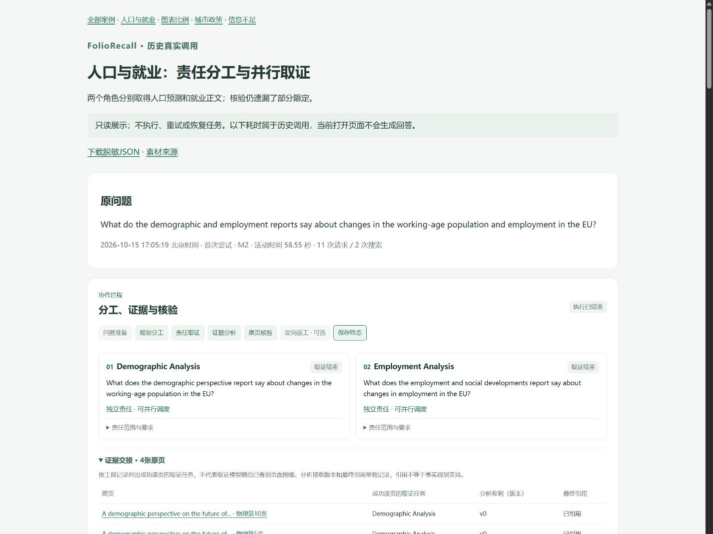

# FolioRecall：项目介绍与面试准备

本材料面向Agent应用工程岗位，重点说明角色分工、任务依赖、共享证据、核验返工、并发预算与恢复。视觉检索和模型实验提供技术基础，工程交付以代码、实际记录和可运行案例为依据。

当前本地审核候选将多轮问答、浅色协作界面、四份离线真实案例和ONNX FP32查询组合在一起。60次研究对照及消融、六次真实安装态浏览器确认来自历史方法 `6fe8d8c`；本轮复用历史案例，以真实检索配模拟生成器检查当前候选，没有新增API调用或重新评测。所有语义评分保持 `human=not_checked`。[候选与启动说明](v0.1.0发布说明.md) · [当前展示验证](首版使用与评测.md#agent-showcase) · [历史真实结果](首版使用与评测.md#multi-agent-research-results)

## 简历条目

**项目简介：** FolioRecall是一套以原页证据为依据的多Agent文档研究应用，支持视觉与BM25混合检索、双语多轮问答，以及LangGraph组织的规划、取证、分析、核验和定向返工。提供CPU常驻查询模型、CLI、浏览器和离线案例。

**主要工作：** 实现责任拆分、前置依赖和最多两路并行取证，按角色合并执行状态，管理共享页面与当前轮引用权限；实现逐声明模型核验、有限算术复算、一次返工、检查点恢复与成功操作复用，统一请求、页面、tokens及SQLite费用预占。接入实时任务卡、读页任务归属和版本化核验展示，完成便携安装交付。完整ONNX FP32后端将CPU检索请求P50由19.33降至8.62毫秒；完成60次同预算协作对照及消融，记录实际协作与返工，也保留覆盖退化和核验误判。

投递时保留以上两个段落即可。详细指标和限制在项目页面说明：ONNX计时不包含远程生成，协作对照没有证明整体质量优于单Agent。

## 一分钟介绍

FolioRecall用于从包含正文、表格和图表的文档中取证并回答问题。我实现了四类Agent：规划器拆分责任和依赖，取证Agent搜索并读取原页，分析Agent比较证据和计算，核验Agent检查声明及遗漏，必要时定向返工一次。LangGraph负责执行图和检查点，我负责任务约定、共享证据权限、阶段预算、恢复规则和界面装配。页面能够直接展示谁负责什么、读取了哪些页，以及核验后改了什么；四份真实案例可以离线打开。现有对照证明了流程可运行，也暴露出核验误删和覆盖下降，因此研究流程用于复杂任务与工程展示，快速问答保留单Agent。

## 五分钟演示

先打开候选中的 `showcase/index.html`。四份案例包含精选原页和既有调用结果，无需API密钥、模型或索引。截图和案例均标注为历史真实记录的当前界面展示，不把重新渲染写成新调用。

如需展示检索，使用42页示例和独立ONNX FP32模型附件，在演示前启动服务；命令见[快速开始](v0.1.0快速开始.md)。完整JRC库不随候选分发，离线案例只附决定讲解内容的页面。

| 时间 | 操作与讲解 |
|---|---|
| 0:00–0:30 | 展示人口与就业问题，说明用户需要比较两份报告，定位项目的文档研究用途。 |
| 0:30–2:00 | 打开 `cov-01` 的任务卡，逐项对应责任、原页和调用记录；说明独立取证可以并行。切到 `confirm-04` 查看前置依赖和计算，说明有依赖的任务为何等待。 |
| 2:00–3:30 | 打开 `confirm-03`，从核验问题定位原责任任务，再对照补查前后的页面与草稿。说明最多一次返工，城市政策正文补齐后仍有遗漏。 |
| 3:30–4:30 | 打开 `cov-11`，展示核验格式失败、失败阶段和保留草稿。结合代码说明同次尝试的检查点恢复、独立补跑的成功操作复用，以及未知在途不重发；这份失败记录本身不作为恢复成功的证明。 |
| 4:30–5:00 | 展示候选入口和代码目录，说明个人实现、上游组件及已知取舍。给出ONNX查询延迟收益，明确协作覆盖没有整体提高。 |

现场不必重新生成答案。需要说明实时行为时，展示已经验证的角色事件与执行代码；模拟生成器验证用于检查界面和恢复路径，不作为真实质量或服务端并发性能证据。界面不显示隐藏思考。

## 实现与上游的边界

| 层次 | 上游提供 | 本项目实现与适配 |
|---|---|---|
| 图执行 | LangGraph `StateGraph`、`Send`、条件边与SQLite检查点接口 | 任务责任、依赖调度、角色状态合并、阶段资源预留、核验及一次返工、失败和恢复规则 |
| 取证与生成 | Qwen生成模型、NanoVDR查询学生及公开权重 | HTTPX模型调用、搜索和读页工具、原页传递、引用权限、结构化结果和费用归属 |
| 检索 | Sentence Transformers、ONNX Runtime、FAISS与BM25 | 页面与正文绑定、RRF融合、完整查询后端、索引匹配、缓存和部署比较 |
| 应用 | Gradio、线程和队列等基础组件 | 多轮上下文、角色进度、任务卡、证据归属、核验版本、终态保存及离线案例 |

主要代码入口：[研究图](../foliorecall/multi_agent_research.py)、[共享执行与恢复](../foliorecall/multi_agent.py)、[会话与事件队列](../foliorecall/chat.py)、[浏览器装配](../foliorecall/demo.py)。源码可以对应到演示中的实际步骤，无需将上游框架能力写成自行实现。

## 十个面试问题

### 1. 这些Agent的职责如何区分？

规划协调提取问题要求，并给取证任务分配责任和依赖；最多两位取证Agent各自维护消息与工具调用；分析Agent接收实际原页，完成比较、计算和草稿；核验Agent逐声明检查草稿与问题要求。它们使用同一个生成模型，但上下文、指令、可执行操作和输出约定不同。单来源问题允许一个取证任务，并不为凑数量强行启动两位。

### 2. LangGraph具体承担了哪些工作？

研究图用 `StateGraph`组织问题准备、规划、取证请求、工具、分析、核验和收尾。`Send`分发当前依赖已满足的取证任务，条件边控制继续读页、转入分析或返工。SQLite检查点用于同一次尝试的图恢复，共享执行器另存成功请求和工具结果，供合法独立补跑复用。原单Agent继续使用Python工具循环，没有将整段 `ask()`包成一个图节点。

### 3. 并行是否只是界面同时出现两个Agent？

并行发生在远程模型请求，最多两路。父任务提交锁保证用户整轮请求串行；独立查询锁只串行本地查询编码和检索，不占用远程请求的等待时间。角色使用独立provider上下文，资源申请在锁内预占，返回状态按角色键合并。既有研究对照中10轮出现客户端请求区间重叠，但平均活动时间仍长于单Agent；客户端重叠不能证明服务端内部采用何种计算方式。

### 4. 依赖与共享证据如何避免串用？

规划结果显式保存 `depends_on`。前置任务完成且无技术失败时，调度器才启动依赖任务；失败则保留已有证据并标记阻塞。worker状态分别记录成功执行读页工具的页面，父任务统一去重缓存。读页后先把证据引用写入消息，若还有下一次worker模型请求，才装入对应正文和图像；最后一次工具执行也可能直接转入分析，因此读页归属不能证明worker模型已看过图像。分析与核验另行接收实际原页。前置摘要仅辅助理解，不授予引用权限。

### 5. 引用合法与引用可信有什么区别？

程序检查引用是否来自本轮实际交给分析模型的页面，并校验答案字段。搜索摘要、worker声称读过的ID和历史引用均不能直接授予权限。语义支持还要核对主体、期间、条件、单位与数字；核验Agent也接收原页，但模型可能误判。项目因此保留逐声明记录和助手评审，不把引用ID合法率写成回答准确率。

### 6. 核验如何触发返工，如何防止无限循环？

核验输出逐声明判断和具体问题。已有页面足够时交给分析Agent修订；缺少正文时选择原责任取证Agent，最多两次模型请求，优先读已有候选。整个流程最多返工一次，修订稿使用新的版本和声明ID。收尾仅保留模型核验标为支持的声明，将草稿与核验报告中的未解决事项、拒绝声明合并到 `unresolved`，不再自由生成答案。这只能保留模型已经报告的问题，不能保证找出全部遗漏。程序复算加减乘除和比例，不能替代操作数、单位及语义判断。城市政策案例仍有遗漏，V2G案例也出现过核验误删。

### 7. 多个角色如何共享预算和费用？

研究模式统一限制16次请求、6次搜索、10个不同页面、16000输出tokens和300秒活动时间，提前留出分析、核验和返工额度。并发发送前在锁内占用请求次数与最大输出量；SQLite事务记录费用预留，收到usage后结算，缺usage保留未知费用。页面名额按父任务去重，各取证任务分别记录成功读页，不据此推断模型已接收图像。父任务活动时间使用实际经过时间，不把分支时间相加。`ledger_id`用于费用去重，项目支出上限与服务账户余额分开处理。

### 8. 中断以后恢复到哪里？

同一次尝试中断且没有终态时，使用该尝试的图检查点继续执行。已有完整网络失败终态、预算允许时，原规则允许一次独立补跑：新尝试使用新的图线程，重新经过图流程，按逻辑操作编号读取成功请求和工具缓存，不再次发送这些成功请求。这与直接从上次失败节点续跑不同。只剩末次核验时无需额外搜索；已有完成结果时直接返回保存结果。

存在费用记录但响应状态无法确认时暂停，不自动重发。费用库与图检查点是独立文件，不保证任意崩溃窗口下恰好执行一次。CLI支持原目录恢复，浏览器没有恢复按钮。

### 9. 前端如何保持与执行记录一致？

工作线程运行执行器，真实回调经队列驱动Gradio更新，界面不根据计时猜进度。任务卡区分等待、执行、结束、阻塞和失败，模型请求完成不等于责任已经完成。执行器先保存权威终态，再渲染原页和答案；断开浏览器不会重发，渲染失败不抹掉结果。离线案例使用保存结果副本和同一展示组件，原记录保持不变。Gradio服务端会话内存保存当前聊天记录，模型只取最近三轮成功问答改写指代，失败草稿不进入上下文。刷新或新建会话后不沿用原上下文，独立终态文件仍在，费用账本不清空。

### 10. 没有整体质量收益，项目能证明什么？

它提供了可检查的协作工程实现：责任分工、依赖调度、远程并发、证据共享、核验返工、预算管理、恢复及完整使用入口。60次真实尝试为这些能力提供运行记录，也揭示额外步骤可能产生遗漏、误删和延迟。工程完成与质量提升分开判断，研究流程保留为复杂任务及协作展示入口，快速问答继续推荐单Agent。无需新增大量角色或反复调提示，才能解释已经完成的工作。

## 实测结果与讲解边界

| 比较 | 已有证据 | 讲解边界 |
|---|---|---|
| 研究主对照：单Agent／basic／research | 覆盖0.734375／0.578125／0.546875，各16个非空结果；research 17/18有效核验答案、另1次结构失败 | 54次主对照涉及18轮、15个会话单元，另有6次消融；助手评分，不宣称协作整体优胜。 |
| 研究执行行为 | 11次返工，10轮客户端请求重叠；research／单Agent平均活动56.43／32.56秒 | 并发真实发生不等于整轮加速；模型核验不是人工确认。 |
| A5 Visual／Hybrid RAG／Agent | 覆盖0.702193／0.736988／0.722295，各分母76；总计240项首次终态、237项结构合法 | 原单轮方法，不作为当前研究流程的准确率；40题配对不称240个独立问题。 |
| 完整ONNX FP32查询后端 | 同CPU开发集检索JSON请求P50由19.33降至8.62 ms，五领域指标与PyTorch一致 | 预热RSS由636.0增至817.0 MiB；不包含生成和界面，不宣称整轮问答同比提速。 |
| ONNX动态int8 | 请求P50为4.79 ms，五领域等权nDCG下降0.005031 | 保留可选，默认采用FP32；本机VNNI结果不泛化到所有CPU。 |

ONNX历史测量的实际FAISS线程数为4，不与后来搜索阶段单线程实验作严格同条件比较。全部语义评分保持 `human=not_checked`。离线案例属于展示材料，不新增实验条目或评分样本。[完整研究结果](首版使用与评测.md#multi-agent-research-results) · [CPU后端](首版使用与评测.md#onnx-cpu-backends) · [实验CSV](experiments.csv)

## 可供追问的训练与部署实验

训练实验放在主演示之后，面试官询问检索模型或实验设计时再展开。

- **普通LoRA三种子：** 本机4060 Laptop完成普通LoRA与LLaVE各三个种子的64步训练，形成21份匹配索引和评测。270题、3006页的领域等权nDCG@10由原始教师0.612402升至普通LoRA 0.650042±0.007900；九个种子／领域组合均改善。LLaVE为0.649618±0.008002，没有稳定额外收益。原页复核19题44页，保留目录干扰和版权缺图等限制；文档级隔离与上游预训练重叠未完全确认。[记录](首版使用与评测.md#teacher-holdout-results)
- **收益向CPU学生迁移：** 固定普通seed42教师，两份新学生分别对齐原教师与LoRA教师，各282步。三领域等权nDCG为0.566638／0.637859，均低于公开学生0.669182；复核17题40页后停止产品迁移。公开六层ONNX配置保持不变，教师收益没有写成现有Agent质量提升。[记录](首版使用与评测.md#teacher-transfer)
- **多深度学生：** 实现共享骨干的四／六层出口、独立投影保存恢复和实际裁剪，并加入独立四层对照。修复辅助头梯度清零问题，完成六组CPU测量；联合四层减参20.7%，开发集nDCG却为0.495222，低于公开六层0.972699，因此不采用。[记录](首版使用与评测.md#multidepth-query)
- **历史结果：** LoRA750在五领域等权nDCG提高0.035867，Finance-EN下降0.021927；早期继续蒸馏相对公开ML下降0.129877。公开ML的同卡BF16编码P50加速6.23–7.65倍来自上游NanoVDR，不写成本项目训练出的收益。早期200题单种子LLaVE仅比普通训练提高0.001845，后续三种子结果另列。[记录](首版使用与评测.md#本轮实测结果)

代码与模型来源见[NOTICE](../NOTICE)。完整JRC库、教师权重、凭据、检查点数据库和原始运行目录不随审核候选分发；查询模型是独立附件，不进入源码或wheel。当前版本仅供本地审核，GitHub推送和公开发布等待用户确认。
